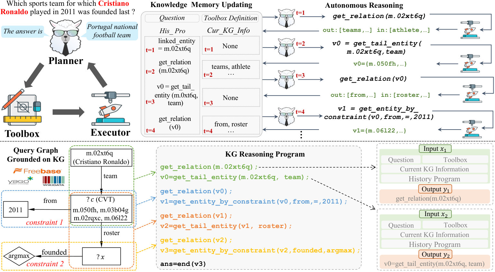
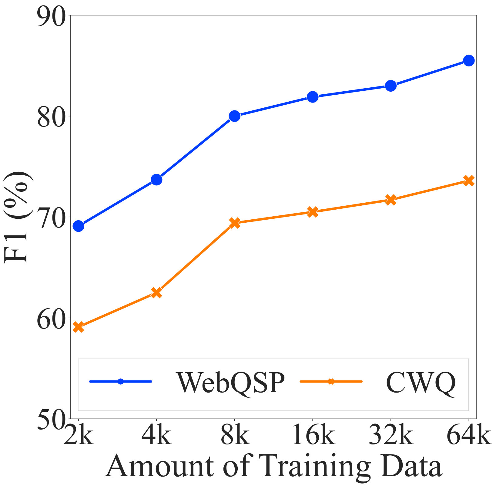
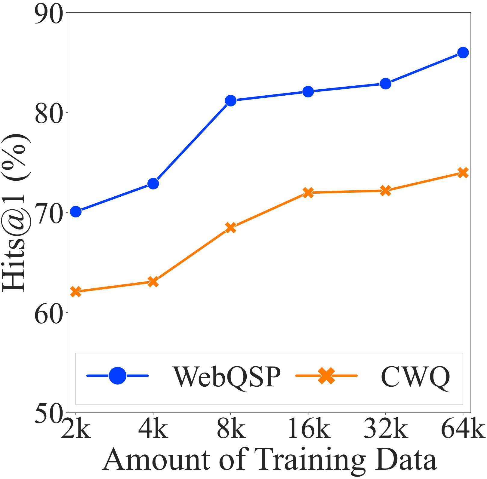

#  KG-Agent: An Efficient Autonomous Agent Framework for Complex Reasoning over Knowledge Graph

## 1. 研究动机与贡献

为什么要把大模型和知识图谱（KG）结合？
- 现代 **大语言模型（LLMs）** 在语言理解上非常强，但在多跳、知识密集型推理任务上依赖内参知识不足以稳定作答。知识图谱以三元组形式存储结构化事实，能够补强 LLM 的外部知识来源，但如何高效、灵活地让 LLM 利用 KG 是个挑战。
- 现有方法主要有两类：检索增强（把相关三元组序列化进 prompt）和协同增强（设计 LLM 与 KG 的交互策略，如先写计划再查询或边查询边写计划）。问题在于：交互策略常是人工预设的，不足以适应多样化复杂任务；且很多方法依赖封闭大模型 API（如 ChatGPT、GPT-4），不利于开放小模型的实用化。

这篇工作的三大核心贡献：
1. 提出 **KG-Agent**：一个基于 LLM 的自主代理框架，使得较小的 LLM 可以在推理过程中主动决策、反复调用工具直到完成 KG 推理任务，从而减少对更大闭源模型的依赖。
2. 构建一个面向 KG 的多功能工具箱（toolbox），把常见的图操作（如筛选、计数、检索等）封装为工具，供 LLM 选择调用，使模型能以离散/可执行的操作操纵结构化结果。
3. 用程序化（code-based）指令合成策略，把已有 KGQA 数据集中的推理链转成可执行的“程序”并生成指令式训练对，使用约 $10\text{K}$ 训练样本对 **LLaMA-7B** 进行微调，显著提升在多数据集上的表现（既有域内也有域外迁移）。

## 2. 方法介绍

总体思路（见下图）：把一个经过指令微调的 **LLM**、一个多功能工具箱、一个基于 KG 的执行器和记忆模块组合成闭环代理。模型循环选择工具、交给执行器运行、把结果写入记忆，并以此决定下一步，直到输出最终答案或 SPARQL 查询。

*图：KG-Agent 概览（上半部为代理运行流程，下半部展示指令微调数据合成与 prompt 模板示例）。*

关键组件说明
- **多功能工具箱（Toolbox）**：把在 KG 推理中常见的操作封装为工具，例如基于 `SPARQL` 的检索（返回实体/关系集）、集合运算（交并补）、聚合（计数、排序、Top-k）等。工具提供明确、离散的接口，便于 LLM 学会何时调用何种操作。
- **KG 执行器**：接收工具调用生成的查询或指令（例如 `SPARQL`），在实际 KG 上执行并返回结构化结果，避免将大量 KG 原始三元组直接拼到 prompt 中。
- **知识记忆（Memory）**：记录中间实体集、推理步骤、上下文提示等，支持短期的迭代决策和长期的检索线索。在每一轮，LLM 能读取记忆并决定下一个工具调用或终止。
- **自主迭代机制**：模型通过读问题 + 读记忆来选择工具（或直接输出答案）。这是一个自动化的“感知—行动—观察—记忆更新”环路，类似强化的交互但在本工作以监督学习与工具调用行为为主导。
- **程序化指令合成与微调**：从现有 KGQA 数据集中抽取推理链，生成等价的程序（例如逐步的 `SPARQL` 片段或伪代码），再把“问题 → 代码式推理步骤 → 工具调用样例”构造成指令微调对。使用这些合成数据对小模型（**LLaMA-7B**）进行指令调优，使其习得操作结构化数据与选择工具的能力。

一个简化的代理循环（伪流程）：
1. LLM 读取问题与记忆。
2. 选择工具（e.g., `query_entities`, `filter_by_relation`, `count`）。
3. 生成工具调用指令 → 执行器执行 → 返回结构化结果。
4. 更新记忆（记录新实体集、步骤）。
5. 若满足终止条件则输出答案，否则回到步骤 1。

## 3. 实验结果

评测任务与数据集
- 域内 KGQA：**CWQ**、**GrailQA**、**WebQSP** 等（多跳、复杂查询）。
- 域外/零-shot ODQA：**WQ-Freebase**、**TQ-Wiki** 等，用于测试迁移与泛化能力。

主要结果概览（论文报告的亮点）
- 仅用约 $10\text{K}$ 合成指令样本微调 **LLaMA-7B** 后，**KG-Agent** 在多项数据集上超越了以更大 LLM 或更多训练数据为基础的现有方法。
  - 域内：在 **CWQ** 上获得约 $7.5\%$ 的相对 F1 提升；在 **GrailQA** 上约 $2.7\%$ 相对提升（使用的训练数据量要少得多）。
  - 域外：零-shot 性能优于一些使用全量监督微调的模型；例如在 **TQ-Wiki** 上约 $8.5\%$ 的相对准确率提升（论文对 **WQ-Freebase** 的具体百分比在摘录中未显示，但也报告了显著改善）。
- 数据量敏感性：图示显示性能随微调样本量增长快速上升，但在 $10\text{K}$ 左右已经达到很好效果，体现了“程序化合成指令 + 工具化接口”对小模型的高效性。

下面两张图展示了不同微调样本量下在 WebQSP 和 CWQ 上的 F1 / Hits@1 曲线，表明 $10\text{K}$ 即能取得接近最佳的效果：

*图：不同微调数据量下（WebQSP / CWQ）的 F1 与 Hits@1。*

*图：同上（另一视图/子集）。*

实证结论
- 以工具化、程序化的训练数据指导，较小模型也能学会在 KG 上进行多步、结构化的推理。
- 自主代理式的工具选择与记忆更新，使得推理流程更灵活，可适应未预见的任务需求。

## 4. 简要总结

要点回顾
- **KG-Agent** 将 LLM、工具箱、KG 执行器与记忆结合成一个自主代理，允许模型在 KG 上反复做出工具选择和记忆更新，直至完成推理任务。
- 使用程序化的指令合成方法，对 **LLaMA-7B** 进行约 $10\text{K}$ 样本的微调，就能在多个 KGQA 与 ODQA 任务上取得或超过现有 SOTA 的表现，显示了小模型通过“学会操纵结构化数据”而获得的效率优势。
- 框架强调模块化（工具/执行器/记忆）与可解释的中间结果（可审计的工具调用与执行器返回），对实际应用友好。

局限与未来方向
- 当前依赖高质量的程序合成——合成质量会影响微调效果；如何自动获得更广泛、鲁棒的合成数据是下一步工作。
- 目前侧重 KG（图结构）；作者计划将框架推广到其他结构化数据（关系型数据库、表格等）。
- 实际应用中的延迟与执行器开销、以及在开放域 KG（长期更新、噪声事实）上的稳健性仍需要评估。

如果你只记三点：
1. 用“工具 + 记忆 + 程序化指令微调”的组合，让小模型能做复杂 KG 推理；  
2. $10\text{K}$ 合成样本即可显著提升 **LLaMA-7B** 的多跳 KGQA 能力；  
3. 代理式的自主决策比固定交互策略更灵活，更易推广到多样任务。

阅读原文可进一步了解工具集合的具体接口、程序合成细节和完整的实验表格与消融研究。

## 科学发现范式

- 主要范式：P04 Modular Pipeline Composition
- 次要范式：P05 Data & Evaluation Engineering, P09 Inference-Time Control & Guided Sampling
- 分类理由：论文把复杂KG推理拆成可互换的模块（LLM、多功能工具箱、KG执行器、知识记忆）并通过迭代机制组合它们，典型的模块化流水线思路；同时合成了代码化的指令调优数据（数据/评估工程 P05），并在推理时以工具选择/记忆更新来实时控制行为（推理时控制 P09）。

## 先前工作分析

近年的工作在三个技术方向上为 KG-Agent 提供了直接的构建模块和问题意识：一类是面向 KG 的协同交互方法（以 StructGPT 为代表），它们把 LLM 的语言理解能力与对 KG 的结构化查询结合起来，通过多轮交互或 SPARQL grounding 完成多跳问答；另一类是语言代理范式（如 ReAct、AutoGPT、ProgPrompt），這些工作提出把 chain-of-thought 与显式 action/工具调用、程序化 prompt、以及短/长期记忆结合起来，从而实现自动化的工具选择、执行与记忆管理；第三类则是检索增强的 KGQA 流派（RNG-KBQA/TIARA 等）和记忆增强机制（MemoryBank），它们分别暴露了检索式丢失结构信息与需要有效记忆策略的局限。将这些具体细节合并，显现出两方面的机会：一是需要一个能自主选择工具、执行 KG 操作并在多个推理步之间维护中间知识的代理框架；二是需要用可执行的程序化表示来训练较小 LLM，使其能可靠地生成可执行操作序列。KG-Agent 正是在这种背景下成为自然的下一步：它综合了代理式工具调用与记忆管理、以代码/程序化指令微调 LLM 的做法，并且针对 StructGPT 与检索式方法的局限设计了自适应的迭代决策与 KG 执行器，从而使较小模型也能高效完成复杂的 KG 推理。
