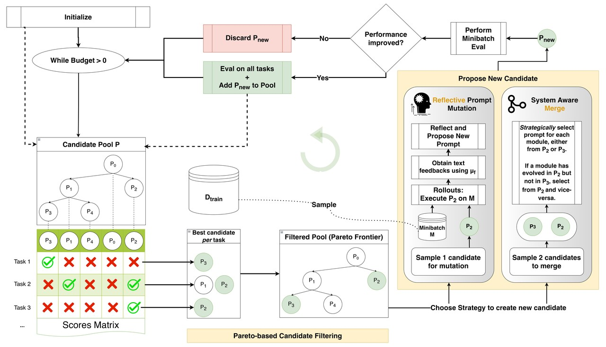
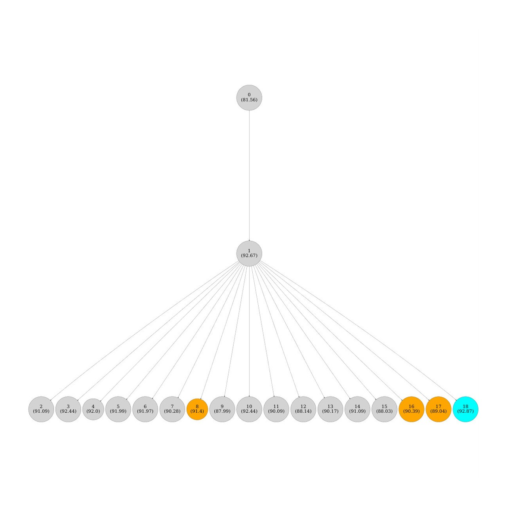
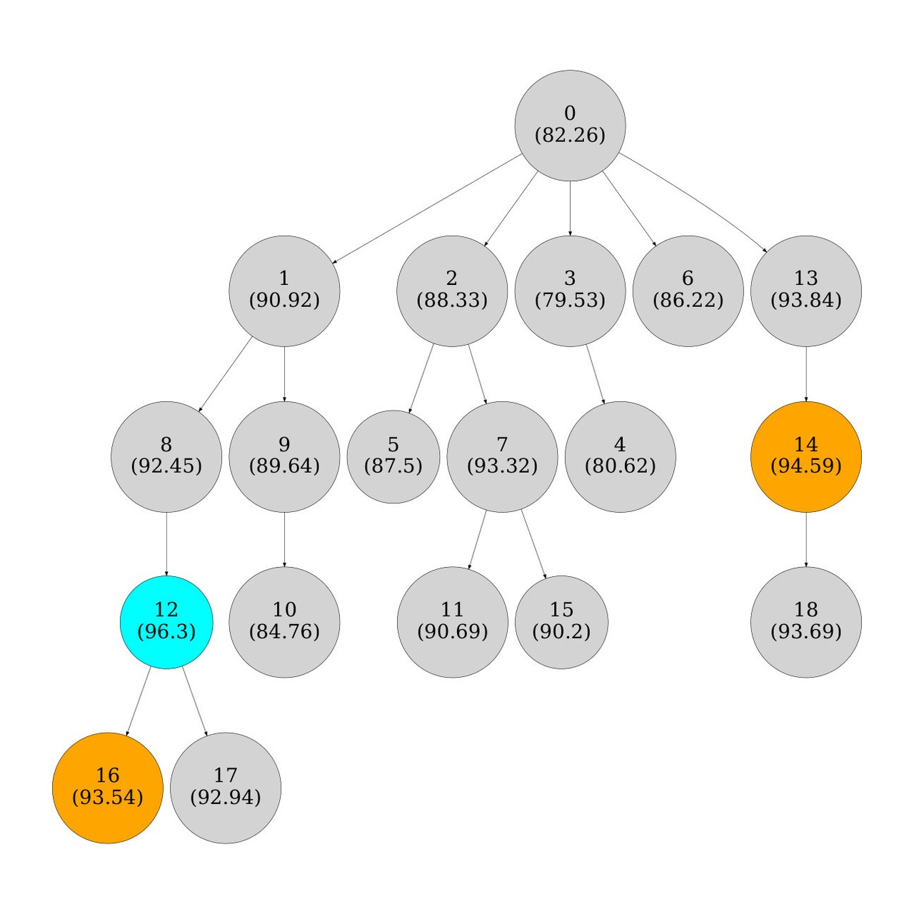
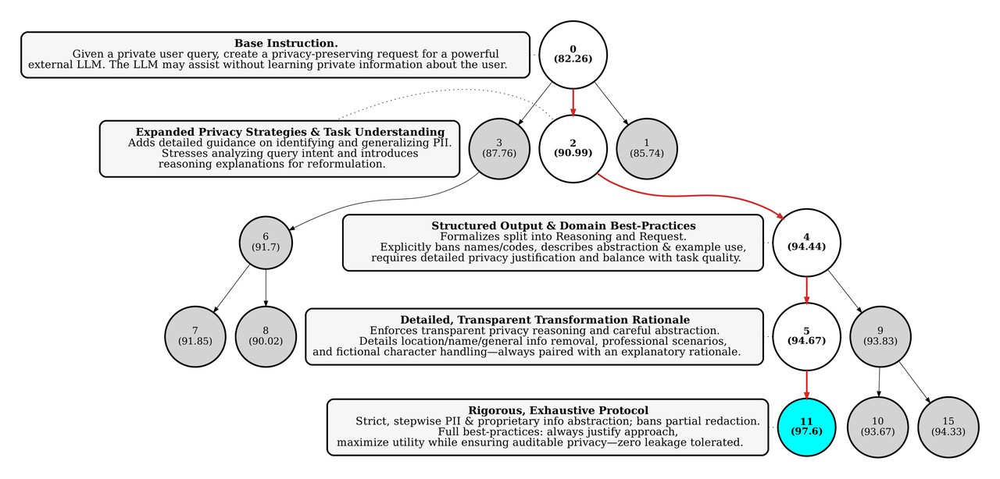
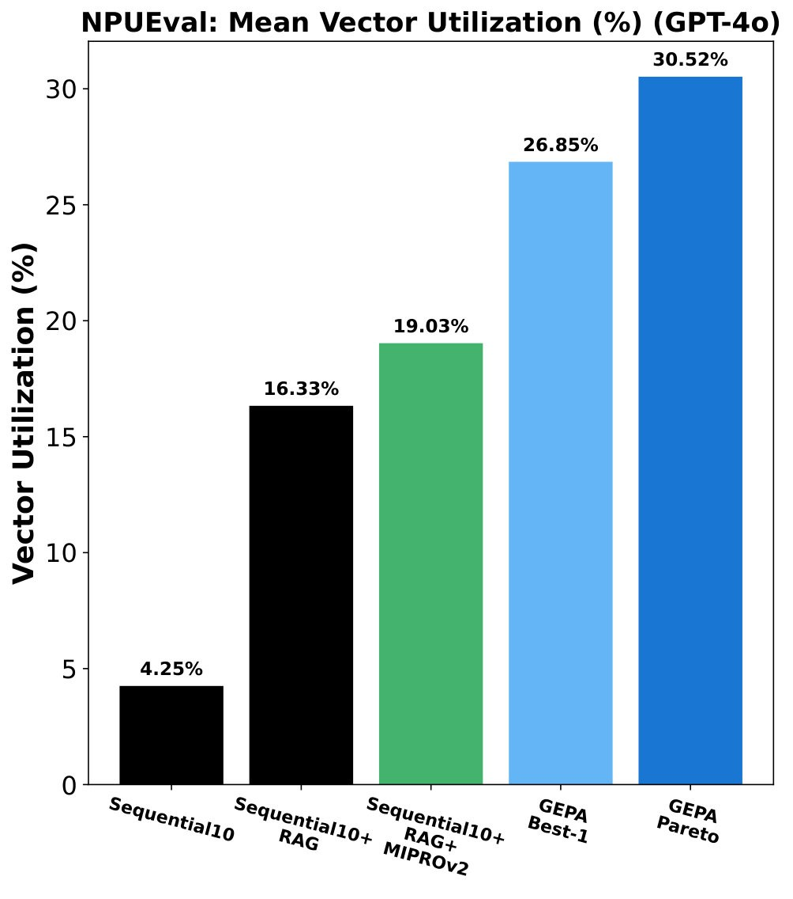

# GEPA: Reflective Prompt Evolution Can Outperform Reinforcement Learning

**标题**：GEPA: Reflective Prompt Evolution Can Outperform Reinforcement Learning
**作者**：Lakshya A Agrawal，Shangyin Tan，Dilara Soylu，Noah Ziems，Rishi Khare，Krista Opsahl-Ong，Arnav Singhvi，Herumb Shandilya，Michael J Ryan，Meng Jiang，Christopher Potts，Koushik Sen，Alexandros G. Dimakis，Ion Stoica，Dan Klein，Matei Zaharia，Omar Khattab，UC Berkeley，Notre Dame

> **一句话导读**：本文提出一种名为 **GEPA** 的文本反射式提示词优化器，通过自然语言反射与帕累托前沿选择，在多任务上超越强化学习和现有提示词优化方法，且采样效率大幅提升。

## 三句话看懂
- **问题**：现有的强化学习方法调整复合 AI 系统时需要数万次采样，且容易陷入局部最优。
- **方法**：本文提出 GEPA，结合自然语言反射、帕累托前沿候选选择与遗传算法来演化提示词。
- **结果**：在 Qwen3 8B 模型上，GEPA 比 Group Relative Policy Optimization (GRPO) 平均准确率提升 6%，采样次数少最多达 35 倍。

## 为什么就要这样做
在开发由多个大模型调用和外部工具组成的复合 AI 系统时，如何优化其下游性能是一个核心挑战。传统的强化学习方法（例如采用可验证奖励的 GRPO）通过稀疏的标量奖励来估计策略梯度。然而，这类方法在实践中通常需要数十万次采样，计算成本极高，在面对昂贵的工具调用或无法调整权重的闭源大模型时难以应用。

另一方面，大模型在运行过程中产生的中间推理、工具调用以及环境返回的错误信息，本质上都可以序列化为丰富的自然语言轨迹。作者认为，与其将这些丰富的文本盲目压缩为稀疏的标量奖励，不如直接利用大模型的语言先验，通过自然语言反射来显式诊断错误并更新提示词。

## 核心思路
作者观察到，大模型系统在运行失败时会留下清晰的中间轨迹与错误提示。与其使用传统的梯度下降或纯贪婪搜索，不如像人类工程师那样，通过阅读这些运行日志来反思问题所在，并对提示词进行针对性修改。

这就像是人类团队的迭代过程：不盲目依赖盲目的随机试错（即传统强化学习），而是记录每一次尝试中在不同任务上表现最好的方案，通过交叉与反思汇聚多方智慧。GEPA 正是通过维护一个帕累托前沿候选池，避免了传统贪婪优化器一旦陷入局部最优就无法自拔的顽疾。

## 方法怎么做

如图 1 所示，GEPA 接收初始系统提示词、训练集和评估指标，在循环中通过反射式突变或合并生成新候选，并在验证集上维护帕累托前沿，最终输出综合表现最好的提示词。

### 遗传优化循环
GEPA 从仅包含基础系统的候选池出发，不断通过变异和交叉产生新候选。每一个新候选都在一小批任务上评估，如果表现优于父代，则将其连同血统记录一起加入候选池，并在验证集上评估以更新帕累托前沿。

### 反射式提示词突变
自然语言执行轨迹为每个模块提供了极好的可解释性。当系统产生成果或失败时，反射大模型会查看这些轨迹，将成功或失败归因于提示词的具体部分，进而提出有针对性的修改意见，对单个模块的指令进行精准更新。

### 帕累托候选选择
传统的优化策略往往只保留全局表现最好的单个候选，容易导致搜索停滞。如图 2 所示，GEPA 维护一个帕累托前沿，在每个任务上记录所有候选能达到的最高分，并根据候选在各个任务上的领先优势进行随机采样，从而有效平衡了探索与利用。

## 效果如何

**表 1：Qwen3 8B 模型上的不同优化器基准测试结果**

| 方法名 | HotpotQA | IFBench | Hover | PUPA | Aggregate |
| :--- | :--- | :--- | :--- | :--- | :--- |
| Baseline | 42.33 | 36.90 | 35.33 | 80.82 | 45.23 |
| GRPO | 43.33 | 35.88 | 38.67 | 86.66 | 48.91 |
| MIPROv2 | 55.33 | 36.22 | 47.33 | 81.55 | 47.84 |
| GEPA | 62.33 | **38.61** | **52.33** | **91.85** | **54.85** |

如表 1 所示，在 Qwen3 8B 模型上，GEPA 的综合准确率达到 54.85%，显著优于基线的 45.23% 以及 GRPO 的 48.91%，并且将采样次数大幅减少。

如图 4 所示，单次反射式更新能够捕获任务的具体细微差别，从而带来明显的性能阶跃。此外，消融实验证明，帕累托选择策略相比于单纯的贪婪最佳选择或束搜索，能够更好地探索提示词空间，避免局部最优。

## 值得关注的点
这篇论文的核心突破在于证明了"语言空间的反射演化"在某些复合任务中可以完全压制参数空间的强化学习。对于资源受限于大模型权重微调、或是需要在短时间内适配复杂工具流的工程师来说，GEPA 提供了一条极具吸引力的工程路径。

不过读者也需要注意其局限性：GEPA 的大部分优化预算消耗在了验证集上的评估和选择中，如何动态减小验证集开销将是未来提升效率的关键。

## 读后小结
GEPA 针对复合 AI 系统的提示词优化难题，创新性地结合了自然语言反射与帕累托前沿选择。它不仅在多个复杂推理和代理任务上以极低的采样开销超越了传统的 GRPO 强化学习方法，还展现出优秀的跨模型泛化能力。最值得记住的一点是：让大模型通过阅读自身的运行日志来进行“语言级反思”，往往比盲目调整模型权重更加高效。

## 科学发现范式

- 主要范式：P01 Gap-Driven Reframing
- 次要范式：P03 Representation Shift & Primitive Recasting
- 分类理由：论文中提出的GEPA模型通过反思性提示演化来优化提示，显著提高了样本效率，重新定义了问题的解决方式，符合'Gap-Driven Reframing'的模式。同时，GEPA在提示优化中改变了提示的核心表示，符合'Representation Shift & Primitive Recasting'的模式。

## 先前工作分析

GEPA 的发展受到若干关键先前工作的显著影响，这些工作致力于大语言模型（LLMs）的提示优化。"Group Relative Policy Optimization" 的基础性工作由 Zhang et al. 提出，为 GEPA 展示其更优的样本效率与有效性提供了基线。此外，作为领先的提示优化器，MIPROv2 被直接与 GEPA 进行比较，凸显了后者通过反思式更新和基于 Pareto 的选择策略所取得的进展。Guo et al. 的 "EvoPrompt" 所带来的启发展示了进化算法在提示优化中的潜力，而 GEPA 通过整合自然语言反思采纳了这一思路。进一步地，Wei et al. 所指出的 chain-of-thought prompting 的局限性揭示了若干空白，而 GEPA 通过其创新的反思式提示演化方法对这些空白加以应对。Monea et al. 关于语言空间中的学习的工作提供了理论基础，GEPA 在此基础上进一步构建；而 Suzgun et al. 关于测试时策略合成的洞见则为 GEPA 的实时优化能力提供了启示。总体而言，这些先前工作为 GEPA 照亮了道路，使其成为 LLMs 提示优化领域中一种自然的发展。
