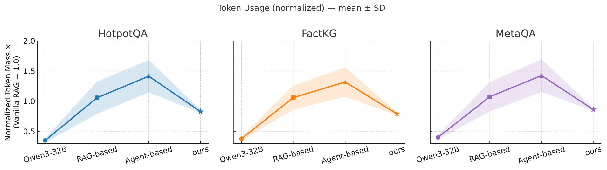
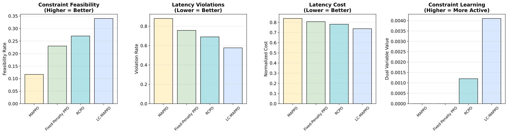
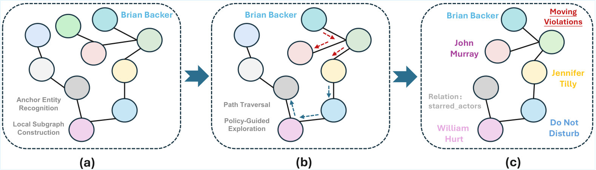

#  : Agentic Neuro-Symbolic Knowledge Graph Reasoning via Dynamic Learnable Context Engineering
## 1. 研究动机
多跳知识图谱问答（KGQA）要求在图上找到跨跳的证据链并保留可审计的溯源。然而部署系统同时受三类资源限制：子图增长（边数）、交互步数（延迟代理）与提示/检索的选定 token 数（成本）。传统做法如固定 $k$‑hop 展开或延长 chain‑of‑thought，只是被动放大上下文或延长推理，常造成过度检索、噪声干扰和不可预测的运行时。本文的出发点是：把“上下文构造”本身视为一个受约束的序列决策问题——学习在明显的资源预算下，何时扩展／回退／保留证据并停止，从而显式把准确率、延迟与成本的权衡做为可控对象。

## 2. 核心洞见
- 将多跳 KGQA 建模为带有每查询预算的约束马尔可夫决策过程，预算包括 $B_{edges}, B_{steps}, B_{tokens}$。  
- 采用一个由三名协同智能体组成的**神经-符号（neuro‑symbolic）控制器**，使决策在符号状态（节点、边、路径）上以可审计的离散动作（edit, traverse, curate）展开，而优先级由轻量神经打分器给出。  
- 在训练中直接把步数与 token 使用纳入目标，通过拉格朗日乘子在中央训练时强制约束，以便一个检查点在推理时既可执行硬上限也可采用价格化权衡。

## 3. 提出的方法
### 3.1 方法概述
方法名为 **CLAUSE**（文中称为 CLAUSE 的框架），包含三位代理：
- **Subgraph Architect**：基于问题锚定，按预算构建或删减子图，保留支持答案的路径同时抑制过度扩张。动作是增删边（edits）。  
- **Path Navigator**：在已构建的子图上探索路径、决定何时回溯或继续，受交互步数预算 $B_{steps}$ 约束。  
- **Context Curator**：把符号证据文本化并在 token 预算 $B_{tokens}$ 下选择最小充分片段，保证下游 LLM 可在给定 tokens 内解答并保留溯源。

三者通过 `LC-MAPPO`（Lagrangian‑Constrained Multi‑Agent Proximal Policy Optimization）联合训练：采用 CTDE（centralized training with decentralized execution）的范式，一个多头中心化 critic 分离任务价值与各项成本估计，并用独立拉格朗日变量 $\lambda_{edges},\lambda_{steps},\lambda_{tokens}$ 去约束每集（episode）资源使用。训练目标即在满足或交易预算的前提下最大化任务回报。

### 3.2 关键实现细节
- 状态表示为符号图 + 问题向量；动作集合包括离散的 `add_edge`、`del_edge`、`traverse`、`backtrack`、`curate_snippet`、`stop`。所有动作可审计，便于溯源。  
- 中心化 critic 为多头：一头估计环境任务价值 $V^{task}$，另外三头分别估计边/步/token 成本的累计值 $V^{c}_{edges},V^{c}_{steps},V^{c}_{tokens}$。这样训练中可依据各自估值更新对应拉格朗日乘子，实现独立而稳定的约束学习。  
- 推理时同一检查点可接收两种部署配置：硬上限（caps）或软价格（prices），后者通过调整 $\lambda$ 实现按查询适配，无需重训。  
- 与现有 MARL 或 RCPO 的差别在于：多成本、分头 critic、以及在符号图域上动作的可审计性与稀疏性，这使得子图增长能被显著抑制而不破坏准确性。

## 4. 实验结果
### 实验设置 / 关键发现
- 数据集：**HotpotQA**, **MetaQA**, **FactKG**。阅读器以 Qwen3‑32B 等为主，比对多类基线：无检索LLM（GPT‑OSS‑120B, LLaMA3.3‑70B, Qwen3‑32B）、各类 `RAG`（Vanilla/Hybrid/Light/GraphRAG）与 agent‑based（`ReAct`, `Graph-of-Thoughts`, `AutoGen`, `KG-Agent`）。度量：精确匹配 EM@1，平均延迟（归一化以 Vanilla RAG = $1.0$），平均边预算（同样归一化），以及 token 使用。  

主要数值结论（节选）：
- EM@1：**CLAUSE** 在所有数据集均给出最高或匹配最优的 EM（HotpotQA 71.7；FactKG 84.2；MetaQA 1/2/3‑hop 为 91.0/87.3/85.5）。  
- 与最强 RAG 基线 `GraphRAG` 比较，在 MetaQA‑2hop 上相对提升 +39.3 EM@1，同时延迟降低 18.6% 且边增长降低 40.9%。  
- 延迟与边预算：CLAUSE 的平均延迟常低于其他 agent 系统（例如在 HotpotQA 上为 1.48 vs AutoGen 的 2.43），在某些单跳场景甚至低于 Vanilla RAG（MetaQA 1‑hop = 0.98）。边预算在所有设定中保持最低（归一化 0.74–0.90），表明其子图编辑与早停策略有效抑制冗余扩展。  
- Token 使用：CLAUSE 的 token 消耗低于同类 RAG/Agent 平均水平，表明 Context Curator 有效剔除冗余文本片段。  
- 约束满足性（`LC-MAPPO` vs 其他）：在 MetaQA 给定 $B_{edges}=0.5, B_{steps}=0.7$ 的约束下，`LC-MAPPO` 的可行率从 `MAPPO` 的 $0.117$ 提升到 $0.340$（+191%），延迟违规率降低 34%，并在学习出的双变量上表现更强的适应性（示例值 $\lambda$≈0.004 vs RCPO 的 0.001）。  

此外，消融实验显示移除任一代理或关闭约束处理都会使 EM 或效率显著下降：去掉 Subgraph Architect 后 EM 从 87.3 下降到 74.8 并且边/延迟上升（1.44 / 1.32）；去掉 Path Navigator 或 Context Curator 也各自造成 EM 与效率的下降，验证三者需联合控制。

在论文中还有端到端案例，展示如何以问题锚点（如 "Who co-starred with Brian Backer?"）触发逐步的增边、路径发现与片段筛选，最终在 token 预算下选出仅两段片段并返回有溯源的答案（相应流程见下图案例）。

## 5. 分析与洞察
- 预算化的上下文构造能同时带来准确率与效率上的双赢，因为它把探索深度与证据选择解耦：少却精准的边和片段比大而全的子图更利于下游 LLM 生成正确答案。  
- 多头中心化 critic 的设计是关键：将任务价值与每类成本分开估计，使拉格朗日乘子对每类资源的调节具有语义可解释性，避免了单一惩罚项混淆不同维度的权衡。  
- CTDE 的架构允许在训练期间利用全局信息改善信用分配，而在推理时保持轻量、分散的代理决策，从而支持低延迟部署。  
- 价格化（soft trade‑offs）与硬 caps 两种部署模式具有灵活性：在延迟敏感场景可设置严格 caps，在准确率优先且可接受成本波动时可用价格自动调整。

## 6. 主要贡献
- 将 KGQA 的上下文构造明确建模为带三个实际部署成本约束的序列决策问题。  
- 提出 **CLAUSE**：一个具备可审计符号动作与轻量神经打分的三代理神经‑符号框架。  
- 设计 `LC‑MAPPO` —— 在 MAPPO 基础上加入拉格朗日约束与多头中心化 critic，以支持多维资源约束的稳定学习。  
- 在三个数据集上展示该方法在 EM、延迟、边预算与 token 使用上的综合优势与可控性。

## 7. 局限性与未来工作
- 训练样本与环境交互成本高：MARL 的样本效率问题影响大规模图与更复杂逻辑的推广。  
- 当前动作集与策略主要针对有明确实体/关系类型的 KG；对非结构化、噪声较多的知识源（如网页）适配需额外设计。  
- 可扩展性问题：在超大 KG 上实时计算中心化 critic 的估计与拉格朗日更新需要更高效的近似或分层策略。未来可考虑结合模型‑基方法、离线 RL 或自监督的预训练策略来提升样本效率，并研究与稀疏检索器的更紧耦合方案。

## 8. 总结
本文提出了一套面向部署约束的神经‑符号 KGQA 控制器，通过把上下文构造当作受预算约束的序列决策问题来学习何时扩展、遍历、回退与裁剪证据。基于三名分工明确的代理与 `LC‑MAPPO` 的中心化多头价值估计，CLAUSE 在多项基准上达到了更高的准确率并显著抑制子图膨胀和延迟，证明了将可审计的符号动作与约束感知学习结合，是实现高效可控 KGQA 的有效路径。
