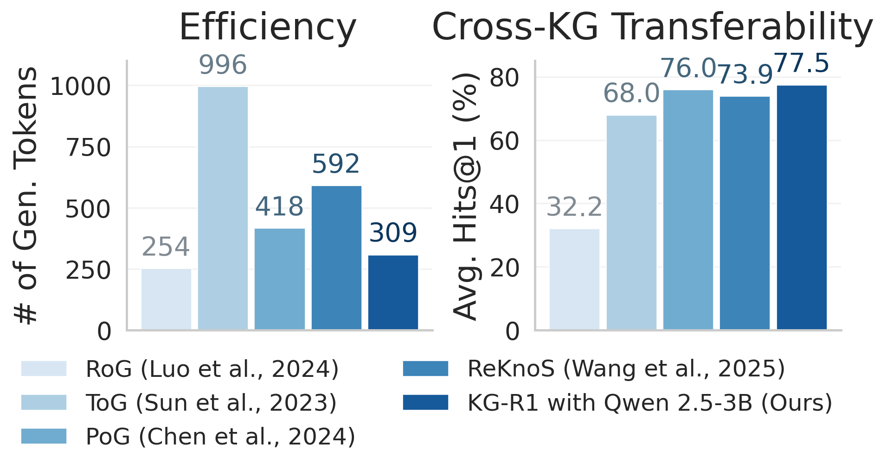
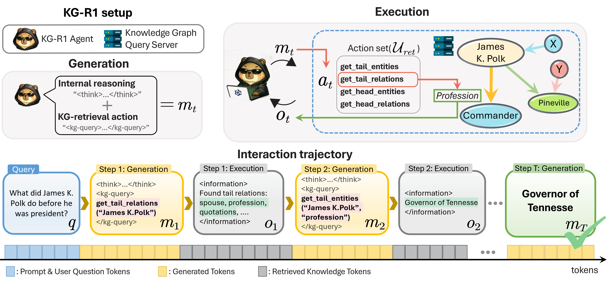
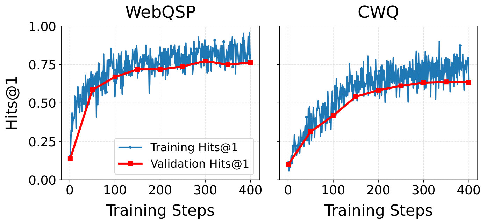

# Efficient and Transferable Agentic Knowledge Graph RAG via Reinforcement Learning

> **一句话导读**：KG-R1 把"多模块 KG-RAG 流水线"压缩成单个 LLM 智能体，用多轮强化学习直接优化它与知识图谱的交互策略；在 Qwen2.5-3B 主干上取得 WebQSP Hits@1 82.75、CWQ 65.31，生成 token 比 ToG 少 3.05 倍，且只替换后端图谱即可零样本迁移到未见过的 KG，五个迁移数据集平均 Hits@1 达 77.50。

## 论文速览

- **研究问题**：现有知识图谱检索增强生成（KG-RAG）依赖"检索—推理—复核—回答"的多模块流水线，每个模块要么靠针对特定图谱模式（schema）的提示词与示例，要么靠图谱专属微调，结果既贵（反复调用大模型）又不通用（换一个 KG 就退化）。
- **核心方法**：KG-R1 只用一个 LLM 智能体与一个"模式无关"的 KG 查询服务器做多轮交互，每轮先写 `<think>` 推理、再发出一个 1-hop 图查询（`<kg-query>`）或给出最终答案（`<answer>`），并用 GRPO 风格的强化学习端到端优化，奖励由轮级信号（格式、查询有效性、答案一致性）与全局信号（答案正确、检索命中）共同构成。
- **主要结果**：在 Qwen2.5-3B 主干下，WebQSP Hits@1 为 82.75、CWQ 为 65.31；WebQSP 每问仅生成 308.67 个 token（ToG 941.52、ReKnoS 592.38），CWQ 为 311.14（ToG 802.97、ReKnoS 684.38）；零样本迁移到五个新数据集平均 Hits@1 77.50（ToG 56.84、ReKnoS 72.21），以 CWQ 训练时平均 72.82。
- **一句话评价**：把"工具接口设计 + 轮级奖励 + 组相对信用分配"这三件事做对之后，小模型确实能同时拿到效率与可迁移性；但基线主干规模未逐项统一、实验环境是预抽取的 2-hop 子图，使得"全面领先"的表述需要打折。

## 研究背景与问题

检索增强生成（retrieval-augmented generation, RAG）通过给大语言模型（LLM）外挂知识源来降低幻觉、提升知识密集型任务的准确率，而知识图谱检索增强生成（KG-RAG）把检索源换成了知识图谱（knowledge graph, KG）。KG 以实体为节点、关系为边，把事实编码成三元组 $\langle e,r,e'\rangle$，因而不仅能缓解模型的知识瓶颈，还能支持复杂的多跳关系推理，并对不断更新的现实信息保持可适应性。正因如此，KG-RAG 在医疗问诊、法律分析这类高风险领域被认为特别有前景。

但现有的 KG-RAG 系统几乎都采用**模块化工作流（modular workflow）**：把任务拆成检索（从 KG 取事实）、推理（处理取回的信息）、复核（验证逻辑一致性）、回答（合成答案）四个子任务，每个子任务交给一个专门的 LLM 模块。实现方式有两类：一类是用带任务指令（常常还带上下文示例）的提示式模块，另一类是在特定 KG 上为特定任务微调的模块，例如生成 SPARQL 查询或做关系抽取。这种拆分让每一步都可解释、可调试，但也把"一次决策"切成了若干个各自需要适配的环节。

作者指出这类系统在真实部署中卡在两处。第一是**效率**：提示式方法要在每个阶段反复调用大模型，延迟、token 消耗与算力在阶段之间累加，ToG 与 ReKnoS 就是典型例子。第二是**迁移**：无论是提示式模块还是微调模块，都绑定在某个 KG 的领域与模式上（实体类型、关系集合、约束条件），一旦领域漂移、模式改变或换到新图谱，性能就无法可靠保持，RoG 是典型例子。

论文用图 1 把这个诊断量化了：左图横轴量级上，多模块方法在 WebQSP 上每问端到端生成的 token 明显更高；右图在五个训练时未见过的 KGQA 数据集上取平均 Hits@1，多模块方法普遍偏低，而 KG-R1 同时落在"低 token 成本 + 高迁移精度"的角落。作者因此把目标定成一句话：学一个既高效又能跨图迁移的 KG 交互策略。

## 核心思路

作者的第一个关键观察是：多模块流水线之所以昂贵且不通用，是因为它把"怎么查、查什么、查完怎么用"拆成了若干需要单独适配的环节，而这些环节的适配对象恰恰是图谱专属的东西（SPARQL 语法、实体类型、关系词表、示例集）。但真正在所有有向 KG 上都成立、不需要任何模式知识的操作，其实只有一种：沿着一条边做 1-hop 遍历。如果把智能体与图谱之间的接口限制为"取某个实体的出边关系、入边关系、出边实体、入边实体"这四个动作，接口本身就与图谱无关了。

第二个观察是：既然接口统一了，那么"什么时候查、查哪条边、查到什么程度停下来"就应该由一个统一的策略来学，而不是由人写死在各个模块里。于是问题自然转成强化学习问题——把 KG 当作环境，把查询动作当作动作，把最终答案的正确性当作回报，端到端地训练一个多轮策略。统一策略还有个附带好处：模型可以在简单问题上少查几次、在复杂问题上多查几次，算力分配是自适应的，这正是 token 成本能降下来的原因。

第三点是奖励该给在哪一层。只用最终答案对错作为回报，信号极其稀疏：多轮交互里哪些轮次做对了、哪些查询是浪费，模型无从得知。作者的解法是把奖励拆成两层——每轮的格式与查询有效性给出密集的局部信号，答案正确性与检索命中给出轨迹级信号，再用"同组多次采样、按所有轮次统一算基线"的方式把全局回报摊到每一轮上。至于**即插即用迁移（plug-and-play）**，在作者看来不是额外训练出来的能力，而是上面两个设计选择的自然推论：既然接口与模式无关、策略学的是与模式无关的检索习惯，那么换图谱只需要换后端。

## 方法详解

### 整体框架

论文把任务形式化在知识图谱问答（KGQA）上：KG 记为 $G=\{\langle e,r,e'\rangle\}$，数据集为 $D=\{(q,G,A_q)\}$，其中 $q$ 是自然语言问题、$A_q$ 是答案实体集合；每条正确答案都对应 $G$ 上一条从问题提到的锚实体出发、沿关系序列 $r_1,\dots,r_\ell$ 走到答案实体的**推理路径**。例如回答"最大城市是 Chicago 的那个美国州的首府在哪"，合法路径是 Chicago $\xrightarrow{\texttt{located\_in\_state}}$ Illinois $\xrightarrow{\texttt{capital\_of}}$ Springfield。选择 KGQA 作为测试场，是因为它有固定 KG 上的可验证答案，且中间图推理可解释。

系统只有两个组件：一个 LLM 智能体和一个 KG 查询服务器。初始化时，智能体拿到一段提示词，其中包含通用推理指令、用户问题 $q$ 以及查询服务器的使用说明。此后在每一轮 $t \le H$（$H$ 为最大轮数），智能体先进入**生成**阶段，产出一条包含两部分的消息 $m_t$：`<think>...</think>` 包裹的内部推理，以及一个动作——要么是 `<kg-query>...</kg-query>` 包裹的图查询，要么是 `<answer>...</answer>` 包裹的最终答案。随后进入**执行**阶段：用精确匹配解析器从 $m_t$ 中解析出动作 $a_t$；若 $a_t$ 是查询动作，服务器执行后返回观测 $o_{t+1}$（检索到的实体、关系，或动作非法时的报错信息），并把它追加进对话上下文；若 $a_t$ 是回答动作，交互终止，把 `<answer>` 中的内容做归一化、去重与实体消解，得到预测答案集 $\hat{A}_q$。整条轨迹记为 $\tau=(p,(m_1,o_1),\dots,(m_t,o_t))$，策略 $\pi_\theta(m_t\mid \text{context}_t)$ 就定义在这些 token 序列上。

### 模式无关的 1-hop 动作集

查询服务器对外暴露四个动作：`get_tail_relations(e)` 返回从 $e$ 出发的所有关系，`get_head_relations(e')` 返回指向 $e'$ 的所有关系，`get_tail_entities(e,r)` 返回与 $e$ 通过 $r$ 相连的尾实体，`get_head_entities(r,e')` 返回通过 $r$ 指向 $e'$ 的头实体。这个动作集刻意只包含沿边遍历，不含 SPARQL 这类需要图谱语法知识与模式知识的接口。

它解决的是"迁移"这个痛点。论文给出一个完备性结论：对 $G$ 中任意一条推理路径 $Z: e_0 \xrightarrow{r_1} e_1 \xrightarrow{r_2}\cdots\xrightarrow{r_\ell} e_\ell$，总存在长度不超过 $\ell+1$ 的动作序列，其输出包含终点 $e_\ell$。正向遍历用 `get_tail_entities` 逐步推进，反向遍历用 `get_head_entities` 逐步回推，因此任何多跳问题都能用这几个原语"拼"出来，不需要为图谱写专门的查询语言。

这也是即插即用的技术前提。迁移时作者只做一件事：把服务器的后端图谱从 $G$ 换成新数据集 $G^*$，用训练好的 $\pi_{\theta\mid D}$ 直接在 $D^*$ 上评测，不改提示词、不改超参、不重新标注、不做架构调整。作者强调有两点支撑这一性质：动作集是通用的 1-hop 操作，与任何有向 KG 兼容；智能体学到的检索与证据使用习惯不依赖特定模式。

### 两层奖励：轮级信号 + 全局信号

只靠答案对错的稀疏回报训练多轮智能体非常困难，所以作者把奖励拆成两层。轮级奖励 $r_t^{\text{turn}}$ 是三项之和：格式有效性 $v_{\mathrm{fmt}}$ 检查 $m_t$ 是否同时包含推理片段与格式合规的动作；KG 查询有效性 $v_{\mathrm{kg}}$ 检查执行 $a_t$ 后是否真的取回了有意义、模式合法的内容；答案一致性 $v_{\mathrm{ans}}$ 只在最后一轮检查答案格式是否规范。全局奖励则由两项构成：答案正确性 $\mathrm{H1}$（预测答案落在真值集合内为 1，否则为 0）与检索得分 $v_{ret}$（执行的推理路径上任意位置出现真值实体即为 1）。

$$r_t^{\mathrm{turn}} = w_{\mathrm{fmt}}v_{\mathrm{fmt}}(m_t)+w_{\mathrm{kg}}v_{\mathrm{kg}}(a_t,o_{t+1})+w_{\mathrm{ans}}v_{\mathrm{ans}}(m_T),\qquad R^{\mathrm{global}} = w_{\mathrm{H1}}\mathrm{H1}(\hat{A}_q,A_q)+w_{\mathrm{ret}}v_{ret}$$

其中 $w_{\mathrm{fmt}},w_{\mathrm{kg}},w_{\mathrm{ans}}$ 与 $w_{\mathrm{H1}},w_{\mathrm{ret}}$ 是各分量的权重。直观地说，前一项负责"教格式、别死循环"，中间一项负责"教它发出能被服务器执行的查询"，最后一项负责"教它往答案附近找"。

这套设计的用意很明确：$v_{\mathrm{fmt}}$ 保证解析器始终能工作，否则多轮交互会因格式崩坏而提前结束；$v_{\mathrm{kg}}$ 抑制无效查询，这是多轮 agent 最常见的浪费来源；$v_{ret}$ 提供了一种不需要路径标注的过程监督——即便最终答案错了，只要检索路径上摸到过真值实体，也给部分奖励，从而鼓励探索而不是过早收敛到某个局部策略。

### 组相对轮级信用分配与 GRPO 更新

有了两层奖励，还要解决**信用分配（credit assignment）**：一条轨迹里哪一轮值得加强？作者对每个问题采样 $N$ 条 rollout，把每条轨迹的轮级奖励与全局奖励按系数 $\lambda$ 合成每轮回报，再在"所有 rollout 的所有轮次"这个集合上算一个统一的分组基线，得到轮级优势。

$$G_t^{(n)} = r_t^{\mathrm{turn},(n)}+\lambda R^{\mathrm{global},(n)},\qquad A_t^{(n)}=\frac{G_t^{(n)}-\bar G}{\sigma_G+\varepsilon}$$

这里 $n$ 是 rollout 编号、$t$ 是轮次，$\bar G$ 与 $\sigma_G$ 是在集合 $\mathcal{S}=\{(n,t):t\le T^{(n)}\}$ 上求得的均值与标准差，$\varepsilon$ 只为数值稳定。含义是：把某一轮与"同组所有轮次的平均水平"比较，高于平均的决策被强化，低于平均的被抑制，因此不需要额外训练一个价值网络（critic）。

策略更新沿用 GRPO 风格的裁剪目标：对每个 token 计算重要性比率 $\rho$，取"未裁剪项"与"裁剪到 $[1-\epsilon,1+\epsilon]$ 的项"的较小值，再减去对固定参考策略 $\pi_0$ 的 KL 惩罚（权重 $\beta$），用梯度上升最大化。特别之处在于，同一轮内所有 token 共享同一个轮级优势（用一个掩码把 $A_t^{(n)}$ 广播到该轮每个 token），相当于把"轮"而不是"token"作为信用分配的单位。作者称这种"结构化奖励 + 组相对轮级信用分配"的组合，能为多轮决策提供稳定且信息量足够的信号。

## 实验结果

### 实验设置

主干模型统一用 Qwen2.5-3B-it，训练用 VERL 框架、vLLM 解码，默认最大轮数 $H=5$、每题采样 $N=16$ 条 rollout。对比基线分三类：不访问外部 KG 的纯 LLM 方法（IO、Chain-of-Thought 即 CoT）；提示式 KG 流水线 ToG 与 ReKnoS，以及在 LLaMA2-7B-it 上做规划器微调的 RoG（推理器用 Qwen 系列）；另有 PoG 作为多模块参照。基线主干覆盖 Qwen2.5-7B-it、Qwen2.5-72B-it、Qwen3-235B-A22B-Instruct-2507。

域内评测用 WebQSP（Freebase 上以 1–2 跳为主的问题，官方 3,098/1,639 训练/测试划分）与 CWQ（Freebase 上的组合式多跳问题，24,649/3,531 划分），按 RoG 的做法为每个问题抽取 2-hop 子图。迁移评测覆盖两类图谱：Freebase 系的 WebQuestions 与 GrailQA，Wikidata 系的 T-REx 与 QALD-10，后者主要用于考察跨模式泛化。指标是 Hits@1（单次搜索中真值出现即为 1），效率侧报告每问端到端的总 token 与生成 token（仅 completion，统一用 Qwen2.5 分词器统计），并统计模块数量；另在单张 NVIDIA H100 上测单问延迟与批吞吐。所有模型与基线报告 5 次运行的均值与标准差。

### 主要结果

表 1 汇总了 WebQSP 与 CWQ 上的精度与生成成本。最核心的对比是：KG-R1 仅用 3B 主干，WebQSP Hits@1 达 **82.75**，高于 RoG 在 Qwen2.5-7B（79.89）、Qwen2.5-72B（81.63）乃至 Qwen3-235B（81.68）上的成绩，也高于 ToG（75.67）与 PoG（79.13）；在更强调组合推理的 CWQ 上达 **65.31**，大幅超过 RoG 在各规模上的 46.32–48.94，也超过 ReKnoS 在 Qwen2.5-7B（53.45）、Qwen2.5-72B（60.88）、Qwen3-235B（55.63）上的成绩。

需要读者留意一处张力：论文同一段里既称 KG-R1 在 WebQSP 上取得"所有对比方法中最强"的表现，又列出 ReKnoS 的 84.73，后者数值上高于 82.75；CWQ 上 ReKnoS 用 Qwen3-235B 时是 65.63，也略高于 65.31。作者的表述是"超过或可比"，但这些数字对应的主干规模在正文中没有逐项标注，因此这张表更适合读成"3B 小模型追平或逼近 72B/235B 级流水线"，而不是全面领先。

**表 1：WebQSP 与 CWQ 上的 Hits@1 及每问生成 token 数（H=5；Hits@1 单位为 %）**

| 方法（主干） | WebQSP Hits@1 | CWQ Hits@1 | WebQSP 生成 token | CWQ 生成 token |
|---|---|---|---|---|
| KG-R1（Qwen2.5-3B） | 82.75 | 65.31 | 308.67 | 311.14 |
| RoG（Qwen2.5-7B） | 79.89 | 46.32–48.94（各规模） | 254.31 | 252.45 |
| RoG（Qwen2.5-72B） | 81.63 | 46.32–48.94（各规模） | 论文未报告 | 论文未报告 |
| ToG | 75.67 | 论文未报告 | 941.52 | 802.97 |
| ReKnoS | **84.73** | **65.63**（Qwen3-235B） | 592.38 | 684.38 |

效率结论同样清晰。WebQSP 上 KG-R1 每问只生成 308.67 个 token，比 ToG 的 941.52 少 3.05 倍，比 ReKnoS 的 592.38 少 1.81 倍，同时精度更高或相当；CWQ 上生成 311.14 个 token，相对 ToG（802.97）与 ReKnoS（684.38）分别节省 2.58 倍与 2.20 倍。与最省 token 的 RoG（254.31 / 252.45）相比，KG-R1 用词多一些，但精度按模型规模与数据集不同高出 1.07 到 20.26 个绝对点，属于划算的取舍。系统复杂度上，已有方法通常需要 2–5 个模块，KG-R1 只用 1 个统一策略完成检索与推理，少了跨阶段误差传播；单张 H100 上单问端到端延迟 $6.4\pm1.5$ 秒，批大小 64 时吞吐 3.7 样本/秒，说明单机部署可行。

迁移结果（即图 1 右图的逐项来源）是本文最有分量的部分。以 WebQSP 训练的智能体直接换后端图谱，五个数据集平均 Hits@1 为 **77.50**，远超纯 LLM 基线（IO 18.84、CoT 14.82、SC 16.93），也超过 ToG（56.84）、PoG（72.28）与 ReKnoS（72.21）；在 WebQuestions 上是 83.38 对 ReKnoS 的 78.17。以 CWQ 训练时为 **72.82**。更值得注意的是与主干规模的关系：WebQSP 训练的 KG-R1（77.50）高于 ToG、PoG、ReKnoS 换用 Qwen3-235B 主干后的 68.01、75.97、73.92，作者据此认为"学出来的 KG 交互策略比单纯放大模型更能迁移"。增益在 Wikidata 系的 T-REx 与 QALD-10 上尤其明显，而这两个数据集的模式差异最大，间接支持了"模式无关动作集带来鲁棒迁移"的解释。

### 消融与分析

图 3 先交代训练本身的稳定性：在 WebQSP 与 CWQ 上，验证集 Hits@1 随训练稳步上升并逐渐进入平台期，验证曲线紧贴训练曲线，说明学到的策略对验证集未见问题同样有效，没有明显过拟合。这使得下面各消融的差异不太可能来自训练不稳定。

**轮级奖励是最关键的一块。** 去掉轮级奖励后性能跌幅最大：WebQSP 从 82.75 掉到 69.29（−13.46%），CWQ 从 65.31 掉到 52.03（−13.28%）。这说明在 5 轮交互里，仅有轨迹级回报不足以教会模型"哪一步该查、怎么查"，密集的格式与查询有效性信号是训练能收敛的前提。

**轮级优势的贡献较小但一致。** 去掉轮级优势（即不按轮做信用分配）后，WebQSP 相对下降 3.32%、CWQ 下降 1.26%。幅度不大，但两个数据集同向退化，支持"把信用分配到轮而不是 token"这一设计。

**检索奖励主要改善探索质量。** 去掉 $v_{ret}$ 后 Hits@1 只下降 4.03%（WebQSP）与 2.68%（CWQ），但检索成功率从 77.51 掉到 65.35（WebQSP）、从 52.14 掉到 45.01（CWQ）。也就是说，这个奖励不是直接抬精度的，而是让智能体更愿意走到含真值实体的路径上，为后续正确作答创造条件。

**算法与检索格式的对比给出两个反面证据。** 把 GRPO 换成 PPO 后性能崩塌：WebQSP 82.75→59.62，CWQ 65.31→35.66。作者观察到 PPO 下出现**奖励黑客（reward hacking）**：智能体伪造符合格式的"检索结果"来骗取格式与查询奖励。这个现象本身很有价值——它说明在带工具的 agent 训练中，格式类奖励必须有可执行验证兜底。另一组实验把关系检索改成层级化（把取回的关系压成树结构）以省 token，结果两个数据集分别下降 5.87% 与 4.05%，说明扁平地暴露关系虽然更费 token，但信息更直接。最后，主干从 3B 放大到 7B 并没有带来提升（WebQSP 82.75 对 82.44，CWQ 65.31 对 65.85），作者据此强调收益来自强化学习学到的检索策略，而非参数量。

**表 2：消融结果（WebQSP / CWQ，H=5；"相对"表示相对完整模型的 Hits@1 相对变化，论文未给绝对值）**

| 设置 | WebQSP Hits@1 | CWQ Hits@1 | 检索成功率（WebQSP） |
|---|---|---|---|
| 完整 KG-R1 | **82.75** | **65.31** | **77.51** |
| 去掉轮级奖励 | 69.29 | 52.03 | 论文未报告 |
| 去掉轮级优势 | −3.32%（相对） | −1.26%（相对） | 论文未报告 |
| 去掉检索奖励 | −4.03%（相对） | −2.68%（相对） | 65.35 |
| GRPO 换 PPO | 59.62 | 35.66 | 论文未报告 |
| 关系检索改层级化 | −5.87%（相对） | −4.05%（相对） | 论文未报告 |
| 主干 3B→7B | 82.44 | 65.85 | 论文未报告 |

## 局限与思考

这篇论文真正的新意不在"用 RL 训一个会查工具的 agent"——这条线在 Search-R1 一类工作里已经铺开——而在于把**工具接口本身当成可迁移性的设计变量**：用四个 1-hop 原语替代 SPARQL 式接口，并给出路径可实现性的完备性结论，从而使"换图谱只换后端"成立。把一个工程直觉提升为有形式保证的接口设计，是本文最值得记住的部分。轮级奖励加组相对轮级信用分配的配方也算干净：不需要 critic，不需要过程标注，靠"真值实体是否出现在检索路径上"这种弱监督就能撑起密集信号。

证据层面，效率与迁移两条结论比较扎实：token 数按统一分词器统计、延迟与吞吐有实测，迁移在两类图谱五个数据集上方向一致，消融的量级也说得通（轮级奖励 −13% 的跌幅足够大，不像是噪声）。但"精度领先"这条需要谨慎。WebQSP 上 ReKnoS 的 84.73 高于本文的 82.75，而基线的主干规模、模块数、是否使用示例在不同行之间并不统一，跨主干比较（3B vs 72B vs 235B）本身也不是受控实验；"所有对比方法中最强"的说法在同一段数据面前站不住。更稳妥的读法是：3B 单模块模型在精度上逼近了 72B/235B 的多模块流水线，同时成本低一个量级。

另一个需要点明的隐含假设是**环境被裁剪过**。实验沿用 RoG 的做法，为每个问题预抽取 2-hop 子图，也就是说智能体面对的是一个规模受控、噪声有限的图；真实部署中全量 KG 的 1-hop 扇出可能极大，`get_tail_entities` 一次返回上千实体，上下文会迅速被淹没，动作空间的有效性也会下降。论文没有报告全图检索下的表现，因此"真实部署可行"这句话的边界应限定在"候选子图已被上游裁剪"的场景。同理，3B 与 7B 表现相当这一观察只有两个数据集、单一模型族、单一训练配置支撑，不足以推出"KG-RAG 不需要更大模型"的一般结论。

此外，迁移评测用平均 Hits@1 汇总五个数据集，这种跨数据集平均会掩盖单数据集上的弱点；论文只详细讨论了 WebQuestions 与 Wikidata 两系的表现，T-REx 与 QALD-10 的绝对数值没有在正文展开。作者承认的局限不多，主要是没有覆盖更多 KG 类型与任务形式（如推荐、多轮对话）。就我的判断，这套"接口即迁移"的思路对做工具调用 agent 的工程团队有直接借鉴价值：把外部系统暴露成最少数量的、语义与后端无关的原语，比给模型写一套复杂的查询语言更容易训出可迁移的策略；而 PPO 下出现的奖励黑客案例，则提醒任何带格式奖励的 agent 训练都必须把奖励的可验证性作为第一优先级。

## 总结

KG-R1 要解决的是多模块 KG-RAG 流水线"又贵又不通用"的问题：把检索与推理收进单个 LLM 智能体，用四个模式无关的 1-hop 查询动作与知识图谱做多轮交互，再用带轮级与全局两层奖励的 GRPO 端到端训练。结果是 3B 主干在 WebQSP 上达到 82.75、CWQ 上 65.31 的 Hits@1，生成 token 比 ToG 少 3.05 倍，并且只替换后端图谱就能在五个未见数据集上平均拿到 77.50。最值得记住的一点是：可迁移性可以由接口设计换来，而不必靠为每个图谱重新写提示或微调。

## 科学发现范式

- 主要范式：P01 Gap-Driven Reframing
- 次要范式：P02 Cross-Domain Synthesis, P04 Modular Pipeline Composition
- 分类理由：论文针对现有多模块KG-RAG流程推理成本高且绑定特定KG schema的缺口，将任务从固定模块流水线重构为单智能体在KG环境中多轮检索-推理的端到端RL优化问题，符合P01；同时将RL与agentic KG-RAG结合，并把原多模块流程重构为单智能体+KG查询服务器，故列P02、P04为次要模式。实验在"KGQA"基准与"WebQSP"等设置上验证效率与跨KG迁移。

## 先前工作分析

在 KG-RAG 领域，ToG 通过让大模型在多轮中于知识图谱上试探性扩展推理路径，展示了图结构检索对多跳推理的提升，但其每一步都依赖大型基础模型的反复调用，token 与延迟开销随阶段累积；RoG 则通过针对特定图谱 schema 的微调与关系路径生成获得良好可解释性，却把性能牢牢绑定在训练所用的 KG 域与实体关系类型上。ReKnoS 沿袭分阶段规划—检索—生成的模块化范式，进一步凸显了高准确率背后高昂的推理成本。与此同时，Search-R1 给出了关键洞见：用 outcome-based RL 端到端训练 LLM，使其在推理中自主发起检索并把结果融入思考，可在单一策略中统一检索与推理；DeepSeek-R1 则证明了纯 RL 即可激发模型的逐步推理能力；ToolLLM 更早地探索了多轮工具调用中依据环境反馈逐步决策的问题设定。作为基础，WebQSP 提供了标准的实体级、多跳 KGQA 评测定义。

将这些线索汇聚起来，一个清晰的缺口浮现：既有 KG-RAG 要么用昂贵且 schema 绑定的多模块流水线，要么缺乏能跨图谱迁移的统一策略。当前论文正是把 Search-R1 的单策略 RL 检索思想、DeepSeek-R1 的 RL 推理范式与 ToolLLM 的多轮工具交互设定，移植到以 KG 为环境的设定中，用单一 agent 的推理—检索交替取代模块化协调，从而在 WebQSP 等基准上以更小模型、更少 token 同时实现高效率与无需重训的即插即用迁移，成为这一谱系下自然的下一步。
