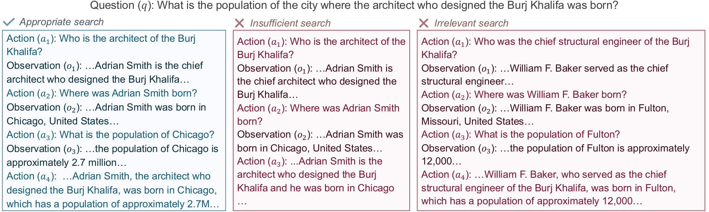
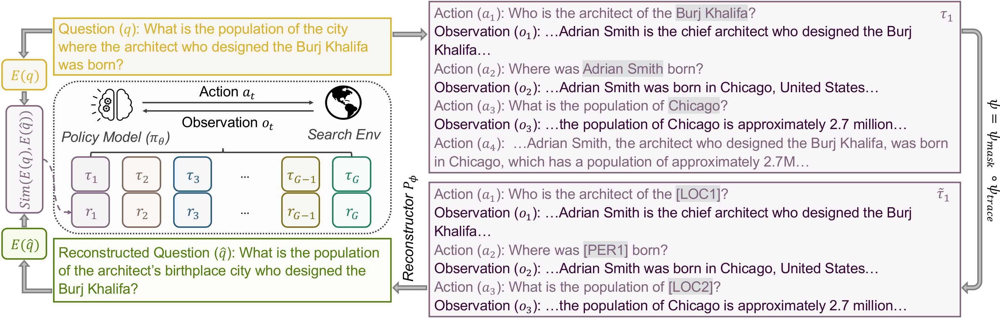
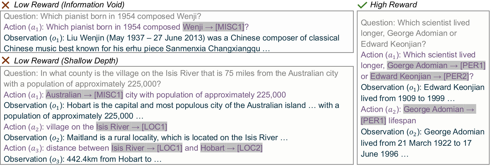
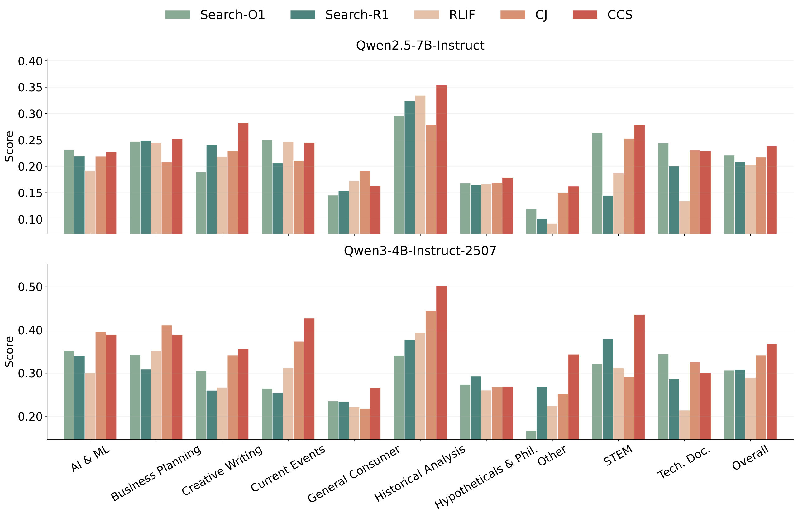

# Cycle-Consistent Search: Question Reconstructability as a Proxy Reward for Search Agent Training

> **一句话导读**：本文提出 **Cycle-Consistent Search (CCS)** 框架，通过引入循环一致性和信息瓶颈，无需人工标准答案即可训练多步搜索智能体，在 Qwen2.5-7B-Instruct 模型上将平均准确率提升至 60.6%。

## 三句话看懂
- **问题**：现有的搜索智能体强化学习依赖标准答案作为奖励信号，在专业或快速演化领域成本高昂且难以获取。
- **方法**：本文提出循环一致性搜索方法，把搜索轨迹看作原问题的编码，通过重建原问题的质量来提供无监督的代理奖励。
- **结果**：在七个问答基准和一个深度研究基准上，Qwen2.5-7B-Instruct 模型的平均准确率达到 60.6%，表现超越所有无监督基线并可媲美有监督方法。

## 为什么要做这件事
随着大语言模型的发展，搜索智能体需要通过迭代规划和工具调用来解决复杂的多跳问题。目前的强化学习优化严重依赖正确答案来定义奖励，这导致了一个根本性的可扩展性瓶颈。如果在缺乏标准答案的场景下盲目训练，智能体往往无法获得可靠的反馈信号。

如图 1 所示，作者观察到优质的搜索轨迹能够完整保留问题所需的全部信息，而低质量轨迹则会遗漏关键步骤或漂移到无关信息。

## 核心思路
作者的核心观察来自无监督机器翻译中的循环一致性思想：如果一个转换过程足够好，那么它应该包含足够的信息，使得原始输入能够通过逆向映射被恢复。

作者可以把这个直觉类比为一个侦探破案：如果搜集到的线索和行动过程是完整且正确的，那么仅凭这些记录就能反推出最初遭遇的悬案是什么。如果中间偷懒抄了捷径或者查错了方向，就无法完美还原原貌。

## 方法怎么做

如图 2 所示，CCS 整体流程为：智能体针对问题生成搜索轨迹，轨迹经过信息瓶颈处理后，输入到一个固定的预训练重建器中恢复出重建问题，最后通过计算重建问题与原问题的语义相似度来给出轨迹奖励。
### 循环一致性建模
作者将问题视为语义意图，搜索轨迹视为该意图的动态展开。在最优策略下，搜索轨迹应当是对源问题的无损编码，即问题能够通过轨迹再重建回原问题，重建的相似度直接作为中间轨迹质量的代理指标。
### 战略信息瓶颈
为了防止智能体通过表面词汇的直接复制来实现重建，作者引入了两个信息瓶颈：一是排除包含复述上下文的最终回答，二是利用命名实体识别对搜索动作中的专有名词进行泛化标签替换，迫使重建过程必须依赖检索到的实际观察结果。
### 策略优化
通过群体相对策略优化算法，智能体对每个问题采样一组轨迹，分别计算它们重建原问题的语义相似度得分并归一化为优势值，以此引导智能体倾向于生成能够更好保留搜索结构与信息支撑的高质量轨迹。

## 效果如何
作者在 HotpotQA、2WikiMQA、Musique、Bamboogle、NQ、TriviaQA 和 PopQA 共七个数据集上进行了评估，对比了模型直接推理、有监督微调以及多种无监督方法。

如消融实验和定性分析如图 3 所示，去除信息瓶颈或暴露原始词汇会导致性能显著下降。实验证明，掩码动作与观察结果的结合能够有效剔除表面捷径，并保留对重建至关重要的结构信号。

在开放式深度研究任务中，如图 4 所示，CCS 在多个领域上取得了最佳的综合性能，表现超越了传统的有监督基线。

## 值得关注的点
这篇论文最大的亮点在于将多步搜索智能体的强化学习彻底从标准答案中解放出来，利用循环一致性和信息瓶颈解决了无监督场景下的“信息泄漏”漏洞。不过读者也需要留意，该方法在计算奖励时需要依赖一个额外的重建模型，这会带来一定的额外开销。

## 读后小结
本文针对搜索智能体严重依赖标准答案的痛点，创新性地引入了循环一致性搜索框架，通过设计信息瓶颈并以问题重建质量作为代理奖励。实验表明该方法在多个问答和深度研究基准上取得了优异效果，为无监督大模型智能体训练开辟了新途径。

## 先前工作分析

在自然语言处理和计算机视觉领域，循环一致性（cycle-consistency）原则通过对偶学习与图像到图像转换等开创性工作得到了广泛发展，其核心思想是利用逆向映射来重构原始输入，以此作为评估前向转换质量的有效代理。与此同时，大语言模型驱动的搜索智能体通过诸如「ReAct」等多步推理与工具调用框架，将知识检索成功演变为复杂的顺序决策过程。然而，现有的强化学习方法高度依赖昂贵的黄金标准答案监督，这构成了严重的可扩展性瓶颈。先前诸如「IRCoT」等交织检索方法虽然提升了多步查询表现，但并未摆脱对外部强监督的依赖。为了弥合这一缺口，当前研究巧妙地将传统跨域翻译中的循环一致性思想引入搜索领域，将搜索轨迹视为源问题的某种信息保持编码。然而，直接应用该机制会面临由于表面词汇重叠导致的严重信息泄漏问题。为此，论文结合了类似「LUKE」中针对实体处理的洞见，引入了最终响应排除和命名实体识别掩码等战略性信息瓶颈。通过将这些技术进行创新性融合，当前工作成功构建了一个无需黄金监督、仅依赖问题重构度作为代理奖励的可扩展搜索智能体训练框架「Cycle-Consistent Search」，从而在多个基准测试上实现了与监督方法相媲美的优异性能。
