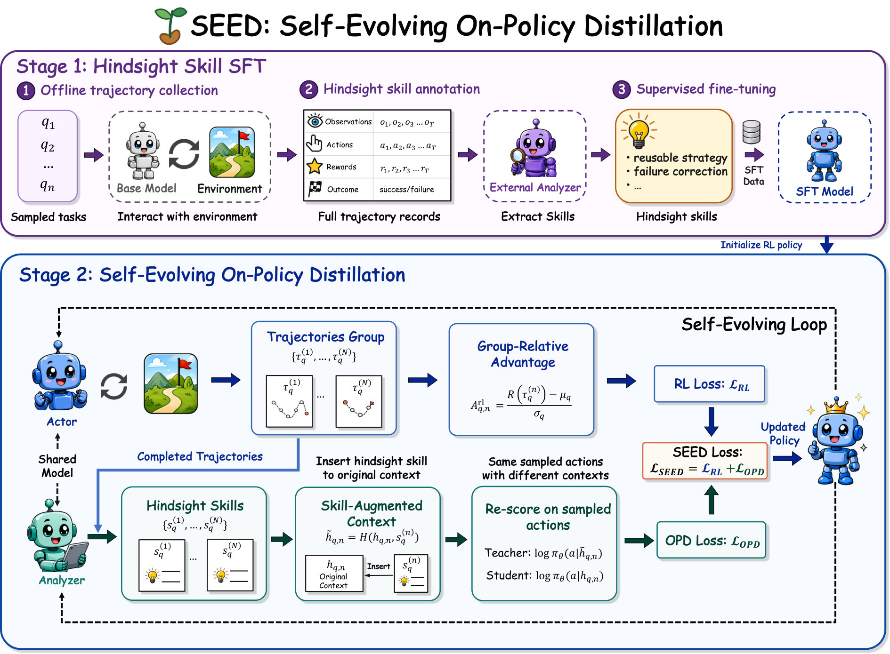

#  SEED: Self-Evolving On-Policy Distillation for Agentic Reinforcement Learning
## 1. 研究动机与贡献

问题背景（为什么要做）  
- 现代大规模语言模型正被用作“智能体”去完成长时序、多回合、需要工具和环境反馈的任务（比如网页导航、机器人交互、基于检索的问答等）。这些任务的回报往往是稀疏且延迟的：奖励通常在整条轨迹结束时给出，而不是对每一步决策提供细粒度提示。  
- 因此存在一个“监督鸿沟”：标量的轨迹级结果无法告诉模型哪些中间观察、动作或工具调用是关键的、哪些是可复用的策略或需要修正的局部错误。

核心观察与设计原则  
- 完整轨迹在事后包含丰富的“后见(hindsight)”信息：子目标是否达成、哪些观察决定了成败、哪些工作流可复用。  
- 为了把这些信息有效转化为训练信号，监督应满足三点：**on-policy**（与当前策略的分布一致）、**dense**（作用到 token/决策级别而非仅轨迹级）、**self-evolving**（能随策略改善而更新，不是静态的教师或数据集）。

本文贡献（精炼）  
- 提出 **Seed**（**SE**lf-**E**volving On-Policy **D**istillation），将完成的 on-policy 轨迹自动转化为自然语言的 **hindsight skills**，并把这些 skill 导致的行为偏移以密集 token 级的蒸馏信号回写到策略中。  
- 设计了一个策略同步的 hindsight OPD（on-policy distillation）机制：对同一条采样轨迹，在“普通上下文”和“skill 增强上下文”下对采样动作重新计分，从概率偏移中得到密集监督，并与轨迹级 RL 目标联合优化（例如以 $\mathcal{L}_{\mathrm{RL}} + \lambda \mathcal{L}_{\mathrm{OPD}}$ 形式）。  
- 在多种 agentic 基准（体感/视觉规划、网页导航、检索式 QA 等）上展示了性能、样本效率和泛化性的稳健提升。

## 2. 方法介绍

总体思路（两阶段）  
1. **Hindsight-skill supervised fine-tuning (SFT)**：先用 SFT 训练模型学会把一条已完成的交互轨迹摘要成可复用的自然语言 skill（例如“先在页面右上角点击高级搜索，若无结果则切换到站内检索”或“如果收到 404 则重试并记录当前查询”）。这一阶段教会模型如何做轨迹分析与生成技能描述。  
2. **Self-evolving on-policy distillation (OPD)**：在 RL 循环中，使用当前策略模型既负责收集轨迹又负责把这些轨迹解析成 hindsight skills。更新策略后同一检查点同时提升采样能力和轨迹分析能力——实现“共同进化”。

方法细节（关键步骤与数学表示）  
- 采样：在当前策略 $\pi_\theta$ 下采样一条轨迹，得到一系列状态/观察与采样动作 $\{(s_t, a_t)\}_{t=1}^T$。  
- 技能抽取：用同一模型（作为 analyzer）把完整轨迹映射为一到若干条自然语言 skill，记作 $k$（可以是字符串或一段说明）。这是训练时的特权信息（训练期可用，推理期移除）。  
- 重新计分（policy-synchronized rescoring）：对轨迹中已采样的动作保持不变，分别在普通上下文 $c$（原始对话/观测历史）和 skill-增强上下文 $c^+ = c \oplus k$（把 skill 附加为私有提示）下计算动作的条件概率：
  $$
  \log p_t = \log \pi_\theta(a_t \mid c),\qquad
  \log p_t^+ = \log \pi_\theta(a_t \mid c^+).
  $$
  定义单步的 log-probability 偏移为
  $$
  \Delta \log p_t = \log p_t^+ - \log p_t.
  $$
- 构造密集蒸馏信号：把 $\Delta \log p_t$ 转成一个可优化的损失项。论文提供了将这一偏移用于 on-policy distillation 的机制——一个常见形式为最小化负的偏移或等价的 KL/交叉熵项，例如
  $$
  \mathcal{L}_{\mathrm{OPD}} = -\sum_{t=1}^T \Delta \log p_t
  $$
  或者以分布匹配的角度：
  $$
  \mathcal{L}_{\mathrm{OPD}} = \sum_{t=1}^T D_{\mathrm{KL}}\!\big(\pi_\theta(\cdot\mid c^+) \,\|\, \pi_\theta(\cdot\mid c)\big),
  $$
  具体实现可用交叉熵或温度软化的 KL。重要的一点是：监督目标是在策略本身采样的动作上施加的（on-policy），因此减小了分布错位问题。  
- 联合训练：最终采用联合目标训练策略参数：
  $$
  \min_\theta\ \mathcal{L}_{\mathrm{RL}}(\theta) + \lambda\,\mathcal{L}_{\mathrm{OPD}}(\theta),
  $$
  其中 $\mathcal{L}_{\mathrm{RL}}$ 是常规的轨迹/回报驱动的 RL 损失（例如基于优势估计或策略梯度），$\lambda$ 控制蒸馏信号的权重。  
- 自我进化循环：每次参数更新后，用新的 $\theta$ 做为下一轮的采样器与 analyzer，从而让 hindsight skill 的生成和策略行为共同提升，避免 stale（过时）的教师信号。

训练与推理界面设计  
- 生成的 natural-language skills 仅在训练时作为“privileged supervision”使用；部署/推理时不需要附加提示或外部记忆，策略已经把这些行为模式内化为模型权重。  
- Seed 的优势来自三点同时满足：on-policy（样本来自当前策略）、dense（偏移信号逐 token/逐步提供）和 self-evolving（analyzer 与 actor 共用同一检查点并随训练更新）。

(概览示意图)  

图注：左侧展示采样轨迹 -> 中间展示 analyzer 生成的 hindsight skills -> 右侧展示用 skill 进行重评分并构造 OPD 信号，最终与 RL 一起优化。

## 3. 实验结果

实验设置（概览）  
- 任务覆盖面广：包括基于文本的网页导航与检索式问答、以及视觉与规划类的 embodied 交互/视觉推理任务。论文对比了有代表性的基线（只用 outcome-based RL、带静态技能或外部 memory 的方法、以及其它自蒸馏方法等）。

主要发现（定性与结论式总结）  
- 性能提升：**Seed** 在多种基准上稳定优于纯 RL 基线和若干自蒸馏/技能方法，尤其在长时序、稀疏奖励场景下收益明显。  
- 样本效率：由于提供了密集的 token-级监督，学习速度更快，达到同样任务成功率所需的交互样本更少。  
- 鲁棒性与泛化：训练得到的策略在未见的场景/任务变化中表现更稳健，论文指出这是因为模型学会了可复用的工作流与失败避免规则，而不是仅记忆任务特例。  
- 消融（ablation）分析：去掉 hindsight SFT（即 analyzer 质量下降）或不做 on-policy 重评分都会削弱效果，说明两阶段设计与 on-policy 重新计分是关键成分。  
- 推理开销：生成的 skill 只在训练时使用，部署时没有额外提示成本；训练期间的额外计算主要来自对同一动作在两种上下文下的重新评分。

## 4. 简要总结

Seed 的核心思想简单且有力：把事后可观测的“后见”信息转化为自然语言的可复用技能，并在训练期内把这些技能的行为影响以 on-policy、密集的蒸馏信号写回到策略权重，使策略在遇到新的或更困难情形时能内化这些策略与失败避免规则。三大优点是：1) 减少轨迹级稀疏回报带来的学习困难，2) 保证监督与当前策略分布一致（on-policy），3) 随策略一起“自我进化”，避免监督过时。

有几点值得注意的局限与未来方向：  
- skill 质量依赖于 analyzer 的能力，初始阶段若 analyzer 差可能带来低质或误导性的技能。  
- 重评分与 skill 生成带来训练时间/计算开销；如何高效筛选/权衡技能是下一步工程问题。  
- 可拓展性方向：把 skill 组织为层级结构、引入置信度加权、或与检索式记忆结合以应对极长历史和复杂多任务场景。

参考与复现  
- 作者已在仓库中公开代码（论文摘要中给出链接），读者可查看实现细节、超参与具体基准的量化结果。

## 科学发现范式

- 主要范式：P01 Gap-Driven Reframing
- 次要范式：P05 Data & Evaluation Engineering, P04 Modular Pipeline Composition
- 分类理由：论文“Seed”明确指出结果导向RL在长序列任务中存在的监督缺口，并将该缺口重新表述为将完整的on-policy轨迹转化为可蒸馏的行为规则（即生成自然语言的“hindsight skills”）以回灌至策略，从而符合Gap-Driven Reframing（P01）。其次，方法通过构造合成监督信号（以“hindsight skills”作为训练时的合成监督）属于数据/合成监督工程范畴（P05）；同时将收集—分析—重打分—蒸馏组织为两阶段、可替换的演员/分析器模块化流程，体现了模块化流水线思想（P04）。

## 先前工作分析

在有关稀疏回报与轨迹重标注的工作中，“Hindsight Experience Replay” 明确提出把完成轨迹重新解释为训练信号，这为把整段交互挖掘成可学习信息奠定了基础；“DAgger” 则从理论和实践上强调了在学习者自身分布上采样以减轻分布错配的必要性，支撑了对 on-policy 训练/蒸馏的采样设计。面向语言代理的研究如“Reflexion”与“Self-Refine”展示了用模型自身的语言化反思或多轮自修正来提取洞见并改进行为的可行机制，直接启发把轨迹分析模块做成与策略共享的、会随着策略进化的语言化分析器。同时，已有“On-Policy Distillation”方法为在学习者采样上施加稠密蒸馏监督提供了直接的技术脉络。另一方面，像“Voyager”这类依赖外部记忆或静态技能库的代理，暴露了技能易变且可能与当前策略错位的缺陷。從这些工作的组合中，自然而然浮现出一个机会：把完成轨迹的 hindsight 信息以自然语言技能形式提取出來、在同一 checkpoint 上自我生成并以 on-policy 的稠密蒸馏信号回写到策略中，从而实现监督与策略分布共演化并在推理时不依赖外部技能。这一思想正是 SEED 在方法论和实现上整合并推进上述前作的自然下一步。
