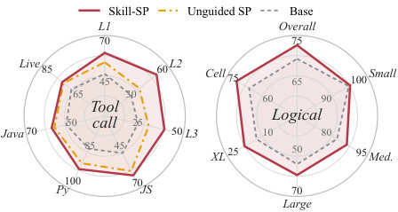

#  Skill Self-Play: Proactive Curricula for Self-Evolving Agents

## 1. 研究动机与贡献

为什么要做这件事？近年来大模型的“自我进化”趋势把训练重心从人工标注转向交互式自改进（self-evolution）。常见做法有两类极端：

- 环境绑定（environment-bound）的方法有严格的验证机制（比如代码执行器、模拟器），因此反馈精确但任务空间被局限在特定环境内；
- 开放式合成（open-ended generation）的方法可以产生大量多样任务，但缺乏可靠验证，长此以往会产生格式错误或误导性奖励，导致训练数据质量下降，甚至“合成数据坍缩”。

核心观察：将“技能（skills）”作为中间抽象，可以调和两者的矛盾。每个技能是一个可重用的、面向执行的模块（包含说明、约束、执行机制），既能在特定情景提供严格可验证的执行边界，也能被动态路由以维持任务的多样性。

主要贡献（精简）：
- 提出并实现了 **Skill-SP**（`Skill-SP`），一个由**Proposer**、**Solver**、**Controller** 和一个动态演化的**skill library**（记作 $\mathcal{S}$）组成的自我演化框架；
- 用技能作为“任务模式接口”，在任务生成前注入结构性约束、在解答后提供可执行的验证机制，并在训练过程中演化技能库，实现结构化的、有验证性的、开放式任务生成；
- 在工具调用（`API-Bank`、`BFCL`）和逻辑推理（`ZebraLogic`）等可验证任务集上展示显著改进：最高可达 +42.9 点（工具使用）和 +12.0 点（逻辑推理）；
- 开源实现： https://github.com/Qwen-Applications/skill-self-play

（首图展示了 Skill-SP 在 Qwen3-4B-Ins 上扩展能力的效果：工具调用与逻辑推理均有明显提升）

## 2. 方法介绍

总体思路（一句话）：把“技能库”作为训练时的可演化接口，借助技能对任务合成进行主动引导，同时用技能提供严格的验证与难度度量，形成一个可持续扩展的自我训练闭环。

核心组件（首次出现加粗）：
- **Proposer**（提议者）：策略为 $\pi_{\text{propose}}$，在被路由到某个技能或技能组合后生成候选任务样本；
- **Solver**（求解器）：策略为 $\pi_{\text{solve}}$，在得到任务后尝试执行/求解并产生执行轨迹；
- **Controller**（控制器 / 技能管理器）：维护并演化技能库 $\mathcal{S}$，基于执行反馈做技能的精修、裁剪与诱导（induction）。

流程概览（参见方法图）：
1. Controller 从技能库 $\mathcal{S}$ 中动态采样或路由一个技能指令送给 Proposer；
2. Proposer 在技能约束下生成若干候选任务（这些任务结构上更可靠，避免盲目模板化或格式错误）；
3. 候选任务首先经过“可验证性检查”（例如 API schema 校验、逻辑一致性或可执行性测试）；通过的任务按“前沿奖励”（frontier reward）排序，构成给 Solver 的训练样本；
4. Solver 对任务进行求解，产生执行轨迹与验证结果；这些执行信号用于：
   - 更新 $\pi_{\text{solve}}$（提升解题能力）；
   - 更新 $\pi_{\text{propose}}$（引导 Proposer 生成更契合 Solver 学习前沿的任务）；
   - 被 Controller 收集以精炼/生成新的技能，或剔除低质量技能。
5. 周期性地，技能库 $\mathcal{S}$ 因执行反馈而发生演化：包含技能的合并、修正、归档与新技能诱导，形成一个不断扩展的“可执行任务模式”集合。

![Overview of Skill Self-Play. An evolving skill library routes task-generation guidance to the proposer, which generates candidate tasks that undergo validity verification. Valid candidates are ranked by frontier reward to construct the solver curriculum. The resulting signals drive co-evolutionary proposer and solver updates, while validation failures, novel samples, and task-level statistics trigger skill refinement, pruning, and induction, distilling training feedback into reusable skills for subsequent task generation.](assets/figures/method.jpg)

关键设计动机与优点：
- 主动性：与纯后验过滤不同，技能在任务生成前就注入结构约束，减少无效/畸形样本；
- 可验证性：技能自带可执行边界，便于构建精确的验证器（不是仅靠格式检查）；
- 可扩展性：新发现的模式会被抽象成技能，避免把历史轨迹堆成巨大的上下文（context bloat）；
- 协同进化：Proposer 与 Solver 在同一训练循环中通过“前沿奖励”相互推动能力边界。

形式上，训练目标是一个协同的强化学习/生成优化循环：Proposer 学习在技能条件下最大化候选任务对 Solver 的“前沿促进”收益；Solver 则在这些被验证的任务上最大化成功率或环境回报。Controller 则以元策略的形式维护 $\mathcal{S}$ 的质量与多样性。

## 3. 实验结果

设置与基准：
- 任务域：工具调用（`API-Bank`、`BFCL`）和逻辑推理（`ZebraLogic`）——这些任务都可以设计明确的验证器；
- 模型：多个开源 LLM 骨干（例如 Qwen3-4B-Ins 等）；
- 对比：与“Unguided self-play”（无技能引导的自我生成）及其他基线对比。

主要结论（高层）：
- 在工具调用任务上，`Skill-SP` 将最佳骨干模型的表现提升了最多 **+42.9** 点；在逻辑推理上提升了 **+12.0** 点；
- 对于那些初始对齐或能力较差的模型，Skill-SP 能显著“翻盘”（即从误导/失败状态演化到可用的解题能力），而纯开放式自生成往往在逻辑任务上根本生成不出有效题目；
- 诊断分析显示：随着训练进行，技能库 $\mathcal{S}$ 会捕捉到模型能力附近的“难度模式”，Proposer 生成的任务集中在学习前沿上，从而推动 Solver 的持续进步。

定性观察：
- 技能化路由显著减少了无效候选任务（格式错误、不可执行、逻辑矛盾等）；
- 新诱导的技能常常对应于具体且可执行的子任务模式，这些模式在后续训练中反复成为高价值的“教具”。

（论文中还包含更细粒度的消融实验与技能演化轨迹分析，证明 Controller 的诱导与修剪策略对长期稳定性至关重要。）

## 4. 简要总结

为什么这篇工作值得关注？
- 它把“技能”从推理/执行时的辅助工具上升为“训练时”的核心接口，通过可演化的技能库同时解决任务多样性与验证可靠性之间的根本矛盾；
- 方法设计兼顾结构化验证与开放式发现：既能保证训练数据的可执行性和准确性，又不会把训练域锁死到单一环境；
- 在实证上对复杂的工具调用与逻辑推理任务给出了显著提升，展示了这种协同进化范式的实际效用。

局限与开放问题（供进一步思考）：
- 自动诱导的技能质量与覆盖度依赖于初始验证器与 Controller 策略，技能“错诱导”仍可能引入偏差；
- 如何量化技能之间的冗余与组合泛化能力尚需更多理论工具；
- 将本方法推广到那些难以构造外部验证器的开放任务（例如高度主观或模糊的自然语言生成）仍是挑战。

结语：`Skill-SP` 提供了一条有吸引力的路径——把训练中积累的交互经验抽象成可治理、可执行的技能，从而让自我演化既可控又持续扩展。这是一种将“工程式验证”与“开放式创造”结合起来的实用范式，值得在更多自监督与交互学习场景中探索。

## 科学发现范式

- 主要范式：P01 Gap-Driven Reframing
- 次要范式：P03 Representation Shift & Primitive Recasting, P04 Modular Pipeline Composition
- 分类理由：论文从明确的矛盾出发——在“环境绑定的精确验证”和“开放式自生成功能”之间的缺口，提出将该缺口重构为以技能库为中心的训练约束与接口，典型地属于Gap-Driven Reframing（P01）。同时，作者将散乱执行轨迹重塑为可复用的技能原语，符合Representation Shift（P03）；并以"Proposer"、"Solver"、"Controller"三模块构成可替换的训练流水线，体现Modular Pipeline Composition（P04）。实验证明方法在"Qwen3-4B-Ins"及"API-Bank"、"BFCL"、"ZebraLogic"等数据集/基准上有效。

## 先前工作分析

几篇关键前作在技术细节上为后续方法奠定了明确基础："Self-Instruct" 揭示了自我生成 + 被动过滤管道在规模化自演化时易陷入质量退化的弱点；Shumailov 等对“synthetic data collapse”的分析进一步说明了仅靠后验筛查无法从根本上防止训练回路被误导；与此相对，像 "Absolute Zero" 与 "SPIRAL" 的研究则展示了把验证锚定在可执行环境或模拟器中能够得到高保真反馈，但代价是任务分布被环境边界束缚；在工具调用方向，"API-Bank" 提供了基于 schema 的可执行验证范式，证明了可执行接口在评分与训练中的价值；而 "Introducing Agent" 系统化了“skill”这一可检索、可执行的程序化单元，给出将知识封装成模块以供路由和复用的明确设计。综观这些工作，可以清晰看到一个未被充分解决的机会：如何在保持严格可验证执行（以防训练噪声累积）的同时，不因外部环境或模板束缚而丧失任务多样性。基于上述洞见，Skill-SP 自然提出把“技能”提升为训练时的主动接口：用技能为提议器预先注入结构化约束以提高生成质量，同时把技能自身作为可执行的验证器与记忆单元在提议器、解算器和控制器之间共同进化，从而在验证可靠性与开放式探索之间架起一座可持续的桥梁。
