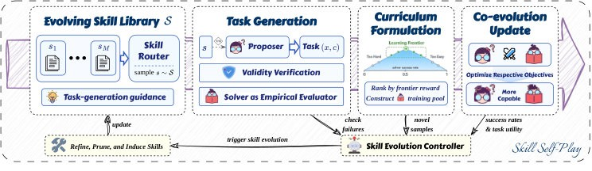
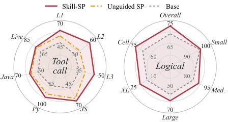
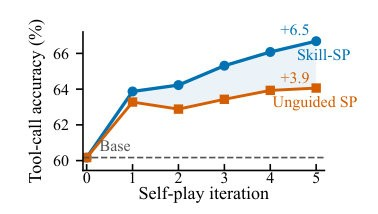
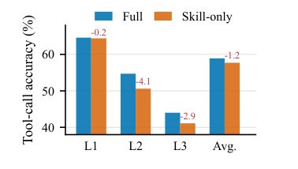
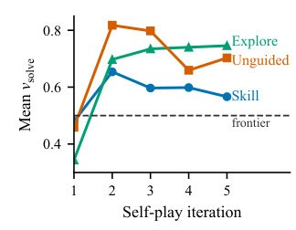
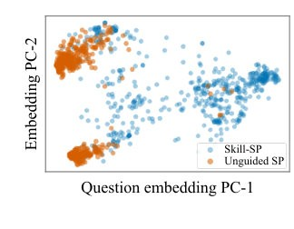
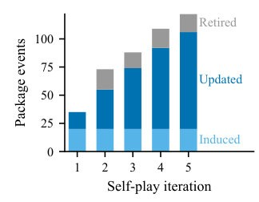
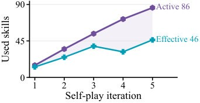

# Skill Self-Play: Proactive Curricula for Self-Evolving Agents

**标题**：Skill Self-Play: Proactive Curricula for Self-Evolving Agents
**作者**：Siyuan Huang，Pengyu Cheng，Haotian Liu，Tao Chen，Yihao Liu，Jingwei Ni，Shijie Zhou，Ziyi Yang，Gangwei Jiang，Mengyu Zhou，Yu Cheng，Xiaoxi Jiang，Guanjun Jiang
**单位**：
1. Qwen Large Model Application Team, Alibaba
2. The Chinese University of Hong Kong
3. Renmin University of China
4. Sun Yat-sen University
5. Peking University
6. University of Zurich

> **一句话导读**：本文提出 **Skill-SP** 框架，通过动态演化的模块化技能库来引导任务提议器，解决了大模型自我进化中任务多样性与验证可靠性的矛盾，在 4B 模型上将工具调用平均准确率提升至 66.7%。

## 三句话看懂
- **问题**：现有的自我进化方法陷入了两难困境：依赖固定环境的方法局限于狭窄领域，而开放式自生成则缺乏可靠验证，容易产生误导性噪声。
- **方法**：本文提出 **Skill-SP**，利用动态演化的技能库作为任务接口，协同优化提议器、求解器和技能控制器，实现主动的课程生成与严格验证。
- **结果**：在工具调用和逻辑推理任务上，**Skill-SP** 带来了显著的性能突破，其中 Ministral-3-8B 在工具使用上取得了高达 **+42.9** 点的绝对增长。

## 为什么要做这件事
大模型的训练正在从人工设计和标注转向交互驱动的自我进化。自我对弈（Self-play）作为其中的核心技术，通常高度依赖特定环境来提供精确验证。然而，外部验证虽然确保了准确性，却将智能体的学习限制在狭窄的领域内，无法泛化到更广泛的开放式任务中。为了扩大任务空间，开放式自生成往往缺乏结构化引导，容易合成病态任务或过拟合简单模板，最终导致合成数据崩溃。

如图 1 所示，传统的无引导自我对弈在复杂推理任务上甚至无法合成有效谜题，而本文的方法则能全面拓展模型的边界。

## 核心思路
作者的关键观察在于：智能体的**技能**（Skill）是一个完美的折中媒介。单个技能可以确保在特定场景下进行深入、可验证的执行，而跨技能的动态路由则能保持开放式的任务多样性。这就好比教学生做题不能盲目瞎练，也不能只刷原题，而是要把解题的"题型套路"提炼成可复用的技能模块，再根据学生当前的薄弱环节动态推送难度相当的变式训练。

## 方法怎么做

如图 2 所示，整个框架包含三个核心组件：提议器负责合成挑战任务，求解器学习执行任务，而技能控制器则根据执行反馈持续管理技能库。提议器采样技能生成候选任务，经过严格的结构与契约验证后，高价值任务被送入混合课程池中，同时更新提议器和求解器的策略。

### 技能条件生成与验证
提议器通过动态采样技能库中的技能来进行结构化任务生成，同时保留一部分无约束的开放探索流。生成的任务必须同时满足全局架构合规、契约有效以及多次采样结果一致这三个条件，从而彻底过滤掉噪声和病态任务。

### 求解器与技能库共演化
求解器利用混合边界课程进行策略更新，专门攻克当前能力边缘的任务。同时，技能库本身也在不断演化：系统会通过失败轨迹精炼现有技能、清理过于简单的冗余技能，并从开放式探索中归纳出全新的技能模块。

## 效果如何
本文在 API-Bank、BFCL 工具调用基准以及 ZebraLogic 逻辑推理基准上进行了广泛评估，对比了初始基线模型和无引导自对弈（Unguided SP）方法。

**表 1：工具调用预测主实验结果 (avg@8)**
方法: Qwen3-4B-Ins; API-Bank Avg.=51.4; BFCL Avg.=71.2; Avg.=60.2
方法: 　 + Unguided SP; API-Bank Avg.=54.4; BFCL Avg.=75.4; Avg.=64.1
方法: 　 **+ Skill-SP**; API-Bank Avg.=**58.9**; BFCL Avg.=**75.9**; Avg.=**66.7**

如表 1 所示，在 Qwen3-4B-Ins 上，**Skill-SP** 的平均准确率达到了 66.7，全面优于基线和无引导方法。

如图 3 和图 4 的消融实验所示，去掉技能引导或仅使用单一的技能生成流都会导致性能下降，这证明了双流架构和动态演化的必要性。

如图 5、图 6 和图 7 的数据循环诊断所示，技能流生成的任务稳定维持在求解器的学习前沿，且技能库在迭代中持续活跃。

如图 8 所示，随着自对弈迭代的进行，有效技能数稳步增长，确保了提议器不会陷入单一模式。

## 值得关注的点
这篇论文最大的亮点在于将"技能"作为训练时的结构化接口，成功打通了自我对弈中"多样性"与"可验证性"的死结。对于从事大模型对齐、智能体（Agent）自动化训练以及复杂推理能力提升的研究者来说，这种让提议器和求解器通过动态技能库实现共演化的思路非常具有启发性。不过需要注意的是，该方法依赖基础模型具备一定的初始能力来引导自举，对于完全未对齐的弱模型，可能仍需少量的初始种子数据。

## 读后小结
本文针对大模型自我进化中任务多样性与验证可靠性的冲突，提出了 **Skill-SP** 框架。通过构建动态演化的模块化技能库来协同指导提议器和求解器，该方法在工具调用和逻辑推理任务上取得了突破性效果。最值得记住的一点是，将离散的经验提炼为可复用的技能接口，是实现开放式智能体自主进化的关键路径。

## 科学发现范式

- 主要范式：P01 Gap-Driven Reframing
- 次要范式：P03 Representation Shift & Primitive Recasting, P04 Modular Pipeline Composition
- 分类理由：论文从明确的矛盾出发——在“环境绑定的精确验证”和“开放式自生成功能”之间的缺口，提出将该缺口重构为以技能库为中心的训练约束与接口，典型地属于Gap-Driven Reframing（P01）。同时，作者将散乱执行轨迹重塑为可复用的技能原语，符合Representation Shift（P03）；并以"Proposer"、"Solver"、"Controller"三模块构成可替换的训练流水线，体现Modular Pipeline Composition（P04）。实验证明方法在"Qwen3-4B-Ins"及"API-Bank"、"BFCL"、"ZebraLogic"等数据集/基准上有效。

## 先前工作分析

几篇关键前作在技术细节上为后续方法奠定了明确基础："Self-Instruct" 揭示了自我生成 + 被动过滤管道在规模化自演化时易陷入质量退化的弱点；Shumailov 等对“synthetic data collapse”的分析进一步说明了仅靠后验筛查无法从根本上防止训练回路被误导；与此相对，像 "Absolute Zero" 与 "SPIRAL" 的研究则展示了把验证锚定在可执行环境或模拟器中能够得到高保真反馈，但代价是任务分布被环境边界束缚；在工具调用方向，"API-Bank" 提供了基于 schema 的可执行验证范式，证明了可执行接口在评分与训练中的价值；而 "Introducing Agent" 系统化了“skill”这一可检索、可执行的程序化单元，给出将知识封装成模块以供路由和复用的明确设计。综观这些工作，可以清晰看到一个未被充分解决的机会：如何在保持严格可验证执行（以防训练噪声累积）的同时，不因外部环境或模板束缚而丧失任务多样性。基于上述洞见，Skill-SP 自然提出把“技能”提升为训练时的主动接口：用技能为提议器预先注入结构化约束以提高生成质量，同时把技能自身作为可执行的验证器与记忆单元在提议器、解算器和控制器之间共同进化，从而在验证可靠性与开放式探索之间架起一座可持续的桥梁。
