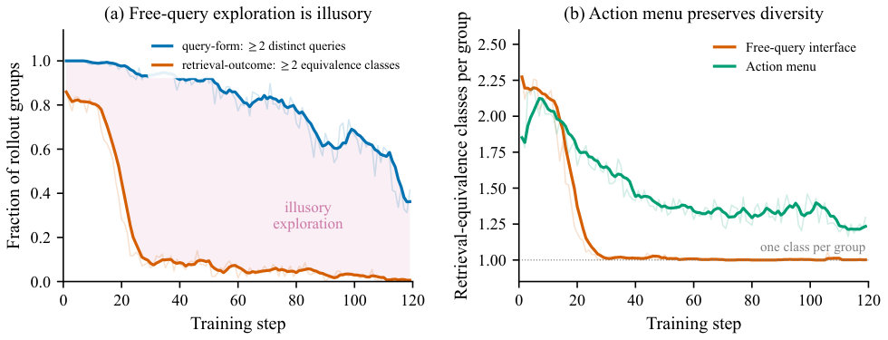
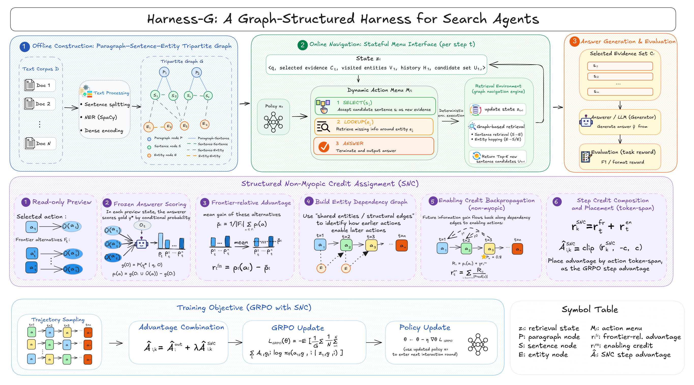

# Harness-G: A Graph-Structured Harness for Search Agents

> **核心主张**：自由格式的检索查询在强化学习（RL）搜索代理训练中会产生“表面多样性但检索结果趋同”的别名问题（retrieval-equivalence collapse），这削弱了基于组内比较的信用分配。通过将检索动作重新定义为在一个段落—句子—实体图上的有限离散选择，并在同一决策前沿（frontier）上对可选项进行显式预览和打分（Structured Non-myopic Credit，SNC），可以恢复有效的检索对比并显著提升多跳/开放域问答的最终性能。

## 1. 问题背景

### 1.1 现有方法的局限
- 研究背景：近年 RL 搜索代理（如 "Search-R1"）把检索表述为自由格式自然语言查询，由策略直接生成查询字符串并以最终答案的回报优化整个多回合交互。  
- 观测到的问题（具体、量化）：
  - 策略在同一问题上会生成大量表面不同的查询（高 query-form diversity），但这些轨迹最终累积到的证据集合高度重叠（低 retrieval-outcome diversity）。在 Search-R1 的训练中，按训练步数观测到：一开始约 $86\%$ 的 rollout 组跨越多个检索等价类，但到训练步 $30$ 时降到不到 $10\%$，说明所谓“探索”多数是语表层的多样性，而非有效的检索差异化。
  - 这导致两类直接损害基于组比较的优化（如 GRPO）：
    - 消失的优势（vanishing within-group advantages）：当不同轨迹检索到相同证据时，它们通常会得到相同或非常相近的最终回报，组内优势趋近于零，无法提供有区分力的学习信号。
    - 棘手的检索归因（confounded retrieval credit）：当检索结果相同但答案不同，回报差异更多地来自下游推理或生成噪声，把回报归因到检索动作会产生误导性梯度。  
- 我们把这一现象命名为 **retrieval-equivalence collapse**（检索等价性坍缩）。此问题并非单纯可通过更细粒度的回报（process rewards、信息增益）解决，因为它源于“动作-环境接口”的多对一映射（多个查询字符串映射到相同检索结果）。

### 1.2 本文瞄准的缺口
- 缺口描述：现有方法主要在奖励或信用分配层面改进（更密、更细的奖励），但很少质疑策略看到的“动作空间”是否恰当——即策略是否能在同一决策状态面对明确且可比较的可行替代项。自由生成的查询字符串导致语义别名（aliasing），从而破坏组内对比学习的基础。
- 本文目标：将检索动作从自由文字生成重构为“有限、可验证且可预览”的离散选择（选择句子/实体/回答）——通过改变接口而非仅改进奖励，来恢复同状态下对比的有效性，并据此设计新的结构化非短视信用分配方法（SNC）。

## 2. 贡献
**类型**：方法改进型

核心贡献（2-4 条）：
- 提出并量化了 **retrieval-equivalence collapse**：通过对 query-form diversity 与 retrieval-outcome diversity 的比较，展示了自由查询接口如何在训练过程中产生虚假的表面探索，从而削弱组相对优化的效果。
  - 解决的问题：揭示了动作空间设计对 RL 搜索代理优化的基础性影响；  
  - 做法：定义基于累积证据集合重叠的检索等价类并追踪其随训练的变化，给出实证证据（例如组跨类比例从 $86\%$ 降到 $<10\%$）。
- 设计 **Harness-G**：将检索重构为基于程序化构建的段落—句子—实体图上的有限动作选择（`Select` / `Lookup` / `Answer`），并由环境负责确定性地构建查询与更新状态，从而消除字符串到检索结果的多对一别名。
  - 解决的问题：消除自由查询产生的语义别名，使同一状态下的可行动作显式、可预览、可验证，从而恢复有效的同态比较。
- 提出 **Structured Non-myopic Credit (SNC)**：在 Harness-G 的前沿（frontier）上，用冻结的答案评分器 $g$ 对被选动作与可选替代进行比较（frontier-relative credit），并沿轨迹的可证明依赖（provenance edges）将下游增益回溯赋予使能早期动作（enablement credit）。
  - 解决的问题：既提供局部的同态动作比较以获得即时区分信号，又把延迟的“桥接”贡献回溯到早期动作，改善非短视（non-myopic）的信用分配。

## 3. 方法

### 3.1 核心思路
- 直觉：自由生成查询会带来大量“语言层面”的噪声，使得不同轨迹看似探索了不同方向，但检索结果常常相同。若将策略的每一步决策限定为“从当前检索状态可选的有限菜单中选一个显式项”，那么策略的不同选择将更直接对应不同的检索结果，从而使基于组比较的 RL 能够真正区分好坏动作。
- 为什么这样做是对的：
  - 显式菜单减少语言别名（linguistic aliasing）：相同检索意图不会被不同字符串所掩盖。
  - 可预览性（preview）允许在策略选择前评估替代项的潜在贡献，支持更可靠的同态比较（frontier-relative）。
  - 确定性执行 + 去重保证环境对选择的响应一致，减少下游回报中与检索无关的方差。

### 3.2 方法细节
- 环境与图结构：
  - 离线构建一个 **段落—句子—实体（paragraph–sentence–entity）图**，节点类型对应文章段落、其中的句子与抽取到的实体，边表示来源/引用/实体出现在某句等关系。
  - 在线环境维护检索状态 $s_t$（已采纳的证据句集合、已访问实体等），并基于 $s_t$ 构造一个去重的、有界动作菜单 $\mathcal{A}_t$。每个动作属于三类之一："`Select`"（采纳某证据句子）、"`Lookup`"（跟踪某实体以展开新证据）或 "`Answer`"（终止并生成答案）。
  - 对于菜单中的每个条目，环境可返回一个“只读预览（preview）”，例如候选句子的摘要或与之关联的段落上下文，用于后续 SNC 评分。
- 策略和执行：
  - 策略 $\pi_\theta(a_t\mid s_t)$ 在每个时间步从有限集合 $\mathcal{A}_t$ 中采样动作，环境验证并**确定性地**执行该动作（包括重复过滤），并返回下一个状态 $s_{t+1}$ 及最终答案（如动作为 `Answer`）。
  - 这一设计把“如何构造检索查询”的责任交给环境，使策略只负责语义决策（选择哪个证据或实体）。
- Structured Non-myopic Credit（SNC）：
  - 冻结答案评分器 $g(\cdot)$：预训练或冻结的答案打分器用于对“如果在当前状态选择某个候选动作并据此回答”的潜在答案质量进行评价。
  - Frontier-relative credit（同态比较）：在时间步 $t$，对被选动作 $a_t$ 与同一菜单其他动作 $a'\in\mathcal{A}_t$ 使用 $g$ 给出局部优势估计，例如：
    $$
    A_t^{\text{frontier}}(a_t) \approx g(s_t, a_t) - \max_{a'\in\mathcal{A}_t\setminus\{a_t\}} g(s_t, a').
    $$
  - Enablement credit（使能回溯）：如果后续某一步 $t+k$ 的选择导致了显著的下游收益增益，则沿着图的溯源边（provenance edges）把这部分增益按路径分配给早期使能动作（例如把后续回报按权重分配到那些构成该后续成功的前置节点）。
  - 与策略更新：将 SNC 得到的逐步优势 $A_t^{\text{step}}$ 与最终答案的 outcome advantage $A^{\text{outcome}}$ 结合，用于组相对策略更新（如 GRPO）。一个常用的组合形式是：
    $$
    A_t = A^{\text{outcome}}_t + \lambda A_t^{\text{step}},
    $$
    其中 $\lambda$ 权衡局部步级信用与最终回报。
- 设计要点与实现注意：
  - 环境确定性和去重是关键，以避免别名再度产生。
  - 菜单大小受限以保障策略可学习性与交互效率。
  - SNC 使用的 $g$ 是**冻结**的，避免循环自增强导致偏移；enablement credit 基于图的可解释性（provenance）来追溯贡献，而非简单的时间折扣。

## 4. 实验与结果
- 评测设置：
  - 数据集：在六个覆盖多跳和开放域 QA 的基准上评估（文中未列出每个名字于摘要，但为主流多跳/OD-QA 集合）。
  - 对比方法：与保留图结构但仍使用自由查询的 Graph-R1，以及其他强化学习与信用改进方法（IGPO、StepSearch、Tree-GRPO 等）比较；同时做门控对比以隔离菜单接口与 SNC 的贡献。
  - 模型规模：在 1.5B 与 3B 参数规模上评估，控制模型族与 RL 算法（主要 GRPO 或其变体）。
- 主要结论（对应实验的 claim）：
  - 整体性能：**Harness-G 在六个基准上的平均 F1 最高**。与最强基线 Graph-R1 相比，在 1.5B 规模上平均 F1 提升 $+10.74$ 点，在 3B 规模上提升 $+3.98$ 点。  
    - 这支持主张：动作接口重构带来的对比信号改善，能转化为显著最终表现提升。
  - 消融/对照试验（验证组件贡献）：
    - 把环境与转移固定、仅改变策略是否通过菜单直接选择或通过自由查询到同一目标：菜单选择在相同转移设置下能保留更多检索-区分性，证明接口本身就能防止 retrieval-equivalence collapse（验证了方法设计的因果性）。
    - 单独移除 SNC（仅菜单）或将菜单与传统最终回报一起用：两者都有收益，但完整系统（菜单 + SNC）表现最好，表明 SNC 的 frontier-relative 与 enablement credit 实际带来额外可学习信号。
  - 稳定性与泛化：
    - 在不同数据集与 RL 算法下表现稳健，交互效率更高（即更少的样本/步骤达到相同或更好性能），在 O.O.D. 设置下转移能力也优于基线（文本中指出“更强迁移”）。
- 实验结论映射到论文主张：恢复同态动作比较（通过菜单）减少语义别名并恢复有效的 within-group advantages；SNC 提供的即时与延迟信用一起提升策略学习，最终反映在 F1 的提升上。

## 5. 局限与边界
- 作者明确不解决或仍有局限的地方：
  - 方法仍为 **文本唯一路径（text-only）**：Harness-G 的图结构与 SNC 设计当前仅在文本证据上实现，尚未扩展到多模态证据（图像、视频等）。
  - 依赖于图构建质量：段落—句子—实体图是离线构建的，其覆盖率与准确性会影响菜单质量与后续性能；若图构建出现错误或实体抽取不充分，性能可能下降。
  - 冻结答案评分器 $g$ 的偏差：SNC 依赖 $g$ 的评估来进行 frontier-relative 比较，若 $g$ 偏差较大，可能引入系统性引导误差（作者选择冻结以避免循环偏移，但这也限制了评分器自适应能力）。
  - 菜单规模与计算成本：虽然菜单受限，但对于超大语料库或低延迟要求的在线设置，构建和预览所有候选项可能带来实用成本。
- 可见拓展方向：将结构化动作与 SNC 扩展至多模态证据空间，改进图构建与评分器适配策略，以降低对离线资源与评分器质量的依赖。

--- 

总体而言，论文通过识别并量化检索别名带来的训练陷阱，提出了从动作接口入手的修复方案（Harness-G）与与之配套的信用分配机制（SNC），并在多基准上展示了实质性的性能提升，强调动作空间设计与奖励设计同等重要。

## 科学发现范式

- 主要范式：P01 Gap-Driven Reframing
- 次要范式：P03 Representation Shift & Primitive Recasting
- 分类理由：论文从实证缺口出发——发现并量化了“检索等价崩溃”（retrieval-equivalence collapse），并不是单纯改进奖励而是通过重构策略—环境接口来解决：将自由文本查询重述为基于段落—句子—实体图的有限动作选择（"Harness-G"），并借此设计结构化非短视信用分配（"SNC"）。这一思路典型地把观察到的限制转化为新的问题表述与约束，符合P01 的核心——Gap-Driven Reframing。作为次要模式匹配P03：方法实质上改变了检索的核心原语（把自由查询表示重铸为图上离散选择），即通过表示/原语转换（paragraph–sentence–entity graph）使问题几何与计算性更易处理（同时对比了"Graph-R1"和"Search-R1"基线并在"六个问答基准"上验证）。

## 先前工作分析

既有工作确立了三条互补的技术脉络。第一，诸如 "Search-R1" 的自由查询强化学习搜索智能体，以及 "Graph-R1" 这类交互式图智能体，将训练 LLM 生成自然语言查询并以结果奖励优化多轮检索这一过程操作化，从而定义了默认的策略—环境接口以及多对一的查询→检索映射。第二，面向更细粒度信用分配的方法（如 "Tree-GRPO"）和组相对优化（"GRPO"）发展了轨迹分组与步骤对比机制，以对抗稀疏的最终奖励，凸显了算法层面的信用分配技术，但仍作用于相同的别名化查询动作。第三，离散导航与图检索工作——以用于 KG 路径导航的 "MINERVA" 和 "GraphRAG" 等语料图系统为代表——表明有限、可验证的动作集与程序化证据图能够实现透明的状态转移，并为下游信用分配建立溯源关联。综合来看，这些脉络揭示了一个缺口：仅靠更密集的信用分配无法修复动作接口中的结构性别名化。这一组合自然提示，将自由形式查询转换为段落—句子—实体图上的显式、有界菜单选择，然后利用由此产生的同状态前沿来计算局部对比与延迟使能信号。因此，"Harness-G" 将基于图的证据基础、离散动作启发与 GRPO 式分组综合起来，用有限的 "Select/Lookup/Answer" 选择替代别名化查询动作，并引入 "Structured Non-myopic Credit" (SNC) 来比较并回溯奖励使检索得以实现的步骤——从而使接口设计本身成为提升检索信用分配有效性的杠杆。
