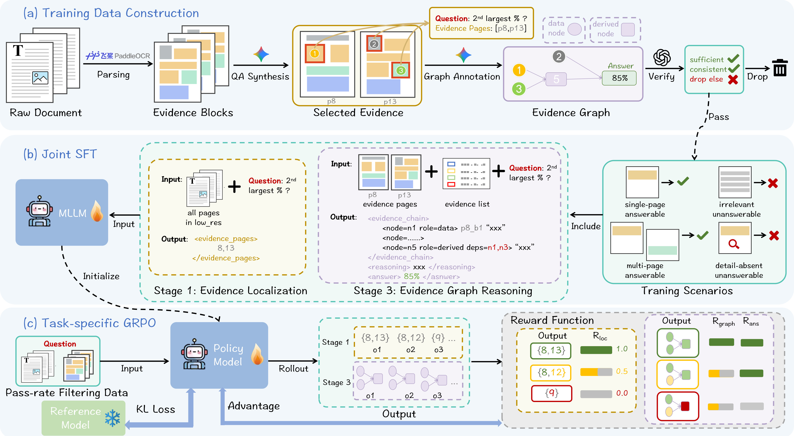
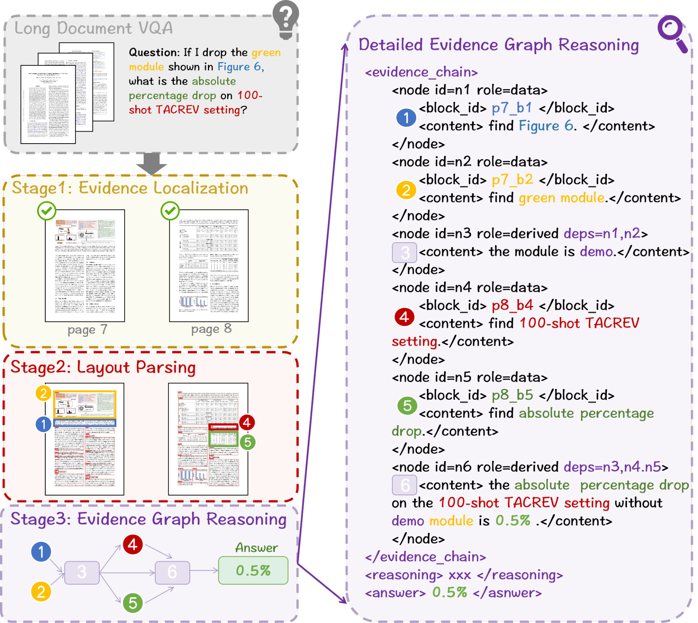
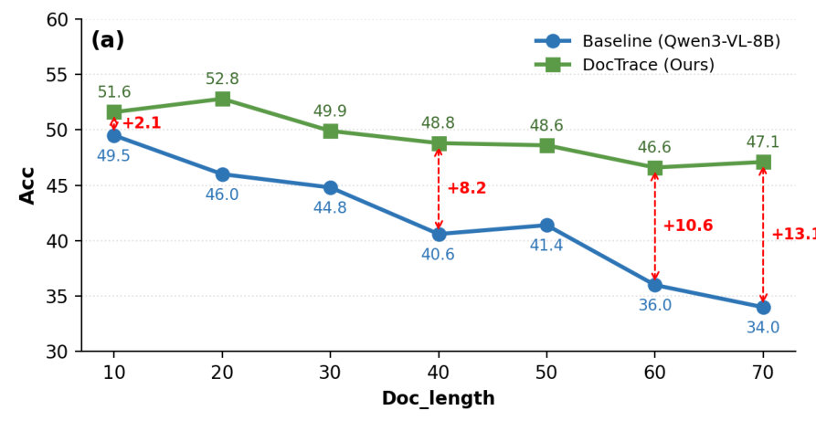

# DocTrace: Towards Traceable Long Document VQA via Hierarchical Evidence Graph Reasoning

> **一句话导读**：本文提出了一种名为 DocTrace 的层次化框架，通过显式的证据图推理来解决长文档视觉问答（LongDocVQA）问题，实验结果表明，DocTrace 在 MMLongBench-Doc 数据集上准确率达到 **52.9**，相比于基线模型 Qwen3-VL-8B-Instruct 提升了 **14.4** 个百分点。

## 论文速览
- **研究问题**：长文档视觉问答（LongDocVQA）需要多模态大语言模型（MLLMs）在多个页面中定位、整合和推理异构文档元素，但现有方法缺乏显式的证据表示和验证机制。
- **核心方法**：DocTrace 将 LongDocVQA 视为显式证据图推理问题，采用层次化框架逐步进行证据定位、结构化文档解析和证据图推理。
- **主要结果**：在 MMLongBench-Doc、LongDocURL 和 SlideVQA 数据集上，DocTrace 分别在准确率上提升了 **14.4**、**11.3** 和 **11.7** 个百分点，显示出其优越的性能。
- **一句话评价**：DocTrace 不仅在准确性上超越了现有的开源基线和专有模型，还提供了可追溯的证据图，使推理过程透明且可验证。

## 研究背景与问题
长文档视觉问答（LongDocVQA）任务要求模型能够处理包含文本、表格、图表等多种元素的长文档，并在这些元素中进行有效的证据定位和推理。现有的 LongDocVQA 方法主要分为三类：端到端的多模态大语言模型（MLLMs）、检索增强生成（RAG）管道和基于代理的框架。然而，这些方法普遍存在一个问题，即缺乏显式的机制来表示和验证证据的逐步组合过程，导致答案的准确性和可追溯性受到限制。

例如，现有的端到端 MLLMs 通常在隐含表示中聚合相关证据，使得用户难以检查每个证据对最终预测的贡献。而检索增强的方法虽然提高了效率，但仍然将检索到的证据视为无序的上下文，未能明确建模证据在推理过程中的组合方式。基于代理的方法虽然通过迭代工具使用暴露了中间动作，但其推理过程仍然是轨迹导向的，未能显式表示已知证据之间的依赖关系。

人类专家在处理长文档推理时，通常会逐步缩小搜索空间，并将证据组织成显式的推理结构。这种推理过程遵循一种层次化的粗到细的工作流程：证据定位、结构化解析和证据组合。因此，作者提出将证据组合视为显式的推理对象，而不是隐藏在潜在模型表示中，从而提高推理的透明度和可验证性。

## 核心思路
作者的关键观察是，现有的 LongDocVQA 方法未能有效地建模证据之间的依赖关系，导致推理过程缺乏透明度。为了解决这一问题，作者提出了 DocTrace，一个层次化框架，逐步执行证据定位、结构化解析和证据图推理。DocTrace 的设计理念是通过显式组织证据，构建可追溯的推理图，从而实现可扩展的多跳推理和节点级证据来源追踪。

具体而言，DocTrace 通过三个阶段来实现这一目标：首先，从低分辨率的文档图像中定位与问题相关的证据页面，减少推理空间；其次，将选定页面解析为具有语义和空间信息的结构化布局元素；最后，构建一个显式的证据图，模型中间推理依赖关系，并通过完整的节点级证据来源推导出最终答案。

## 方法详解
### 整体框架
DocTrace 的整体流程包括三个主要阶段：证据定位、结构化文档解析和证据图推理。输入为低分辨率的文档图像和问题，输出为最终答案及其对应的证据图。每个模块的分工如下：

1. **证据定位**：从低分辨率文档中预测相关证据页面，减少后续处理的搜索空间。
2. **结构化文档解析**：对定位的页面进行高分辨率解析，提取出结构化的布局元素。
3. **证据图推理**：构建证据图，明确模型如何将证据组合以得出最终答案。

如图 1 所示，DocTrace 的推理过程清晰地展示了从输入到输出的各个步骤。

### 证据定位
在第一阶段，DocTrace 通过对低分辨率文档图像和问题 $Q$ 的处理，预测一组证据页面索引 $\mathcal{P}_{\mathrm{evid}}$。这一过程的目标是显著减少后续推理的搜索空间，同时保留与问题相关的信息。具体的预测过程可以表示为：

$$
\mathcal{P}_{\mathrm{evid}} = f_{\theta_{\mathrm{loc}}}(D_{\mathrm{low}}, Q)
$$

其中，$D_{\mathrm{low}}$ 是低分辨率文档图像，$f_{\theta_{\mathrm{loc}}}$ 是证据定位模型。

### 结构化文档解析
在第二阶段，DocTrace 对定位的证据页面进行高分辨率处理，使用文档解析模型（如 PaddleOCR-VL-1.5）提取出细粒度的布局元素。每个元素被表示为：

$$
b_i = (t_i, \mathbf{x}_i, c_i)
$$

其中，$t_i$ 表示语义类型（如文本、表格、图形或图表），$\mathbf{x}_i$ 是其边界框，$c_i$ 是提取的内容。这些解析出的元素形成一个证据池 $\mathcal{B} = \{b_1, b_2, \ldots, b_M\}$，作为后续图推理的基本证据单元。

### 证据图推理
在第三阶段，DocTrace 明确构建一个证据图 $G=(V,E)$，其中每个节点对应于 $\mathcal{B}$ 中的一个证据块或一个中间推理结果，而每条有向边表示推理依赖关系。推理过程可以表示为：

$$
P(A,G \mid \mathcal{B}, Q) = P(G \mid \mathcal{B}, Q) P(A \mid G, Q)
$$

这里，模型首先构建证据图，然后基于该图生成最终答案。由于每个推理步骤都明确基于文档证据，生成的图自然提供了节点级的证据来源，便于答案的验证。

### 学习 DocTrace
#### 训练数据构建
现有的 LongDocVQA 基准仅提供问题-答案对，无法直接监督证据定位或证据图推理。为了解决这一监督缺口，作者自动构建了结构化的监督数据，包括证据页面和证据图。具体而言，训练样本被分为四种代表性场景：单页可回答、多页可回答、无关不可回答和缺乏细节的不可回答。这一分类涵盖了证据组合和校准拒绝行为。

#### 联合监督微调（SFT）
使用生成的语料库，DocTrace 通过多任务 SFT 联合优化证据定位和证据图推理。给定低分辨率文档页面，模型预测证据页面索引；给定定位的高分辨率页面及其解析的布局元素，模型学习生成证据图及最终答案。这一阶段为后续的 GRPO 对齐提供了强有力的初始化。

### GRPO 对齐
尽管联合 SFT 提供了强有力的初始化，但无法完全优化证据定位和图推理。因此，作者进一步使用任务特定的 GRPO 目标对 DocTrace 进行对齐：第一阶段优化证据页面定位，第三阶段联合优化证据图生成和最终答案预测。

#### 定位奖励
由于页面定位是有序的而非二元的，距离真实页面越近的预测应获得更高的奖励。为此，作者采用了距离感知的软 $F_{\beta}$ 奖励，给予接近的预测部分信用。具体的奖励计算公式如下：

$$
R_{\text{stage1}} = \frac{(1+\beta^2)\mathrm{Prec} \cdot \mathrm{Rec}}{\beta^2 \mathrm{Prec} + \mathrm{Rec}}
$$

其中，$\beta$ 控制精确度与召回率的权衡。

#### 图的可信度奖励
为了优化生成的证据图，作者联合评估证据的基础、图的完整性、结构有效性和依赖拓扑。最终的奖励公式为：

$$
R_{\mathrm{graph}} = w_h R_{\mathrm{hit}} + w_c R_{\mathrm{comp}} + w_s R_{\mathrm{struct}} + w_t R_{\mathrm{topo}}
$$

#### 答案正确性奖励
答案奖励优化最终预测的正确性，具体公式为：

$$
R_{\mathrm{answer}} = \alpha R_{\mathrm{exact}} + (1-\alpha) R_{\mathrm{llm}}
$$

## 实验结果

### 实验设置
本文在三个长文档基准上评估 DocTrace：**MMLongBench-Doc**（135 个文档，平均 47.5 页，1,082 个问题）、**LongDocURL**（396 个文档，最多 150 页，2,325 个 QA 对）和 **SlideVQA**（2,215 个问题，跨 20 页文档）。评估指标包括 MMLongBench-Doc 和 LongDocURL 的准确率，以及 SlideVQA 的 F1 分数。

### 主要结果
**表 1：三个长文档理解基准上的性能比较（准确率和 F1）**

| 方法名 | MMLongBench-Doc (Acc) | LongDocURL (Acc) | SlideVQA (F1) |
|--------|------------------------|-------------------|----------------|
| Qwen3-VL (Baseline) | 38.5 | 45.1 | 73.4 |
| **DocTrace (SFT)** | 50.3 (+11.8) | 53.2 (+8.1) | 83.8 (+10.4) |
| **DocTrace (GRPO)** | **52.9** (+14.4) | **56.4** (+11.3) | **85.1** (+11.7) |

如表 1 所示，DocTrace 在所有三个基准上均表现优异，尤其在 MMLongBench-Doc 上达到了 **52.9** 的准确率，超越了最强的开源方法 MM-Doc-R1（49.7）和专有模型 GPT-4.1（45.6）。

### 消融与分析
#### 核心组件的影响
通过消融实验，去掉结构化解析或证据图推理均会导致性能下降，准确率分别降至 46.6 和 47.2。这表明结构化表示和显式证据图推理对于整合长文档中的分散证据至关重要。

#### 与 Vanilla CoT 的比较
将证据图推理替换为传统的链式推理（CoT）模型，准确率为 47.8，尽管在单页问答上略有提升，但在多页问题和不可回答问题上的表现均不如 DocTrace。

## 局限与思考
尽管 DocTrace 在长文档推理中表现出色，但仍存在一些局限性。首先，训练数据的构建依赖于自动生成的证据页面和图，这可能导致监督信号的质量不均。其次，尽管 DocTrace 提供了可追溯的证据图，但在复杂的推理任务中，如何有效地整合和利用这些证据仍然是一个挑战。此外，DocTrace 的性能在特定的文档结构和内容上可能表现更好，而在其他类型的文档上可能不如预期。

## 总结
本文提出了 DocTrace，一个通过显式证据图推理来解决长文档视觉问答问题的层次化框架。通过联合 SFT 和任务特定的 GRPO 训练，DocTrace 在多个长文档基准上取得了优异的性能，尤其在 MMLongBench-Doc 上达到了 **52.9** 的准确率。最值得记住的一点是，DocTrace 不仅提高了答案的准确性，还提供了透明和可验证的推理过程。

## 科学发现范式

- 主要范式：P01 Gap-Driven Reframing
- 次要范式：P03 Representation Shift & Primitive Recasting
- 分类理由：论文将LongDocVQA视为显式的证据图推理问题，重新框定了问题陈述，强调了证据的逐步组合和可追溯性，符合'Gap-Driven Reframing'的模式。同时，论文中提到的结构化文档解析和证据图推理涉及到对核心表示的改变，符合'Representation Shift & Primitive Recasting'的模式。

## 先前工作分析

"DocTrace" 的发展受到若干应对 "Long Document Visual Question Answering (LongDocVQA)" 挑战的关键先前工作的显著影响。例如，"Tito et al." 提出的 "hierarchical evidence graph reasoning" 直接启发了 "DocTrace" 中的 "explicit evidence graph framework"，使其能够以结构化方式进行推理。此外，"Yu et al." 在其 "Visual RAG" 工作中指出的无序证据检索局限，促使需要显式证据组合，而这正是 "DocTrace" 的核心创新。再者，基线方法 "mPLUGDocOwl" 虽然有效，但缺乏对证据依赖关系的显式建模，而 "DocTrace" 旨在纠正这一点。"Guo et al." 提出的 "Group Relative Policy Optimization" 基础训练方法对于优化 "DocTrace" 的证据推理能力至关重要。最后，"Wang et al." 关于基于智能体的文档交互的洞见，以及 "Liu et al." 关于 "LongDocVQA" 挑战的洞见，共同强调了更透明、可验证推理过程的必要性，而 "DocTrace" 成功解决了这一问题。总体而言，这些工作揭示了 "DocTrace" 所利用的空白与机会，使其成为文档理解领域的自然进展。
