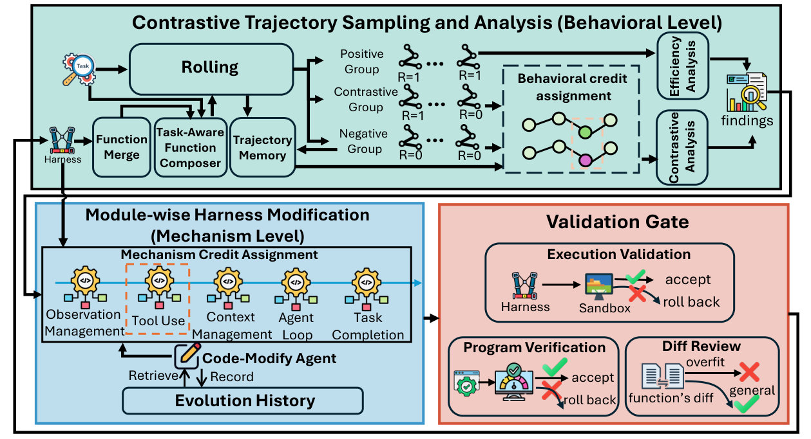
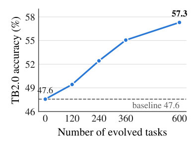

# ModularRSI: Modular and Generalizable Recursive Harness Self-Improvement

> **一句话导读**：本文把智能体执行框架（harness）的递归自我改进重新表述为"机制级 + 行为级"的两级信用分配问题，用五个功能模块的独立进化与同任务内成功/失败轨迹对比来定位可迁移的改进，在 TerminalBench 2.0 上把 DeepSeek-V4-Flash-Preview 的准确率从 47.57% 提升到 52.43%。

## 论文速览

- **研究问题**：如何让智能体执行框架（agent harness）的递归自我改进（Recursive Self-Improvement, RSI）产生可迁移的机制级改进，而不是对下游 benchmark 的特定适配？
- **核心方法**：把 harness 拆成 Agent Loop、Tool Use、Observation Management、Context Management、Task Completion Detection 五个模块，各自独立进化；模块内对同一任务的成功/失败轨迹做对比分析，跨任务聚合证据筛选反复出现的缺陷，改动须通过三道验证门，最后做一轮跨模块集成。
- **主要结果**：在 DeepSeek-V4-Flash-Preview 上，TerminalBench 2.0 准确率从 47.57% 提升到 52.43%，SWE-Bench-Verified 从 73.40% 提升到 76.40%；跨域与跨模型迁移仍有约 2%~5% 的增益，例如 GLM-5.2 从 59.55% 到 61.80%、MiniMax-2.5 从 41.57% 到 44.94%。
- **一句话评价**：最有价值的发现不是那几个点的提升，而是"扩大自我修改空间反而让性能低于不进化基线"（联合全模块进化 44.19% 对基线 47.57%），这为 harness RSI 的设计提供了一个反直觉但证据清晰的约束。

## 研究背景与问题

命令行智能体（CLI agent）在复杂软件工程与终端操作任务上已经取得可观成绩。真正决定其表现的，除了基础模型本身，越来越多地取决于位于模型与环境之间的执行框架（harness）——它负责控制执行流程、调用工具、管理上下文、处理环境反馈。既然 harness 本质是一段可被修改的代码，一个自然的想法就是让智能体从自己的执行经验出发去改写这段代码，也就是 harness 的递归自我改进（RSI）。

问题在于，现有做法大多把进化直接放在下游 benchmark 或由其派生的子集上。Meta-Harness、AHE、HarnessFix 一类方法在评测任务的分布内反复迭代，性能当然会涨，但很难说清涨的是"可迁移的执行机制改进"还是"对这个 benchmark 的适配"。本文把这当作核心诊断：通用 harness RSI 的难点不是能否在进化经验上变好，而是变好的东西是否可复用。

即便把进化数据与评测数据分开，监督信号本身也太粗。一条轨迹的成败同时纠缠了三件事：harness 的系统性缺陷、任务特有的推理决策、以及随机性导致的偶发失败；而任务级的二值奖励只告诉你"这条没做成"，不告诉你"是 harness 的哪个函数做错了"。另一方面，若把整个 harness 当成一个整体去改，一次更新会同时动到互不相关的机制，即使整体指标变好，也无法判断是哪一处改动起了作用。

因此作者把通用 harness RSI 明确表述为一个**两级信用分配（credit assignment）问题**。第一级是**机制级信用分配**：一旦识别出可复用的缺陷，改动必须落到负责该行为的组件上，而不是无差别地修改整个框架。第二级是**行为级信用分配**：必须对执行轨迹做比较和聚合，把反复出现的 harness 缺陷从任务特定决策与随机失败中分离出来。作者指出，HarnessFix 改善了从轨迹中定位失败的能力，但没有把缺陷显式指派给对应的机制；AHE 虽然识别出功能上不同的组件，却仍在联合的 harness 级流程里进化它们，机制级归因只做了一半。

## 核心思路

论文的中心假设只有一句：可迁移的 harness 自我改进取决于信用分配的**精度**，而不是自我修改**空间的大小**。这直接反驳了"让 agent 能改更多代码，它就会变得更强"的直觉——在 benchmark-disjoint 的设定下，可修改范围越大，每次改动与结果之间的因果链就越长，信用分配反而越模糊。

从这个假设出发，两个约束是正交的，分别对应两级信用分配。机制级上，把 harness 切成五个功能内聚的模块，每条进化线只能改自己那一块，修改的搜索空间被压缩，缺陷与改动之间形成近似一一对应的关系。行为级上，在模块内部对**同一个任务**的成功轨迹与失败轨迹做对比——任务难度、领域知识、评测器都相同，剩下的差异才更可能归因于 harness 的行为；再把跨任务的诊断按支持它的任务数聚合，只有反复出现的缺陷才进入修改队列。

这个思路有一个可检验的推论，也是全文最有意思的地方：若假设成立，"能改更多"的对照组应该**更差**，而不只是提升更少。实验确实如此——在匹配轨迹数与进化轮次后，联合全模块进化把 TerminalBench 2.0 准确率压到 44.19%，非模块化的整框架进化压到 46.44%，两者都低于完全不进化的 47.57%，而模块受限进化提升到 52.43%。作者据此写道，在 benchmark-disjoint 的 harness RSI 中，修改系统更多部分的能力可能"增加信用分配的歧义，而不是改善适配"。

## 方法详解

### 整体框架

ModularRSI 的输入是一个已有的 harness（本文用 Harbor 框架下的 Terminus-2）、一批可执行的进化任务，以及一个充当"代码修改智能体（Code-Modify Agent）"的模型；输出是一个进化后的、函数库已冻结的 harness。流程分两大段：先做**模块受限进化**，从同一个初始 harness 出发，五个功能模块各自独立进化成五条 lineage，彼此不共享中间更新；再做**跨模块集成**，把验证过的模块变体组合成统一 harness 并消解冲突。

每条 lineage 内部是一个三阶段循环。第一阶段做对比轨迹采样与分析，从执行证据中识别行为缺陷；第二阶段做模块级 harness 修改，把诊断结论转成局限在目标模块内的函数级改动；第三阶段是验证门，筛掉不可执行或不可泛化的修改。整个过程中 Code-Modify Agent 既是分析者也是改写者，它按批处理证据，编辑范围被硬性限制在目标模块。由于五条 lineage 互不依赖，它们可以并行推进。

预算上，每个模块进化 3 个 epoch，五个模块加一轮跨模块集成 epoch，合计 16 个 epoch 的聚合进化预算；所有对照方法都在这个聚合预算下对齐。实现细节上，进化使用 DeepSeek-V4-Flash-Preview，TPM 限制 200 万 token，批大小为 10，从 2000 个进化实例中按 TB 相关与 SWE 相关两个子集各取 120 个。

### 五个功能模块的切分

作者基于对 harness 实现与执行轨迹的分析，把 Terminus-2 中直接中介智能体—环境交互的行为机制重组为五个模块。**Agent Loop** 控制"推理—行动—观察"循环，包括执行流、交互控制与恢复行为；**Observation Management** 保留任务相关的环境反馈、过滤或压缩噪声观察；**Tool Use** 管理工具的选择、调用与校验；**Context Management** 通过信息保留、压缩与检索维护交互历史；**Task Completion Detection** 判断任务是完成还是需要继续交互。沙箱初始化、并行执行、LLM 通信等基础设施被明确排除在进化范围之外。

这个切分不是随意的功能罗列，而是为信用分配服务的。每个模块定义一个独立的功能域，模块之间有明确的函数接口，运行时由 Agent Loop 协调其余模块并构造给 LLM 的提示。当一个诊断被判定为"观察被截断导致信息丢失"时，它只会被送进 Observation Management 那条 lineage，而不会顺手改掉工具校验逻辑。这就把"改在哪里"从一句空话变成了一个受限的选择题。

与 AHE 的差别正在这里：AHE 也承认 harness 内部功能有别，但它的进化仍在联合的框架级流程中发生，模块边界没有转化为修改边界。本文的做法是把模块边界同时用作**归因单元**和**修改单元**，这也是后续消融中模块化带来最大差异的原因。

### 对比轨迹分析：把成败差异变成可归因证据

对每个进化实例 $x_i$，系统采集 $K$ 条轨迹，任务自带的评测器给每条轨迹一个二值奖励 $r_i^k \in \{0,1\}$，取 $1$ 表示成功。据此把任务分成三组：全部 $K$ 次都成功的为 **Positive** 组，部分成功部分失败的为 **Contrastive** 组，全部失败的为 **Negative** 组。此外还有一个**轨迹记忆（Trajectory Memory）**，跨进化 epoch 保存每个任务的历史轨迹与奖励，在当前 rollout 证据不足时补充证据。

三组的处理方式不同，这是行为级归因的核心。对 Contrastive 组，Code-Modify Agent 直接比较同一任务的成功轨迹与失败轨迹，找出与不同结果相关联的函数级因素——因为任务相同，二者的差异被最大程度地归因到 harness 行为上。对 Negative 组，若能取到该任务的历史成功轨迹，就把它与当前失败轨迹配对做同任务比较；取不到时，只能从失败轨迹中诊断明显的执行缺陷。对 Positive 组，则检查成功轨迹里是否还有提升执行质量与效率的空间，避免进化只在"救火"。

诊断结果被写成结构化 JSON 记录，字段包括所分析的模块、支撑结论的轨迹证据、支持或反对该修改的理由，以及（在适用时）建议的改动。这种格式让后续的聚合与投票成为可能，也让每一条改动都能回溯到具体证据。

### 模块受限修改与三道验证门

修改阶段要解决的是"缺陷很多，先改哪个"。对每一批诊断，系统先把语义相似、指向同一函数的诊断合并成候选修改，每个候选获得一个票数，等于**提供支持证据的不同任务数**：

$$\text{vote}(c)=\left|\{\,i : c \in \mathcal{C}_i\,\}\right|$$

其中 $c$ 是一个候选修改，$\mathcal{C}_i$ 是任务 $i$ 的诊断所能支持的候选修改集合，绝对值表示计数。按票数排序后只改前 $K$ 个候选，全部实验中 $K=10$。这一步把单实例失败挡在门外，只有跨任务反复出现的缺陷才会进入修改队列——这正是跨任务聚合证据的具体落地方式。

为防止多轮修改互相打架，每个函数还维护一份**进化历史（Evolution History）**，记录此前的代码改动以及每次修订引入的功能。Code-Modify Agent 在改写前先读历史，从而保留已经获得的能力，避免重复修改或前后矛盾的修改。

任何函数级更新都必须依次通过三道验证门，任一道失败就按记录的 diff 回滚。**程序检查（Program Check）**做静态检查，验证修改后的 harness 是否合法、与周边系统是否兼容，包括导入与协议合规性。**差异审查（Diff Review）**由 Code-Modify Agent 亲自检查这份 diff 里有没有针对具体任务的解法、启发式规则，或难以推广到进化实例之外的条件分支。**执行验证（Execution Validation）**从当前批次随机抽两个任务，用修改后的 harness 实跑，检测运行时错误或对预期执行协议的违反。三道门分别对应"能不能跑""该不该留""跑起来对不对"，是防止进化退化成对进化集过拟合的最后一道闸。

### 跨模块集成与函数库管理

五个模块各自在自己功能域内变好，拼在一起却未必更好：可能出现重复机制、冲突行为或交互不一致。因此在独立进化之后，作者在进化集上额外做**一轮跨模块集成 epoch**：Code-Modify Agent 分析集成后 harness 产生的轨迹，找出跨模块冲突，再通过删除重复机制、澄清职责边界、调整协调逻辑来精修模块间交互。集成完成后函数库冻结，下游评测不再做任何合并或修改。

函数库的膨胀由两个机制控制。**函数合并（Function Merge）**在进化过程中由 LLM 比较同一模块内函数的描述与行为，把功能相似或重叠的函数合并，在保留已学能力的前提下去冗余；它只用于进化期间，下游评测不启用。**任务感知函数组合（Task-Aware Function Composition）**则解决"该激活哪些函数"：每个进化出的函数都带一段自然语言描述，给定任务描述与所有候选函数的描述，由 LLM 选出一个任务相关的子集，执行时只有这些函数被激活，它在轨迹收集和下游评测两个阶段都运行。

这两个机制的分工值得注意：Function Merge 控制模块**内部**的冗余，任务感知组合控制模块**之间**的干扰。消融实验显示，去掉函数库管理后准确率从 52.43% 掉到 49.81%，说明"只进不剪"的函数累积会明显拖累进化后的 harness。

## 实验结果

### 实验设置

评测使用两个近期的终端类 benchmark。TerminalBench 2.0 包含 89 个多样的长程终端任务，SWE-Bench-Verified 包含 500 个人工验证的真实仓库软件工程任务，二者分别覆盖通用终端交互与仓库级软件工程，所有评测都在 Harbor 框架下、使用官方发布的版本进行。指标有四个：**准确率（Acc）**是所有 rollout 的平均成功率；**Pass@3** 衡量三次独立尝试中至少成功一次的比例；**Pass^3** 要求三次全部成功，衡量执行的一致性；**StepNum** 是每次 rollout 平均的智能体—环境交互步数，反映执行效率。

进化的基础模型是 DeepSeek-V4-Flash-Preview，批大小 10，每个模块进化 3 个 epoch 再加 1 个集成 epoch，Terminus-2 作为"不进化"（No-Evol）基线。进化数据方面，作者从 GitHub、Hugging Face、Kaggle 与 Linux 内核文档等外部来源检索公开资源，构造了 2000 个 Harbor 格式的可执行任务；benchmark 只提供类别级的检索指导，不提供任何实例或任务特定信息。所有实例经过 LLM 过滤（环境完整性、实用性与非平凡性、评测器有效性）、可执行验证（参考 `solution.sh` 必须通过全部测试，空提交不得获得正奖励）、人工复核与 LLM 语义相似度筛查。实际用于进化的是 TB 相关与 SWE 相关子集各 120 个实例。这套"benchmark-disjoint"协议是本文相对既有工作的重要差异：所有对比方法都在同一份数据、同一骨干、同一预算下进化。

### 主要结果

表 1 给出跨 benchmark 的迁移结果。在域内设定下，进化后的 harness 把 TerminalBench 2.0 的准确率从 47.57% 提升到 52.43%，把 SWE-Bench-Verified 从 73.40% 提升到 76.40%，两个 benchmark 的 Pass@3 也同步上升（58.43→65.17 与 83.20→85.40），说明提升不只是把原本就差一点的题"碰巧做对"。

**表 1：跨 benchmark 迁移——在 TB 相关或 SWE 相关进化集上进化后，在留出的两个 benchmark 上评测（DeepSeek-V4-Flash-Preview）**

| 进化数据 | TB 2.0 设定 | TB 2.0 Acc | SWE-V 设定 | SWE-V Acc |
|---|---|---|---|---|
| 不进化 | -- | 47.57 | -- | 73.40 |
| TB 相关 | 域内 | **52.43** | 域外 | 75.80 |
| SWE 相关 | 域外 | 49.44 | 域内 | **76.40** |

从表中可以看出，无论进化数据来自哪个域，进化后的 harness 在两个 benchmark 上都优于不进化基线，标为"域外"的那一列同样有稳定增益，这正是本文最想证明的一点。

更关键的是跨域迁移：在 TB 相关数据上进化出的 harness 把 SWE-Bench-Verified 的准确率提到 75.80%，在 SWE 相关数据上进化出的 harness 把 TerminalBench 2.0 提到 49.44%。进化集与下游 benchmark 在任务实例、轨迹、评测器反馈上完全不重叠，因此这类增益更难用"见过类似题"来解释，作者据此认为 ModularRSI 学到的是执行机制层面的可复用改进。可靠性方面的证据也值得一提：TerminalBench 2.0 上的 Pass^3 从 30.34 提升到 35.96，涨幅（5.62）甚至略高于准确率的涨幅（4.86），意味着进化后的 harness 在重复试验中更少出现随机失败。

跨模型迁移是另一个更有说服力的检验。作者冻结用 DeepSeek-V4-Flash-Preview 在 TB 相关集上进化出的 harness，直接换用其他基础模型在 TerminalBench 2.0 上评测：GLM-5.2 的准确率从 59.55% 提升到 61.80%，Pass^3 从 46.07% 到 49.44%；MiniMax-2.5 从 41.57% 提升到 44.94%，Pass^3 从 24.72% 到 30.34%。不同模型在规划、工具交互、错误恢复上的行为差别很大，一套针对某个模型调出来的技巧很难在换模型后继续有效，因此这条结果支持"改进落在执行流程本身"而非"模型特定行为"的解释。

### 消融与分析

作者首先追问：提升是来自"改得更多"还是"改得更准"？表 2 在匹配轨迹数（每任务 3 条）与聚合进化预算（16 个 epoch）的条件下比较了三种策略。结果非常反直觉：非模块化的整框架进化只得到 46.44% 的准确率，联合全模块进化更低到 44.19%，两者都**低于**完全不进化的 47.57%；只有模块受限进化提升到 52.43%。联合全模块进化的 StepNum 还从 34.70 涨到 44.34，说明它不但没做对，还变慢了；非模块化进化虽然把步数压到 29.03，但准确率与 Pass^3（24.72）都更差。这组对照是全文对该假设最直接的支持：在 benchmark-disjoint 设定下，可修改空间越大，信用分配越模糊。

**表 2：不同 harness 进化策略在 TerminalBench 2.0 上的对比（预算对齐）**

| 方法 | Acc | Pass@3 | Pass^3 | StepNum |
|---|---|---|---|---|
| 不进化基线 | 47.57 | 58.43 | 30.34 | 34.70 |
| 非模块化整框架进化 | 46.44 | 64.04 | 24.72 | **29.03** |
| 联合全模块进化 | 44.19 | 61.80 | 24.72 | 44.34 |
| ModularRSI | **52.43** | **65.17** | **35.96** | 35.57 |

单模块进化的结果进一步解释了增益从哪来。单独进化 Context Management 得 49.44%，Tool Use 得 50.19%，Agent Loop 得 50.56%（单模块中准确率最高，Pass^3 也从 30.34 升到 34.83），Observation Management 得 49.81%，Task Completion Detection 得 49.44%——五个模块单独进化都能超过基线，但各自强项不同。最值得注意的是 Observation Management：准确率只涨到 49.81%，却把平均步数从 34.70 压到 22.50，是唯一大幅改善效率的模块。而跨模块集成把它们合起来后，准确率进一步升到 52.43%、Pass^3 升到 35.96%，高于任何一个单模块，说明这些独立进化出的改进是互补的，集成过程没有把它们互相抵消。

**表 3：三个关键组件的消融（TerminalBench 2.0）**

| 配置 | Acc | Pass@3 | Pass^3 |
|---|---|---|---|
| ModularRSI（完整） | **52.43** | **65.17** | **35.96** |
| 去掉对比轨迹分析（CTA） | 50.56 | 64.04 | 34.83 |
| 去掉函数库管理（FLM） | 49.81 | 62.92 | 31.46 |
| 去掉验证门（VG） | 48.31 | 61.79 | 30.34 |
| 不进化基线 | 47.57 | 58.43 | 30.34 |

表 3 逐个移除三个组件，三者都带来明显退化，且退化方式不同。去掉对比轨迹分析（CTA）后准确率从 52.43% 降到 50.56%，说明同任务内的成败对比确实比单看失败轨迹提供了更可靠的缺陷信号。去掉验证门（VG）后掉到 48.31%，Pass^3 退化到 30.34%——与不进化基线持平，意味着没有这道闸，进化中那些无效甚至有害的修改会被保留下来。去掉函数库管理（FLM）后掉到 49.81%，Pass@3 与 Pass^3 同步下降，说明单纯累积进化出的函数还不够，合并冗余函数、按任务选择相关函数对降低独立改进之间的干扰是必要的。

最后是与现有 RSI 方法的正面对比。在相同的初始 harness（Terminus-2）、相同的进化数据、相同的骨干模型与匹配的进化预算下，Meta-Harness 把准确率从 47.57% 提到 49.44%，AHE 提到 49.81%，而 ModularRSI 达到 52.43%，Pass^3 也以 35.96% 高于 AHE 的 33.70% 与 Meta-Harness 的 31.40%。由于所有条件都对齐，这部分差距不能简单归因于"见了更多轨迹"或"多跑了几轮"。作者还检验了进化数据的规模效应：固定 1 个 epoch，把进化实例数从 120 增到 240、360、600，TerminalBench 2.0 上的准确率呈持续上升趋势，如图 2 所示，这说明这份人工整理的数据本身还有可挖掘的余量。

## 局限与思考

这篇论文真正的新意不在于"让 agent 改自己的代码"——这条线上已有 Meta-Harness、AHE、HarnessFix 等一批工作——而在于把"通用 harness RSI"重新表述成 benchmark-disjoint 条件下的两级信用分配问题，并给出了一套可操作的实现：模块边界既是归因单元也是修改单元，同任务成败对比是行为归因的最小可控实验。最有力的证据也不是 52.43% 这个数字，而是"修改空间越大反而越差"的对照：联合全模块进化 44.19%、非模块化进化 46.44%，双双低于不进化的 47.57%。这种负向结果比正向提升更能说明瓶颈在信用分配而非修改容量。

但就绝对增益而言，证据强度只能算中等。TerminalBench 2.0 只有 89 个任务，一个任务约合 1.12 个百分点，因此 52.43% 与 AHE 的 49.81% 之间的差距大约相当于两到三个任务；论文没有报告多次独立进化的方差或置信区间，也没有做显著性检验，所以"优于 AHE"这个结论在统计上是否稳固仍是开放的。SWE-Bench-Verified 有 500 个任务，73.40%→76.40% 的增益相对更可信，但也只报告了单个进化后 harness 的一次评测结果。

成本与公平性是另一处需要留意的地方。进化过程消耗了多少 token、多少实际耗时，论文未报告；"匹配进化预算"是按 epoch 数对齐（16 个 epoch）而非按 token 数或模型调用次数对齐，而不同方法每 epoch 的开销显然不同，因此对比的公平性只是近似成立。此外，函数合并与任务感知函数组合在评测阶段仍然启用，意味着评测时也存在额外的 LLM 调用，这可能影响 StepNum 这一效率指标在方法间的可比性。benchmark-disjoint 的性质依赖"类别级指导 + 语义相似度筛查"来保证，残留的分布重叠无法完全排除。

作为工程配方，这套方法的可迁移性其实超出 RSI 本身：模块化切分、同任务成败对比、按任务数投票排序候选修改、三道验证门，这四件事即使不做自动进化，也可以直接用于人工迭代 agent 框架。隐含假设也在这里——五个模块的划分是人工基于 Terminus-2 设计的，换一个结构差别较大的 harness（例如以多智能体协作或长时间记忆为核心的框架）是否仍适用，论文没有验证。后续值得做的方向包括：自动化模块发现、把验证门训练成判别器而非依赖 LLM 审查、以及在多随机种子下报告增益分布。

## 总结

本文针对 harness 递归自我改进中"改进是否可迁移"这一核心问题，指出关键在于两级信用分配的精度，并据此提出 ModularRSI：把 harness 拆成五个功能模块独立进化以定位机制级改动，用同任务成功/失败轨迹对比与跨任务证据聚合来归因行为级缺陷，再用验证门与跨模块集成保证改动的可用性与互补性。在 DeepSeek-V4-Flash-Preview 上，TerminalBench 2.0 准确率由 47.57% 升至 52.43%、SWE-Bench-Verified 由 73.40% 升至 76.40%，并在跨域与跨模型设定下保持约 2%~5% 的增益。最值得记住的一点是：当进化数据与评测数据不相交时，限制"能改哪里"比扩大"能改多少"更重要。

## 科学发现范式

- 主要范式：P04 Modular Pipeline Composition
- 次要范式：P01 Gap-Driven Reframing, P05 Data & Evaluation Engineering, P12 Mechanistic Decomposition & Causal Localization
- 分类理由：论文的核心是将agent harness分解为五个功能模块并独立进化后集成，符合P04的模块化流水线组合；同时把generalizable harness RSI重新表述为benchmark-disjoint two-level credit assignment，对应P01的问题重构；构建2,000个evolution tasks与benchmark-disjoint协议属于P05的数据与评估工程；对比成功/失败轨迹以定位模块缺陷并聚合证据，带有P12的机制分解与因果定位色彩。

## 先前工作分析

围绕 harness 的递归自改进，已有工作从不同侧面逼近核心问题："Meta-Harness" 把整包 harness 放到下游基准上进化，虽能提升任务表现，却让可迁移的机制改进与基准特定适应混在一起；"AHE" 已意识到 harness 内存在功能不同的组件，但仍以联合 harness-level 流程更新，缺少对责任机制的独立归因；"HarnessFix" 进一步从执行轨迹定位失败，却没有把缺陷显式映射到应修改的 harness 机制。与此同时，"Living Harness" 展示了交互式 agent evolver 持续修改执行机制的可能性，"Recursive Self-Evolving Agents with Held-out Evaluation" 用 held-out 设置区分可迁移自改进与评测集适应，"Evolving Agents in the Dark" 则从历史轨迹做回顾式诊断，提示可用成功/失败对比聚合反复出现的执行缺陷。这些工作共同暴露出一个缺口：粗粒度任务奖励和整包更新无法同时回答“改哪里”和“改什么”。ModularRSI 因而把 harness 拆成五个功能模块并独立进化，在同任务成功/失败轨迹上做对比、跨任务聚合证据，再用与下游基准不相交的 2,000 个外部任务训练；这正好把前作中的模块意识、失败定位、held-out 评估和轨迹诊断综合成机制级与行为级的双层信用分配。
