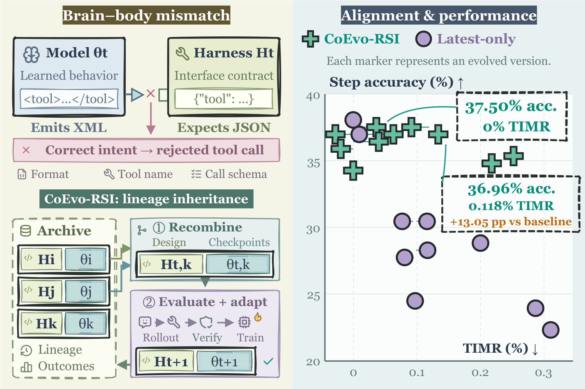
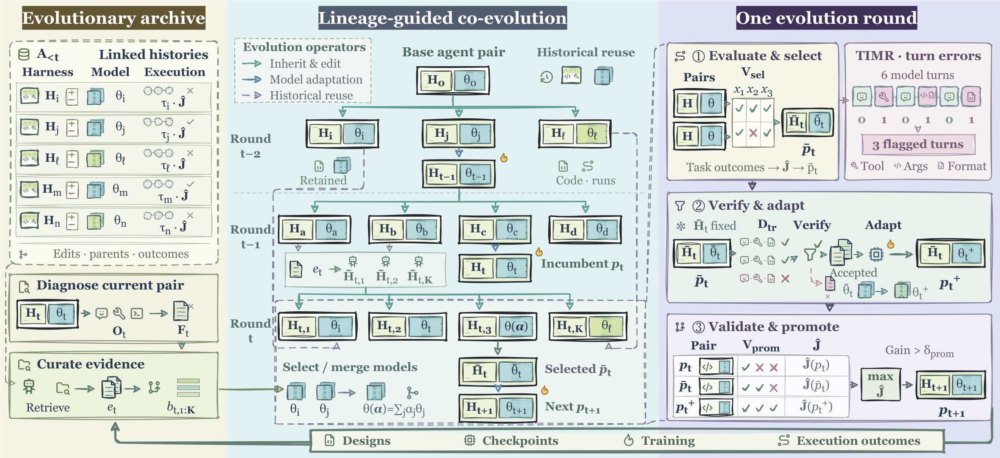
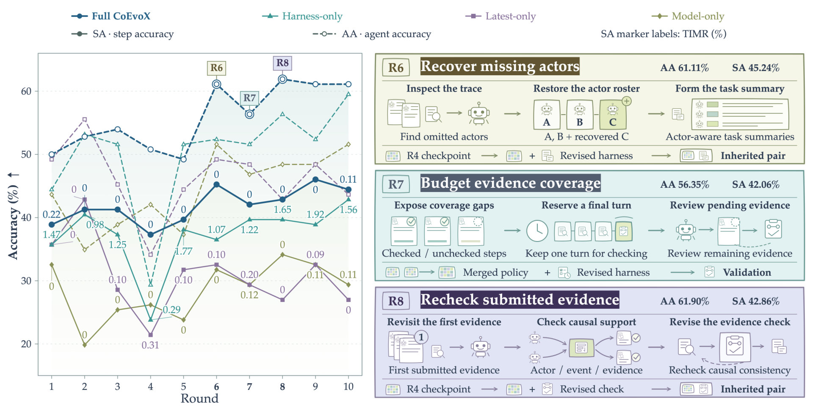
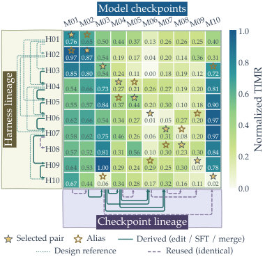

# -0.5cm assets/coevorsi-title.pdf assets/coevorsi-title.pdf 30pt 32pt CoEvo-RSI \\[0.5em] 15pt 18pt Harnesses Evolve, Which Models Should Follow?

> **一句话导读**：论文指出模型—执行外壳协同进化中存在"脑体错配"——进化出的外壳要求的行为模型没学会，或者外壳压制了模型已有的能力——并提出 CoEvo-RSI，让外壳编辑与模型检查点选择双向地从历史档案中继承，仅用拒绝采样轨迹做监督微调（SFT），就把 Qwen3.5-9B 在 TraceElephant 上的 Who 准确率做到 70.78%，比 DeepSeek-V4-Pro-0813 高 14.16 个点。

## 论文速览

- **研究问题**：在模型与执行外壳（harness）联合进化的"递归自我改进（recursive self-improving, RSI）"范式中，外壳每一轮都在变，模型的初始化和适配却通常绑定在最新一代权重或外壳的父分支上，于是出现脑体错配：模型不会用新外壳，外壳也浪费了模型已有的能力。
- **核心方法**：CoEvo-RSI 维护一个共享进化档案，由元智能体（meta-agent）统筹两步继承——外壳侧由多个编辑器从历史设计中各选一个起点改写，模型侧从档案中选择或按 TIES-Merging 合并历史检查点作为初始化，再在被选中的外壳下用自己拒绝采样的轨迹做一轮全参数 SFT，最后按验证集在父代、继承对、适配后对三者中晋升。
- **主要结果**：协同进化后的 Qwen3.5-9B 在 Who&When Hand 上取得 68.39% Who / 29.31% When，超过最强外壳增强基线 FALAT + MiniMax-2.5（66.30% / 25.90%）；Who&When Pro 上 Who 为 69.43%（Qwen3.8-Max 为 65.03%）；TraceElephant 上 Who 为 70.78%，比 DeepSeek-V4-Pro-0813（56.62%）高 14.16 点；RBAC Spider 上 Safe-EX 80.85%、违规率 1.57%，HomeBench VM 成功率 75.51%。
- **一句话评价**：论文把一个常被忽视的工程—方法论问题（继承什么）形式化并做成了可运行系统，方向清晰、结果扎实，但对比基线多为未经同域外壳搜索的通用系统，且作者本人也承认这只是"领域内专用化"而非通用 RSI。

## 研究背景与问题

一个智能体的能力同时取决于它的"脑"（brain，负责推理与选动作的语言模型）和"体"（body，即执行外壳（harness），定义工具接口、动作空间、记忆与执行流程）。因此进展分成两条互补路线：一条是模型训练，用监督学习、强化学习或自蒸馏改进策略；另一条是外壳优化，在模型固定的前提下，依据执行反馈迭代改写提示、工具与控制流，或用种群式进化生成、评估、重组多个外壳设计。两条路线在**模型—执行外壳协同进化（model–harness co-evolution）** 处汇合，近期系统已在工具使用、数学推理、搜索式问答和国际象棋上展示了这种做法的潜力。

问题出在一轮协同进化的耦合方式上。从一对模型—外壳 $(\mathbf{H}_t,\theta_t)$ 出发，执行反馈 $\mathbf{F}_t$ 指导外壳修改，而外壳的新要求又反过来塑造模型这一轮的适配。由于两侧都在动，外壳的执行要求与模型已经学到的能力会逐渐漂移。论文由此首次识别并形式化了**脑体错配（brain–body mismatch）** 问题：当 $\mathbf{H}_t$ 所要求的行为偏离了 $\theta_t$ 已学到的行为，或当 $\mathbf{H}_t$ 限制了 $\theta_t$ 已有能力的使用时，这一对就处于错配状态，任务是在连续多轮协同适配中维持二者的兼容性。

论文给出两个具体例子，把抽象的错配落到可观察的失败上。"接口错配"：模型输出 XML 格式的工具调用，而进化后的外壳期望 JSON，本来正确的调用被直接拒绝。"能力错配"：外壳新增了一个"主动上下文管理工具"，用来决定保留、摘要还是丢弃哪些信息；不熟悉这套操作的新模型用得很差，而某个历史检查点 $\theta_i$ 恰恰已经具备相关能力，是更合适的适配起点。反过来，历史外壳设计 $\mathbf{H}_j$ 也可能提供一套契合当前模型能力的执行流程——这提示"选哪个前代"本身就是需要决策的变量。

现有做法的卡点正在于此。单侧进化方法（如 Meta-Harness、Self-Harness 只改外壳而冻结模型，或 GRPO、GSPO 只在初始外壳下训模型）无法解决两侧同时漂移的问题；已有的协同进化方法（HarnessForge、Co-Harness、WHALE）虽然两侧都动，但模型初始化被绑在最新一代权重或外壳的父分支上，一旦某个有用能力在中间轮次被"淘汰"，后续就无法再取回。论文的核心主张是：兼容性是"某一对"的性质，而不是"某一代"的性质，因此继承应当显式地跨越整个历史档案，如图 1 所示。

## 核心思路

作者的第一个关键观察是：接口与能力的兼容性高度依赖具体的那一对模型—外壳，而不是由"最新一代"决定。为了把这件事变成可搜索的信号，论文提出**轮级接口错配率（Turn-level Interface Mismatch Rate, TIMR）**，用"每个模型轮次里出现接口违规的比例"作为廉价、可自动验证的诊断量。图 1 右侧的散点把这一点讲得很清楚：不同方法、不同轮次的版本散布在"高步准确率—低 TIMR"的对角线上，谁更靠右下角，谁就更"脑体对齐"。

第二个观察是：既然兼容性是对的属性，那么历史档案里被淘汰的分支就不是垃圾，而是候选资源。一个在旧外壳下表现一般的中间检查点，换到新外壳下可能恰好是最省事的初始化；一个早期的外壳设计，可能比当前外壳更贴合模型已有的行为习惯。由此推出的解法是**双向历史继承（bidirectional historical inheritance）**：外壳侧允许每个编辑器自选历史基座，模型侧允许从档案中挑选或合并任意历史检查点，二者互不绑定——模型初始化既不必是最新权重，也不必与外壳的父分支同源。

第三个设计选择是把"继承"交给一个自治的元智能体来统筹，而不是写死规则。元智能体带着固定参数 $\phi$，分别扮演策展人（筛选证据）、多个外壳编辑器（各自选基座并改写）、模型继承者（提出检查点混合系数）三种角色，全部决策都以档案里的执行历史与祖先关系为依据。这样整个循环就有了统一的组织原则：**以脑体对齐为目标函数的一部分来驱动进化**，而不是让外壳和模型各自朝自己的局部最优跑。

## 方法详解

### 整体框架

形式化地，一个可执行智能体是一对 $p=(\mathbf{H},\theta)$，$\mathbf{H}$ 规定提示、工具、状态管理与控制流，$\theta$ 是任务模型参数；约束 $\mathbf{C}$ 固定环境、验证器与允许的接口。给定任务分布 $\rho$ 与固定评测器给出的任务分 $s(x,\tau)$，优化目标是执行轨迹分布下的期望得分：

$$
\mathbf{J}(\mathbf{H},\theta)=\mathbf{E}_{x\sim\rho}\mathbf{E}_{\tau\sim\mathbf{P}_{\theta,\mathbf{H}}(\cdot\mid x;\mathbf{C})}\bigl[s(x,\tau)\bigr]
$$

其中 $\tau$ 是一条包含模型回复、工具交互与最终输出的轨迹，$\mathbf{P}_{\theta,\mathbf{H}}$ 是在该外壳与模型下产生轨迹的分布；实践中用任务集 $\mathbf{D}$ 上每题 $n_{\mathrm{eval}}$ 次执行的平均分来估计，记作 $\widehat{\mathbf{J}}_{\mathbf{D}}(p)$。

每一代围绕现任对 $p_t$ 与档案 $\mathbf{A}_{<t}$（含历史外壳、检查点、执行历史与种子对）走两步继承。第一步，用现任对的执行反馈 $\mathbf{F}_t$ 生成 $\mathbf{K}$ 个后代外壳 $\mathbf{H}_{t,1:\mathbf{K}}$ 与共享证据 $e_t$，后者把历史设计与其当时的模型、结果关联起来。第二步，为这些后代外壳配对选择或合并出来的检查点，得到候选对集合 $\mathbf{Q}_t^{\mathrm{sel}}$。随后在验证集上选出 $\bar p_t$，在它自己的外壳下做适配得到 $p_t^+$，再由验证决定 $p_{t+1}$，所有完成的结果（包括失败修改）连同外壳祖先与模型出处写回 $\mathbf{A}_{<t+1}$。整个数据流如图 2 所示。

### TIMR：把接口错配变成可测信号

要把"对齐"纳入搜索，先得能测。论文定义了 TIMR：对一对模型—外壳的评测轨迹集合 $\mathbf{Z}(\mathbf{H},\theta)$，令 $n_{\mathrm{lm}}(\tau)$ 为轨迹中的模型轮数，$v_{\tau,u}\in\{0,1\}$ 标记第 $u$ 轮是否出现调用不存在的工具、违反接口契约或输出畸形，则

$$
\mathbf{TIMR}(\mathbf{H},\theta)=\frac{\sum_{\tau\in\mathbf{Z}}\sum_{u=1}^{n_{\mathrm{lm}}(\tau)}v_{\tau,u}}{\sum_{\tau\in\mathbf{Z}}n_{\mathrm{lm}}(\tau)}
$$

即违规轮次占模型总轮次的比例，每轮最多计一次（即使后面自我修复也不再重复计数）；数值越低表示每轮越少接口违规。

值得注意的是作者对它的定位很克制：TIMR 只捕捉"可观察的接口违规"，并不能刻画能力层面的错配，论文明确声明它只覆盖脑体错配的一个侧面。它真正的价值在于便宜——不需要人工标注、不需要额外模型，只要跑一遍评测就能算出来。因此它可以同时充当诊断信号（写进证据 $e_t$）和模型继承的搜索信号（候选检查点的观测 $\mathbf{O}_{t,k}^{(q)}$ 里同时记录任务表现与 TIMR）。

### 外壳继承：证据策展与历史基座选择

外壳继承要回答"从哪个历史设计出发改"。第一步是**证据策展**：在验证集 $\mathbf{V}$ 上诊断现任对，得到 $\mathbf{F}_t=\operatorname{diagnose}(p_t,\mathbf{O}_t)$；策展人（Curator）据此在档案上做多步检索，第 $q$ 步从元数据索引 $\operatorname{index}(\mathbf{A}_{<t})$ 里选一个读取动作 $u_{t,q}$，读到的内容不断追加到检索历史 $r_{t,q}^{\mathrm{cur}}$，直到主动停止或用完检索预算。随后它从完整检索历史中产出证据 $e_t$ 与 $\mathbf{K}$ 条修改假设 $b_{t,1:\mathbf{K}}$，产出受上下文长度预算 $\mathbf{L}_{\mathrm{ctx}}$ 约束。这样做的理由很直接：Meta-Harness 一类的经验表明，源码、分数与执行轨迹一起呈现，比压缩成单个标量分数更能支撑后续判断；而把"某设计在它当时的模型下表现如何"一并带给编辑器，才能判断何时值得复用。

第二步是**历史基座选择**，这里刻意不做集中决策。$\mathbf{K}$ 个独立编辑器各拿一条假设 $b_{t,k}$，各自浏览档案并选定自己的起点 $i_{t,k}$，起点外壳记为 $\widetilde{\mathbf{H}}_{t,k}=\mathbf{H}_{i_{t,k}}$；然后在起点上按约束 $\mathbf{C}$ 改写，得到后代 $\mathbf{H}_{t,k}$ 并记录采纳了哪些历史设计 $\mathbf{U}_{t,k}$。不同假设本就可能偏好不同起点（有的想加工具、有的想改控制流），让编辑器各自选，等于在继承阶段就引入了设计多样性；而 $(i_{t,k},\mathbf{U}_{t,k})$ 保存了祖先关系，使后续分析能追溯"这一版是从哪一版演变来的"。与从当前外壳或最新源码出发的做法相比，这是本方法在机制上最实质的差别。

### 模型继承：检查点选择与 TIES 合并

模型侧要回答的是"用哪个权重起步"。作者把它当作兼容性决策而非"用最新"的默认动作：新外壳改变了模型必须执行的行为，一个不会用新工具的最新检查点，未必比一个恰好具备相应能力的老检查点更合适。具体做法是在档案索引 $\mathbf{M}_{<t}$ 上给出一组非负、和为 1 的权重 $\boldsymbol{\alpha}=(\alpha_j)$，单点选择就是一个 one-hot 向量，多点混合则用 TIES-Merging：

$$
\theta(\boldsymbol{\alpha})=\operatorname{TIES}\bigl(\{\theta_j\}_{j\in\mathbf{M}_{<t}};\boldsymbol{\alpha}\bigr)
$$

TIES 会裁掉任务向量中的小幅条目、解决符号冲突，只合并符号一致的更新分量，从而减少多检查点相加时的相互干扰。系数由元智能体直接给出实数，并且它还要决定本轮评估多少个合并候选——这一步也依据历史证据与评测反馈。

搜索过程是有反馈的迭代：在第 $q$ 次决策时，元智能体读入后代外壳 $\mathbf{H}_{t,k}$、共享证据 $e_t$、检查点索引以及当前观测 $\mathbf{O}_{t,k}^{(q)}$（任务表现与 TIMR，评估期间二者固定），提出新的 $\boldsymbol{\alpha}_{t,k}^{(q)}$；初评结果用于修正入围外壳的提案，形成候选对集合 $\mathbf{Q}_t^{\mathrm{sel}}$；最后由验证集按 $\bar p_t=\arg\max_{p\in\mathbf{Q}_t^{\mathrm{sel}}}\widehat{\mathbf{J}}_{\mathbf{V}}(p)$ 选出唯一一对。这条选择准则天然偏向"还没适配就已经能开动这个外壳"的初始化，把适配的负担留给后面的 SFT。

### 成对适配与晋升

选定 $\bar p_t=(\bar{\mathbf{H}}_t,\bar\theta_t)$ 之后，适配阶段只做一件事：在这个外壳下把模型自己的成功经验固化下来。$\bar\theta_t$ 在训练集 $\mathbf{D}_{\mathrm{tr}}$ 上以温度 1 采样，每题最多采三条轨迹，命中验证器即停止；被验证器接受的轨迹用于全参数 SFT，外壳 $\bar{\mathbf{H}}_t$ 保持冻结，得到 $p_t^+=(\bar{\mathbf{H}}_t,\theta_t^+)$。实现上是一轮全参数 SFT、学习率 $5\times10^{-6}$、批大小 8、4 张 H100，不使用强化学习。

晋升阶段把三个候选放在同一验证集上比较：

$$
p_{t+1}=\max_{\succ_{\mathrm{prom}}}\{p_t,\ \bar p_t,\ p_t^+\}
$$

其中排序关系 $\succ_{\mathrm{prom}}$ 要求候选不仅合法、评估完整，而且相对 $p_t$ 的增益必须大于阈值 $\delta_{\mathrm{prom}}$ 才能取代现任；若无人达标则 $p_t$ 继续留任。这个"必须显著更好才换"的设计是对进化式搜索中随机回退的直接防护。最后，所有完成的结果（含未成功的修改）连同外壳祖先与模型出处（合并系数 $\boldsymbol{\alpha}$ 与训练历史）写入 $\mathbf{A}_{<t+1}$——这正是后续轮次能够"往回取"资源的前提。

## 实验结果

### 实验设置

作者选择三个需要不同外壳能力的垂直领域：**多智能体失败归因**（在轨迹中指出责任智能体 Who 与决定性错误步骤 When）、**角色感知的 text-to-SQL**（只有当用户角色被授权访问全部引用表列时才生成 SQL，否则拒答）、**智能家居指令跟随**（把指令映射为设备操作并拒绝不可行指令）。失败归因从 TracerTraj 留出 200 条做进化期验证，训练用其余数据加 CORRECT-Error、AFTraj 与自建轨迹共 3,400 条单错误样本，Who&When 的 Hand/Algo. 子集、Who&When Pro 与 TraceElephant 全部作为分布外（OOD）测试；SQL 用 RBAC 基准的 Spider 子集（官方划分）训练、BIRD 子集零样本 OOD 测试；智能家居用 HomeBench 的多设备合法（VM）与非法（IM）子集官方划分。

基线分四族：直接调用大模型（DeepSeek-V4.1-Flash、DeepSeek-V4-Pro-0813、GLM-5.3、MiniMax-M3、Qwen3.8-Max，均为高思考强度）；外壳增强系统（失败归因上的 CHIEF、FALAT、AgentScope、DCFA，SQL 上的 OpenCode、mini-SWE-agent、Pi）；外壳进化（Meta-Harness、Self-Harness，与本文共享任务模型、元智能体 LLM 与轮数）；模型训练与协同进化（GRPO、GSPO、HarnessForge）。本文以 Qwen3.5-9B 从手写初始外壳起步，元智能体为 `Codex` 中的 DeepSeek-V4.1-Flash（高推理强度），共 10 轮、每轮 $\mathbf{K}=8$ 个外壳候选，结果取三次运行平均。

### 主要结果

失败归因的结果如表 1。最重要的发现是：一个 9B 模型在与外壳协同进化后，能在多个留出基准上超过大得多的模型与专门的外壳增强系统。Who&When Hand 上本文取得 68.39% Who 与 29.31% When，两项都优于最强外壳增强基线 FALAT + MiniMax-2.5（66.30% / 25.90%）；Who&When Pro 上 Who 为 69.43%，高于 Qwen3.8-Max 的 65.03%；TraceElephant 上 Who 为 70.78%，比 DeepSeek-V4-Pro-0813 的 56.62% 高出 14.16 点。

**表 1：失败归因主结果（%，Who/When 越高越好，四个基准均不参与训练与进化选择）**

| 方法 | Who&When Hand Who | Who&When Hand When | Who&When Pro Who | TraceElephant Who |
|---|---|---|---|---|
| DeepSeek-V4-Pro-0813 | 60.34 | 10.34 | 61.77 | 56.62 |
| Qwen3.8-Max | 50.00 | 12.07 | 65.03 | 47.03 |
| FALAT + MiniMax-2.5 | 66.30 | 25.90 | -- | -- |
| Self-Harness | 56.90 | 24.14 | 47.94 | 49.77 |
| HarnessForge | 32.76 | 22.41 | 63.03 | 50.23 |
| GRPO | 37.93 | 17.24 | 62.51 | 44.29 |
| **CoEvo-RSI（本文）** | **68.39** | **29.31** | **69.43** | **70.78** |

从表中可以看出，本文方法在 Hand 子集与两个 OOD 基准的智能体归因上都拿到最好成绩，而单侧进化的 Self-Harness 在 Hand 上落后 11.49 个 Who 点，协同进化的 HarnessForge 甚至低于其基座模型在 Hand 上的表现。

但也有明确的短板：Who&When Algo. 上本文为 62.17% Who / 44.71% When，低于该子集上的最强基线（DeepSeek-V4.1-Flash 的 68.25% Who、DCFA + GPT-5 的 47.62% When）。另一个有意思的分化是 When：TraceElephant 上两个外壳进化基线的 When 都跌到 10% 以下（Meta-Harness 9.13、Self-Harness 7.76），本文保持 28.92%；但 Who&When Pro 与 TraceElephant 上，在初始外壳下做 RL 的 GSPO 反而拿到更高的 When（38.36 对 28.92），说明对齐带来的收益主要体现在智能体归因而非关键步骤定位上。

跨域结果也支持同样的结论，但并非全面领先。RBAC Spider 上本文取得最好的 Safe-EX（80.85%）、Safe-Deny（96.64%）与最低违规率（1.57%），略胜 Pi + MiniMax-M3（80.26% / 96.33% / 1.72%），AC-F1 则为 95.51%，低于 Pi + MiniMax-M3 的 95.85%。OOD 的 BIRD 上 Safe-EX 为 60.15%，与 GLM-5.3 的 60.90% 接近但未超过，明显低于 OpenCode + DeepSeek-V4.1-Flash 的 74.86%；不过它的 Safe-Deny（91.26%）最高、违规率（5.65%）最低、AC-F1（90.24%）第二。HomeBench 上 VM 成功率 75.51%、F1 89.23%，均高于 DeepSeek-V4-Pro-0813（75.10% / 89.18%）；IM 上成功率 84.54% 与两个基线并列最好，F1 91.80% 最高。作者也提醒，安全—效用之间的平衡可能部分来自更保守的拒答——这会提升合规性，却牺牲一部分被授权查询的执行率。

**表 2：角色感知 text-to-SQL 结果（RBAC Spider 子集，%）**

| 方法 | Safe-EX↑ | AC-F1↑ | Safe-Deny↑ | Viol.↓ |
|---|---|---|---|---|
| DeepSeek-V4.1-Flash | 77.33 | 94.46 | 93.80 | 1.69 |
| DeepSeek-V4-Pro-0813 | 78.33 | 94.90 | 95.65 | 2.04 |
| Pi + MiniMax-M3 | 80.26 | **95.85** | 96.33 | 1.72 |
| Qwen3.5-9B（基座） | 71.90 | 89.71 | 87.96 | 5.72 |
| **CoEvo-RSI（本文）** | **80.85** | 95.51 | **96.64** | **1.57** |

表 2 显示，协同进化把基座模型的 Safe-EX 从 71.90% 拉到 80.85%、违规率从 5.72% 压到 1.57%，在三个指标上超过通用编码外壳，仅在 AC-F1 上略逊于最强基线一格。

### 消融与分析

消融在 Who&When Algo. 上跑 10 轮，对比三个变体：Harness-only（冻结模型只进化外壳）、Model-only（只在初始外壳下训练模型）、Latest-only（两侧都进化但只用最新一代）以及完整方法，结果如图 3。它同时验证了两件事：联合进化必要，历史复用也必要。

**联合进化。** Harness-only 在每一轮的 SA 都低于完整方法，且十轮中有八轮 TIMR 高于 1%，而完整方法始终不超过 0.22%——说明只改外壳会让接口越来越"难用"。反过来，Model-only 的 TIMR 近乎为零，但 SA 最高只到 35%，说明仅靠接口兼容不足以换来任务成功。两者合起来正好定位了脑体错配的两个方向。**历史复用。** Latest-only 在第 4 轮出现回退，并以最低 SA 收尾；完整方法同样在第 4 轮下滑，但随后把第 4 轮的权重配上新外壳在第 6、8 轮复用到 61.11% 与 61.90% AA，从回退中恢复过来。这是"显式继承"这一设计最直接的证据：可复用的旧权重是恢复能力的来源。

搜索预算的敏感性分析把每轮外壳候选数设为 $\mathbf{K}\in\{4,6,8,10\}$，其余设置不变：AA 稳定在 45.11%–52.17%，SA 在 28.80%–37.50%，各 $\mathbf{K}$ 下 TIMR 均不超过 0.12%。这说明方法的收益不是靠"多试几个候选"堆出来的，在小预算下同样成立，对实际部署是个好消息。

作者还给出了一张接口兼容性热力图（图 4），这是全文对"为什么必须双向继承"最细的分析。图中行是进化出的外壳、列是模型检查点，格值是全局 min–max 归一化后的 TIMR，进化期只能看到下三角（第 $i$ 个外壳只能配到第 $i$ 代之前的检查点）。三个观察值得记住：其一，随着档案增长（1 个到 10 个检查点），被选中的对向低 TIMR 的右下角移动，平均归一化 TIMR 从第 1–3 轮的约 0.72 降到第 6–10 轮的 0.13，十轮里有七轮选中的就是当时可得的最低 TIMR 检查点；其二，有五轮重新选回了已有权重，且此后每个派生检查点都与第 3 轮检查点合并，说明档案中的"老权重"确实反复被需要；其三，第 10 轮的表现最能说明问题——那个检查点在外壳 4–9 下的 TIMR 高达 0.54–1.00，在最终外壳下却是最低的 0.02，并取得该次运行最好的 Safe-EX（80.85%）。如果只允许继承最新一代，这样的配对根本不会被发现。

成本方面，三次运行的训练耗时在 17.48–20.71 小时之间（其中评估占 4.54–6.11 小时），默认 $\mathbf{K}=8$ 取得最短的 17.48 小时；论文还给出推理成本—准确率的 Pareto 对比（按 Qwen3.5-9B 的 API 定价计算），本文的 9B 智能体在 Who&When Hand 的 Who 准确率与 RBAC Spider 的 Safe-EX 上都落在更优的成本—精度前沿上。此外，RBAC 的逐轮分析显示收益来自具体的外壳能力累积：依次加入证据检查、引用级授权、带修复的验证后，Safe-EX 从 77.09% 升到 80.85%，违规率从 2.00% 降到 1.57%，相对下降 21.5%。

## 局限与思考

这篇论文真正新在哪里？我认为不是"进化"本身——档案式进化在 Darwin Gödel Machine、Meta-Harness 一线已有；新的是把"继承谁"从一个隐含默认（最新一代或父分支）提升为一个显式的、双向的、由元智能体自主决策的环节，并且用 TIMR 这种极便宜的量给它提供了可搜索的信号。加上成对适配与带 margin 的晋升规则，整个循环被做成了可运行、可复现的工程系统，这在协同进化类工作里并不常见。

但证据的强度需要打折扣。第一是对比公平性：SQL 侧的外壳增强基线是通用编码智能体（OpenCode、mini-SWE-agent、Pi），并没有针对"角色感知授权"这一垂直任务做同等强度的外壳搜索；失败归因侧的一部分基线结果直接取自各自论文，评测协议未必完全一致。第二是统计力度：主结果只报告三次运行的平均，没有方差或置信区间，而消融中像 61.11% 与 61.90% 这种同量级的差异很难判断是否显著。第三是结论的边界很清晰：Who&When Algo. 上并未最好，BIRD OOD 上 Safe-EX 明显落后于 OpenCode 与 GLM-5.3，HomeBench IM 的成功率只是并列，说明"跨域迁移"这件事论文并没有真正证成。

还有一些隐含假设值得读者警惕。适配完全依赖验证器给出的接受信号，因此"验证器可靠且覆盖目标行为"是整套方法的地基；一旦验证器只能检查格式而无法判断任务正确性，拒绝采样就会放大错误。TIMR 只覆盖接口违规，能力层面的错配没有对应度量，于是"脑体对齐"在实践中被窄化成了"接口对齐"——Model-only 变体 SA 只有 35% 这一结果其实正说明低 TIMR 远不等于好任务表现。元智能体本身是 DeepSeek-V4.1-Flash 这样的前沿模型，论文没有对元智能体的能力做消融，因此"9B 打败大模型"的叙事里，有多少来自协同进化机制、有多少来自一个很强的外部编排者，目前无法分离；模型规模也只测了 9B 一个点。

尽管有这些保留，这项工作的借鉴价值是明确的。在工程上，它提示作者：与其反复把最新权重硬塞进新外壳，不如把历史检查点、外壳祖先与执行结果当作一等公民存起来，并在部署时允许"旧权重 + 新外壳"这类组合——代价只是一次 SFT 与若干次权重合并，远低于重跑 RL。在研究上，"用便宜的可验证指标驱动继承决策"这个思路可以推广到别的对齐维度（例如工具使用成功率、拒答合理性）；自然的后续工作是引入强化学习而非仅 SFT、扩展到更多模型规模、以及把档案在相关任务族之间共享。作者自己也明确把目标限定为"领域内专用化的 RSI"，而不是跨领域的全能自我改进——这个自我定位是诚实且恰当的。

## 总结

论文识别并形式化了模型—执行外壳协同进化中的脑体错配问题：外壳每轮都变，模型初始化却绑定在最新一代或父分支上，导致模型不会用新外壳、外壳浪费模型已有能力。CoEvo-RSI 的解法是把"继承"变成显式双向决策——外壳编辑器各自从历史设计中选择起点，模型侧从档案中选择或按 TIES-Merging 合并历史检查点，再在被选中的外壳下用拒绝采样的自身轨迹做一轮 SFT，最后按验证集带 margin 地晋升。仅用 SFT，协同进化后的 Qwen3.5-9B 就在失败归因、角色感知 SQL 与智能家居指令跟随三个领域逼近甚至超过大得多的模型（TraceElephant Who 70.78%，比 DeepSeek-V4-Pro-0813 高 14.16 点），而消融与 TIMR 热力图说明收益来自联合进化与跨代复用这两点本身。最值得记住的一句话是：兼容性属于"某一对"而非"某一代"，因此自改进系统必须学会往回看。

## 科学发现范式

- 主要范式：P01 Gap-Driven Reframing
- 次要范式：P04 Modular Pipeline Composition, P05 Data & Evaluation Engineering, P15 Data-Centric Optimization & Active Sampling
- 分类理由：论文从“model-harness co-evolution”中常被忽视的“brain-body mismatch”缺口出发，将其形式化为模型能力与执行框架需求之间的兼容性问题，并据此重构协同进化目标，因此主模式为P01。次模式包括P04：以进化归档、Curator、harness editors、模型继承、评估/适应/晋升构成模块化协同流水线；P05：提出“TIMR”诊断信号并设计评估与验证流程；P15：仅用自身拒绝采样轨迹的SFT进行模型适应，体现数据生成与选择作为优化杠杆。

## 先前工作分析

在模型—执行框架协同演化方向，"Co-Harness" 以验证后的 harness patch 与由改进 scaffold 生成轨迹上的微调交替推进，"WHALE" 将拒绝采样微调与可执行 harness 搜索交替进行，"HarnessForge" 则把故障引导的 harness 裁剪与 harness 条件化的策略对齐结合。这些工作证明同时调整 body 与 brain 有效，却通常从最新一代或父分支初始化，模型侧没有独立检索或合并历史 checkpoint 的机制，因而容易在 harness 需求变化后出现接口与能力错配。"Meta-Harness" 让 proposer 访问早期源码、分数和执行轨迹，"Darwin Gödel Machine" 维护自我修改 agent 的档案并把早期分支作为后续改进的踏脚石，二者共同表明丰富历史可保留单一标量分数遗漏的证据并支撑继承。"SkillRL" 联合演化分层技能库与 agent 策略，"HASE" 让策略参与自身支持系统的编辑，进一步显示模型能力与执行支持可以相互塑造。由此浮现的缺口是：已有协同演化缺少把 harness 历史设计与模型 checkpoint 历史统一起来、按执行反馈双向继承的机制。当前论文正据此提出共享 evolutionary archive 和 meta-agent 协调的 bidirectional historical inheritance，在选定 harness 下选择或合并 checkpoint 并做 SFT，从而把 brain–body alignment 变成演化循环的显式决策。
