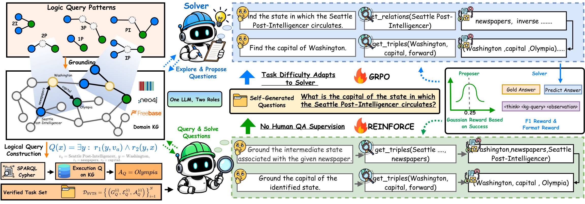
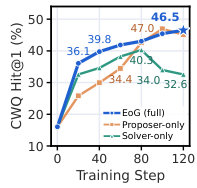
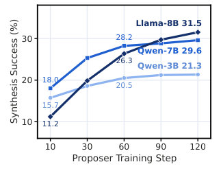

# Evolve on Graph: Self-Evolving Knowledge Graph Reasoning without Question Annotations

> **一句话导读**：论文提出 EoG，让单个 LLM 在知识图谱上分饰“出题者”与“解题者”做自我对弈，用一阶逻辑查询执行保证答案可验证、用解题者的得分方差维持题目难度，在完全没有任何问答标注的 KG 上把 Qwen-2.5-7B 的五基准平均 Hit@1 从 54.09（最强无标注基线）提升到 61.55。

## 论文速览

- **研究问题**：真实场景（工业、医疗）的知识图谱往往没有任何问答标注，数据也不允许交给闭源模型；在这种三重约束下，LLM 能否只用图谱本身提升多跳图推理能力。
- **核心方法**：单一 LLM 以不同角色提示分饰 Proposer（出题）与 Solver（答题）共享参数做自博弈；SVTS 在图谱上采样推理拓扑并执行对应的一阶逻辑查询，得到带完整答案集的“拓扑骨架”作为出题依据；边界感知图课程（Boundary-Aware Graph Curriculum）根据 Solver 在同一问题上的得分方差给出题者发奖励，把题目维持在能力边界。
- **主要结果**：Qwen-2.5-7B-Instruct 上六个基准中五个公开基准的平均 Hit@1 为 61.55、平均 F1 为 56.31，比最强无标注基线 Graph Reranker（54.09 / 44.26）高 7.46 与 12.05；自建工业图谱 IndustryCarBench 上 Hit@1 比 ToG 高 17.80。
- **一句话评价**：把“课程难度”这个原本要靠人工课程表安排的东西，转化为 Solver 自身的组内得分方差，再配上符号执行给出的完整答案集，是本文最值得借鉴的两点；但整体仍是 3B–8B、140 步、6 种拓扑的小规模自博弈验证，与全监督方法在同分布上仍有差距。

## 研究背景与问题

大模型在需要深度、多跳、结构化事实知识的推理任务上，受制于长尾知识覆盖不足与事实幻觉，知识图谱（knowledge graph, KG）因此被当作可靠的外部知识源。但要让图谱真正发挥作用，模型必须在庞大而异质的图上逐步定位每一跳所需的事实，这把问题从“检索”变成了“探索”。相关研究也随之从一次性图检索（RoG、SubGraphRAG、GCR 等）转向多轮图探索。

多轮图探索目前有两支做法。免训练智能体（ToG、PoG、Paths-over-Graph 等）用提示词驱动一个冻结的 LLM，逐步选择关系与实体；基于强化学习的智能体（KG-R1、GraphWalker、Graph-RFT 等）把图谱当作交互环境，用问答数据训练探索策略。两条路线都默认了一个前提：有题可做、有答案可对。而工业、医疗等场景的图谱常常既没有问答标注，数据本身又不允许外传给闭源模型，这个前提直接落空。

作者把困难拆成三条。其一，免训练智能体的探索策略被提示词与冻结骨干固定，无法从交互中积累经验，在小规模开源模型上性能下降明显。其二，RL 智能体的训练数据要么依赖熟悉图谱 schema 的专家标注、每换一个 KG 就得重做一遍，要么依赖闭源模型合成题目。其三，题目的难度主要由其推理拓扑决定，而现有训练数据的拓扑配比在训练前就已离线固定：智能体变强之后，简单拓扑已经掌握、复杂拓扑依旧解不出，两类数据都不再提供有效学习信号。

于是问题被明确为：不使用任何问答标注、不借助闭源模型，LLM 能否只靠 KG 本身提升图推理？本文的答案是把“出题—答题—调难度”整个循环搬回图上，让图谱同时充当题库、答案来源和难度计。

## 核心思路

一个自进化的训练循环只需要三样东西：题目、可信的答案、合适的难度。作者的关键观察是，这三样都能从图谱本身和模型自己的输出里读出来，不需要任何外部标注。这个观察把“数据从哪来”的问题拆成了三个可在图上直接计算的小问题。

答案来自符号执行。图谱本身就是一阶逻辑结构，一个多跳问题的推理拓扑可以写成一阶逻辑查询；在图上执行该查询，得到的就是完整、可判定、可复现的答案集。这同时解决了题目从哪来：把查询图中的中间实体与答案实体替换成占位符，就得到一张只含锚点真实名称的“拓扑骨架”，出题者照着骨架去图上把事实走一遍，就能写出一道忠实于该拓扑的自然语言问题。随机游走合成做不到这一点——它只把游走起点当作唯一答案，而同样的关系往往能到达多个实体。

难度则来自模型自己的得分方差。GRPO 一类算法在同一问题的多次采样组内做优势归一化，若组内所有轨迹得分相同，优势恒为零，这条数据对策略更新毫无贡献；反过来，组内得分方差就精确刻画了“这条数据还能教给模型多少东西”。作者据此直接用方差作为出题者的奖励：方差为零（全会或全不会）奖励最低，方差取到上界 $1/4$（恰好一半轨迹满分、一半零分）时奖励最高。课程因此不需要任何人工难度表，难度信号由 Solver 每一轮的采样自动给出，并随着 Solver 变强向外推移。

## 方法详解

### 整体框架

EoG 的输入是一个带查询接口的知识图谱，输出是一个能在该图谱上做多跳问答的 Solver 策略。流程分为两段：离线阶段由 SVTS 在图上采样推理拓扑并执行逻辑查询，得到任务集 $\mathcal{D}_{\mathrm{SVTS}}$，每个任务包含查询图 $G_Q$、锚点集 $\mathcal{E}_Q$ 和完整金答案集 $\mathcal{A}_Q$；在线阶段循环执行“出题—校验—答题—双角色更新”，测试时只保留 Solver。

三个模块各管一件事，对应引言中的三个挑战：Graph Self-Play 让同一个 LLM 用不同角色提示分别担任 Proposer 与 Solver 并共享参数，解决“探索能力无法从交互中提升”；SVTS 把图谱变成可验证的训练数据源，解决“数据依赖标注或闭源模型”；边界感知图课程用得分方差重塑出题者奖励，解决“拓扑配比固定”。如图 1 所示，三者在同一个训练循环里首尾相接，数据流从图谱出发再回到图谱。

### Graph Self-Play：一个策略，两个角色

两个角色的交互格式完全一致：在 `<think>` 中推理，在 `<kg-query>` 中调用图工具，在 `<information>` 中读取返回的三元组，最后分别输出问题（`<result>`）或答案（`<answer>` 中的 JSON 列表）。可用的图工具只有两个：`get_relations` 返回某实体的关系集合，`get_triples` 返回指定关系下的三元组，因此两个角色本质上都在做同一件事——在图上多轮探索。

出题时，Proposer 拿到的骨架只暴露锚点的真实名称，中间实体与答案实体都是占位符，例如 `Goodison Park ←arena_stadium Mid1@ →owner_s Ans@`。由于占位符上无法调用工具，它必须从锚点多轮探索、把事实补齐，才能写出“在 Goodison Park 比赛的球队的老板是谁？”这样既点明锚点、又隐藏中间与答案实体的问题。提示词要求问题保留骨架的完整推理链，因此回答该问题所需的推理与任务本身严格一致。

解题时，Solver 从提示中给出的锚点出发采样 $n$ 条轨迹（$n=5$），自行决定探索哪些关系、何时停止，每条轨迹以一个实体名列表结束。轨迹奖励兼顾答案与格式：

$$R_{\mathrm{S}}(\rho^{j})=\lambda_{\mathrm{ans}}\,\mathrm{F1}\bigl(\hat{y}^{j},\mathcal{A}_Q\bigr)+\lambda_{\mathrm{fmt}}\,R_{\mathrm{fmt}}(\rho^{j})$$

其中 $\hat{y}^j$ 是第 $j$ 条轨迹的预测答案集，$\mathrm{F1}$ 是它与金答案集的 F1，$R_{\mathrm{fmt}}\in[0,1]$ 衡量轨迹对 think–query–observe 结构的遵守程度，权重为 $\lambda_{\mathrm{ans}}=0.8$、$\lambda_{\mathrm{fmt}}=0.2$。之所以用 F1 而非精确匹配，是因为一个任务可能有多个金答案，只答对部分答案也应得到部分奖励。Solver 用 GRPO 更新：组内归一化优势、token 级重要性比、裁剪与 KL 正则；由于奖励只看最终答案，任何能走到 $\mathcal{A}_Q$ 的探索路径都会被强化，策略因此学出自己的走法，而不是模仿固定提示词。

### SVTS：用一阶逻辑查询执行替代人工标注

作者把复杂逻辑查询的常见划分拿来做推理拓扑，定义了六种查询模式 $\mathcal{P}=\{1p,2p,3p,2i,ip,pi\}$：$1p$–$3p$ 是一到三跳的链式查询，$2i$ 是双向交集（答案需同时满足来自两个锚点的约束），$ip$、$pi$ 是投影与交集的嵌套组合。在 Freebase 上，合成题目覆盖全部六种模式，占比从 9.5%（$pi$）到 22.4%（$1p$），因此 Solver 必须学会路径扩展、约束交集与中间变量跟踪，而不是拟合单一模式。

接地（grounding）负责把抽象模式落到真实事实上：从种子池采样一个实体，在图上按模式游走，把每个变量与关系绑定到真实三元组，直到收满目标数量或耗尽尝试预算。随后把查询图确定性地编译成可执行查询 $Q$，在图上执行得到完整金答案集 $\mathcal{A}_Q=\llbracket\phi\rrbracket_{\mathcal{G}}$。答案为空、异常大或实体无法命名的任务会被直接丢弃而不是截断，以保证每个保留任务的答案集都能被客观检验。这一点与随机游走合成形成鲜明对比：后者只把游走起点当作唯一答案，当 $|\mathcal{A}_Q|>1$ 时，即使 Solver 完整答对，按单一答案打分 F1 也只有 $2/(1+|\mathcal{A}_Q|)$。

执行只能保证 $\mathcal{A}_Q$ 是查询 $Q$ 的答案，不能保证 Proposer 写出的问题 $q$ 表达的是同一个查询。为此作者设计了两级校验：规则检查要求 $q$ 能从 `<result>` 中抽出、长度合理、且不出现任何中间或答案实体；证据检查让 Solver 只看 Proposer 检索到的那些三元组来回答 $q$，只有当它恰好还原出 $\mathcal{A}_Q$ 时 $q$ 才算有效。这个检查是保守的——忠实的问题也可能因单条验证轨迹失败而被拒——但证据不足以确定答案的问题绝不会被接受。SVTS 每个图谱只需离线跑一次，把 EoG 迁到新图谱只需要它的查询端点。

### Boundary-Aware Graph Curriculum：用得分方差定义能力边界

对一条有效问题 $q$，$n$ 条 Solver 轨迹给出答案得分 $s_j=\mathrm{F1}(\hat{y}^j,\mathcal{A}_Q)\in[0,1]$，其组内方差为

$$\sigma^{2}(q)=\frac{1}{n}\sum_{j=1}^{n}\bigl(s_j-\bar{s}(q)\bigr)^{2}$$

即各轨迹得分相对均值的平均偏离程度。$\sigma^2=0$ 表示 Solver 要么全会要么全不会，优势归一化后几乎没有梯度；$\sigma^2>0$ 表示“尚未完全掌握但已经能部分解出”，作者称之为 Solver 的能力边界。

出题者的奖励是一个以 $1/4$ 为峰的高斯函数：

$$R_{\mathrm{P}}(q)=\exp\!\left(-\frac{\bigl(\sigma^{2}(q)-\tfrac14\bigr)^{2}}{2h}\right)$$

其中 $h>0$ 控制峰宽。由于得分落在 $[0,1]$，$\sigma^2$ 的上界是 $1/4$，且仅当一半轨迹得 1、一半得 0 时取到，此时奖励最大为 1；全部同分时奖励最小，为 $\exp(-1/32h)$；全部失败时奖励同样很低，因此 Proposer 无法靠“出无解题”来刷奖励。一个只能答对部分答案的问题会停靠在边界上而不会被判定为已解决，这直接得益于金标是执行得到的完整答案集而非单个实体。

### 交替训练：课程如何自己往前走

Proposer 每个任务只写一道题，没有组内样本可做相对优势，因此用 REINFORCE 更新，以整条出题轨迹的奖励 $R_{\mathrm{P}}(q)$ 作为回报；Solver 用 GRPO 更新。两个角色共享参数 $\theta$ 并交替更新：每一步先在 SVTS 任务上出题、校验，再对有效问题采样 5 条解题轨迹，从中同时得到 $R_{\mathrm{S}}$ 与（通过 $\sigma^2$）$R_{\mathrm{P}}$，最后分别更新。

这种共享带来两个效果。其一，出题本身就是一次多跳图探索，经验会通过共享参数迁移到解题——消融中观察到即使完全不更新 Solver，CWQ 的 Hit@1 也能从 16.06 升到 46.39。其二，Solver 一旦掌握某类问题，其得分趋近 1，$\sigma^2$ 与 $R_{\mathrm{P}}$ 随之下降，Proposer 被推向更难的拓扑，边界自动外移。整个循环只用图谱：任务来自 SVTS，答案来自查询执行，难度来自 Solver 自己的得分方差。

## 实验结果

### 实验设置

评测覆盖三个知识图谱：Freebase 上的 WebQSP、CWQ、GrailQA，Wikidata 上的 GTSQA、WikiWebQuestions，以及基于真实汽车美学图谱自建的 IndustryCarBench（500 道专家撰写的测试题，无训练集）。对比基线包括提示类（IO、CoT、SC）、智能体类（ReAct、ToG、PoG、CoR）与检索类（Text-Based Retrieval、Graph Reranker），全部使用与 EoG 相同的骨干和图谱；GraphWalker 因依赖闭源模型合成数据被排除，其随机游走变体放在消融中近似。KG-R1$^\dagger$ 是在各基准训练集上训练的全监督参考，EoG 从不使用这些标注。

指标为 Hit@1 与 F1，骨干为 Qwen-2.5-3B/7B-Instruct 与 LLaMA-3.1-8B-Instruct。训练用 Verl 在 8 张 GH200 上跑 140 步，每个任务 5 条 rollout，学习率 $1\times10^{-6}$，最多 15 轮助手回合；除非特别说明，分析部分均使用 Qwen-2.5-7B-Instruct 在三个 Freebase 基准上的结果。

### 主要结果

**表 1：五个公开 KGQA 基准上的主结果（Hit@1，%），最后一列为五基准平均 F1**

| 方法（骨干） | WebQSP | CWQ | GTSQA | 平均 F1 |
|---|---|---|---|---|
| ToG（Qwen-2.5-7B） | 55.22 | 36.90 | 38.04 | 43.66 |
| PoG（Qwen-2.5-7B） | 49.23 | 32.82 | 35.02 | 37.75 |
| CoR（Qwen-2.5-7B） | 63.27 | 23.23 | 26.63 | 42.29 |
| Graph Reranker（Qwen-2.5-7B） | 68.27 | 37.69 | 37.85 | 44.26 |
| EoG（Qwen-2.5-7B） | 70.13 | **50.58** | **48.39** | **56.31** |
| EoG（LLaMA-3.1-8B） | **71.82** | 50.36 | 36.37 | 53.91 |
| KG-R1$^\dagger$（Qwen-2.5-7B，全监督参考） | 80.71 | 58.03 | -- | 62.67 |

粗体为无标注方法中的最优；KG-R1$^\dagger$ 为全监督参考，不参与比较。

在完全没有问答标注的条件下，7B 版 EoG 的平均 Hit@1 达 61.55、平均 F1 达 56.31，比最强无标注基线 Graph Reranker 高 7.46 与 12.05。提升集中在多跳题上：CWQ 的 Hit@1 为 50.58（ToG 为 36.90），GTSQA 为 48.39（ToG 为 38.04），WikiWebQuestions 上 73.28 / 60.82 也超过最好的 Graph Reranker（70.37 / 53.48）。作者把这归因于“通过交互学到的探索”比一次性检索或固定提示更适应复杂问题。

跨图谱与跨骨干的表现同样值得注意。Wikidata 上 EoG 直接在目标图谱上训练、管线不做任何改动即可迁移；在无法训练标注型 RL 智能体的 IndustryCarBench 上，EoG 仅靠图谱训练，Hit@1 比最强基线 ToG 高 17.80。骨干方面，Qwen-2.5-3B 上的 EoG 平均 Hit@1 为 46.02，已超过 7B 的 PoG（45.54）；LLaMA-3.1-8B 上平均 58.59 / 53.91，比 SC（44.15）高 14.44 Hit@1。相对免训练起点 ReAct，EoG 在三个骨干上平均 Hit@1 提升均超过 24 点。

不足之处也要看清。LLaMA 版 EoG 在 GTSQA 上 Hit@1 为 36.37，低于 Graph Reranker 的 37.85，说明这套自博弈并非在每张表上都稳定占优；与全监督的 KG-R1$^\dagger$（平均 F1 62.67）相比，EoG 的 56.31 仍有约 6 个点的差距，标注数据在同分布上依然值钱。

### 消融与分析

消融在 Qwen-2.5-7B-Instruct 上进行，五个设置全部使 CWQ 的 Hit@1 下降 4.11–14.65 点。去掉 Proposer 更新后，Solver 奖励持续上升，但 CWQ 的验证 Hit@1 在第 80 步后掉头向下（如图 2 所示），最终比完整 EoG 低 14.36 点，说明没有更新的出题者无法把题目迁移到 Solver 尚未掌握的拓扑上，Solver 于是过拟合了静态任务分布。去掉 Solver 更新则出现一个有意思的现象：CWQ 的 Hit@1 仍从 16.06 升到 46.39，但在 WebQSP 与 GrailQA 上分别落后 16.39 与 6.88 点——只从“出题”获得的探索只能部分迁移，只有两个角色交替更新，出题与解题才互相强化。

把 SVTS 的查询执行换成随机游走合成，CWQ 的 Hit@1 下降 14.65。原因有二：随机游走偏向链式路径，很少产生交集与嵌套结构；且它只把起点实体当作唯一答案，当同一组关系到达多个实体时，原本正确的 Solver 答案会被判错，Proposer 因此可以靠“答案不唯一”的题目去刷边界奖励。执行返回完整答案集从根上消除了这类错误奖励。作者还检查了泄漏：合成题中只有 2.28% 与最近的 Freebase 测试题余弦相似度超过 0.90，因此提升并非来自测试集泄漏。

奖励函数的形状也被单独验证。把高斯边界奖励换成对抗奖励 $1-\bar{c}$ 或三角奖励 $1-2|\bar{c}-1/2|$（$\bar{c}$ 为命中金答案的轨迹比例），三者差异明显：训练中 Solver 偶尔产生过长回复被截断、奖励暂时下降，对抗奖励无法区分“题目太难”与“回复被截断”，其奖励低谷持续最久，CWQ 的 Hit@1 比高斯奖励低 7.99。课程确实在推进（图 3）：三个骨干上 Proposer 的合成成功率都在上升，复杂拓扑从 17.9 升到 31.3，简单拓扑在 34 附近走平，两者差距收窄到 2.5 点；$3p$ 在简单模式饱和后从 16 继续升到 41，同期 Solver 奖励并未下降。

最后一组分析直接回答“SVTS 能否替代人工标注”。作者按测试题的 SPARQL 中所有关系是否出现在训练集里，把 Freebase 测试集划分为 seen 与 unseen schema。在 unseen schema 上，EoG 比用 WebQSP、GrailQA 训练的 KG-R1$^\dagger$ 分别高 2.65 与 5.84 F1；用 27,623 条 CWQ 标注训练的 KG-R1$^\dagger$ 仍然领先，但差距从 5.05 缩到 3.33。整体上，EoG 平均 F1 比用 WebQSP、GrailQA 训练的 KG-R1$^\dagger$ 高 3.05 与 3.65，比 CWQ 版本低 4.49。作者的解读是：标注带来的优势被限制在其训练集覆盖的 schema 之内，而 SVTS 在整个图谱上采样，迁移到未见 schema 时更稳。

## 局限与思考

这篇论文真正新的地方有两处。其一是把 GRPO 的组内方差直接读作学习信号强度，于是“课程难度”这个通常要靠人工课程表安排的量，变成了可以就地计算的奖励项——这是方法论层面的迁移，而不只是一个 trick。其二是用符号执行给出完整答案集，堵住了随机游走合成中“唯一答案”造成的奖励漏洞，这解释了为什么随机游走变体会掉 14.65 点。两者叠加，才让无标注自博弈在 3B–8B 规模上真正跑通；单看任何一半都不足以成立。

证据的可靠性和边界需要分开评价。好的方面是：三个图谱、三个骨干、六个基准上结论方向一致，五个消融设置都指向同一组设计，泄漏检查做到了 2.28%，工业图谱上的结果对“无标注场景”这个卖点最有说服力。可以质疑的方面是：所有实验均为单次运行，论文未报告方差或显著性；训练只有 140 步、六种拓扑、最长三跳，规模偏小；IndustryCarBench 只有 500 道题且结果仅以图呈现；最关键的，与全监督 KG-R1$^\dagger$ 相比 EoG 在同分布上仍低约 6 个 F1 点，作者用“标注收益受限于 schema 覆盖”来解释 OOD 上的反超，这个解释合理，但论文没有给出更细的分层统计来排除其他因素。

还有几处隐含假设值得警惕。整套方法假设目标图谱支持可执行的一阶逻辑查询（Freebase、Wikidata 有 SPARQL），而很多工业图谱只暴露受限 API；它假设实体名与关系名对 LLM 有语义，否则 Proposer 写不出可读的问题；它也假设基础模型已经会按格式调用工具，否则初期 $\sigma^2$ 恒为零，边界奖励无处着力。校验环节用 Solver 自己充当验证器，保守但有偏：它同时压低有效题产量，也可能系统性地拒绝证据链较长的合法问题，而论文未报告有效率随训练的变化。此外 $n=5$ 的方差估计噪声不小，峰值恰好落在 $1/4$ 也依赖“F1 给部分分”这一设定。

对同行最可借鉴的是两条可迁移的经验：把模型自身的得分分布当作数据难度与课程信号，这一思路可以直接搬到工具调用、代码生成、检索等其他自博弈训练场景；符号执行给出完整答案集则提醒做合成数据的人注意多答案任务上的评分偏置——用单个实体做金标时，完整预测的 F1 上界只有 $2/(1+|\mathcal{A}_Q|)$。工程上最有吸引力的是“换一个新图谱只需要它的查询端点”这一性质，若它在更大规模、更复杂 schema 上依然成立，无标注领域做图推理的冷启动成本会显著下降。

## 总结

针对真实场景知识图谱没有问答标注、也不能交给闭源模型这一约束，论文提出 EoG：让单个 LLM 以 Proposer 与 Solver 两个角色在图上自我对弈，用一阶逻辑查询执行提供带完整答案集的拓扑骨架作为训练任务，再用 Solver 在同一问题上的得分方差作为出题奖励，把题目稳定维持在能力边界上。在 Freebase、Wikidata 与一个工业图谱的六个基准上，无标注的 EoG 超过了提示、检索与智能体三类基线，Qwen-2.5-7B 上平均 Hit@1 为 61.55、平均 F1 为 56.31，比最强无标注基线高 7.46 与 12.05。最值得记住的一点是：图谱不仅能提供答案，也能提供题目和课程——难度信号就藏在模型自己的采样分布里。

## 科学发现范式

- 主要范式：P05 Data & Evaluation Engineering
- 次要范式：P15 Data-Centric Optimization & Active Sampling, P01 Gap-Driven Reframing
- 分类理由：论文"EoG"的核心是把无QA标注的KG训练问题重构为可验证任务自生成问题："SVTS"在KG上执行一阶逻辑查询，合成带完整答案集的监督任务，属于合成监督与评估工程；"Boundary-Aware Graph Curriculum"按"Solver"得分方差自适应调节任务难度，属于数据中心优化与主动采样；同时从无标注缺口出发重构为自博弈框架，带有"Gap-Driven Reframing"特征。

## 先前工作分析

多跳图推理的研究首先由 "Think-on-Graph" 等训练-free agent 推进：它们让冻结 LLM 在 KG 上逐步选择关系与实体，但探索策略由提示和骨干模型固定，无法从交互中积累经验；"GraphWalker" 则用随机游走加闭源 LLM 合成问答数据再以 RL 训练图探索，然而数据生成依赖闭源模型，且拓扑混合在训练前固定；"KG-R1" 进一步把 KG 当作交互环境，用人工标注的问答做 RL，说明标注是训练信号的核心瓶颈。与此同时，复杂查询回答中的 "Query2box" 将一阶逻辑查询形式化到 KG 上，为在图上采样推理拓扑并执行逻辑查询、得到 sound and complete 答案集提供了基础。自博弈方向，"Absolute Zero" 证明模型可以在没有外部数据时通过提出并求解可验证任务自我提升；课程学习方向，"Teacher-Student Curriculum Learning" 用学生表现的方差奖励教师，使任务停留在学生能力边界。将二者结合，一个自然机会浮现：若把自博弈从代码/数学迁移到 KG，并用 FOL 查询保证问题可验证，再用学生分数方差动态选择拓扑，就能在无标注 KG 上同时解决数据来源和难度自适应问题。当前论文正是在这些具体机制上综合：以 Graph Self-Play 替代固定探索和标注数据，以 SVTS 继承 FOL 查询的可验证性，以 Boundary-Aware Graph Curriculum 把教师-学生课程中的方差奖励落到图拓扑上，从而让训练任务随 Solver 能力演化。
