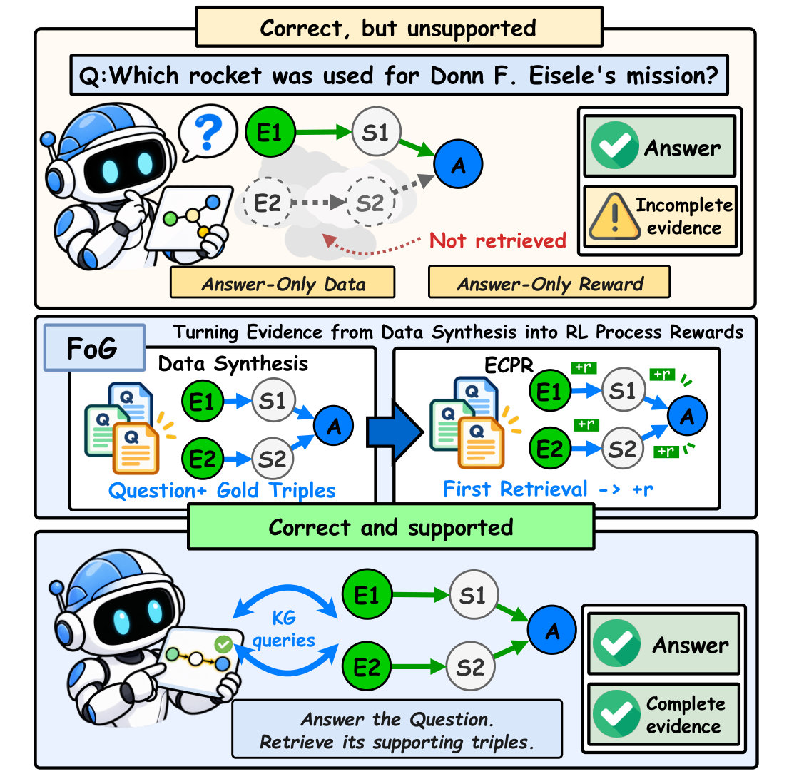
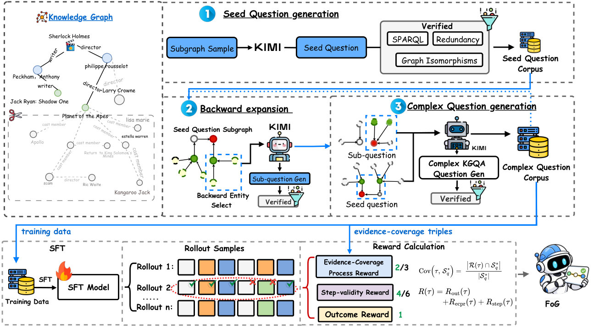
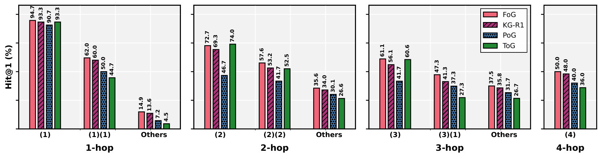
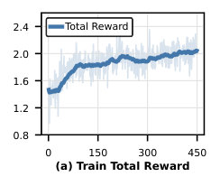

# Clearing the FoG: Training KG Agents to Retrieve the Evidence Behind Their Answers

> **一句话导读**：本文指出知识图谱（KG）对智能体而言同时是“答案来源”和“证据来源”，而现有 KG 智能体的训练数据与奖励只覆盖前者；作者提出 FoG——把支持三元组直接嵌进合成问题、再用“证据覆盖过程奖励”奖励其检索——使 3B–4B 开源模型在三个 KGQA 基准上同时刷新答案准确率与证据覆盖率，最高超过同骨干的强化学习基线 KG-R1 达 +3.73 F1 和 +3.92 Hit@1。

## 论文速览

- **研究问题**：现有 KG 增强方法（检索式与智能体型）都把知识图谱当作“答案来源”，智能体可以答对题却从未检索到支撑答案的三元组，答案因此不可追溯、不可审计。
- **核心方法**：FoG 由三部分组成——证据锚定的合成（把种子问题中的显式实体递归替换成可验证子问题，使每道合成题自带支持三元组）、记录全部返回三元组的 KG 交互智能体、以及把每个支持三元组记给首次检索到它的那一轮的证据覆盖过程奖励（ECPR）。
- **主要结果**：FoG-4B 在 WikiWebQuestions、QALD10-en、GTSQA 上 F1 分别为 66.41 / 47.80 / 48.66，均为最优，较最强基线 KG-R1 最高提升 +3.73 F1、+3.92 Hit@1；证据覆盖率 Cov 在 WikiWebQuestions 与 GTSQA 上分别比 KG-R1 高 +3.84 和 +4.59；冻结模型零样本迁移到 Freebase 上的 WebQSP 仍达 77.2 Hit@1。
- **一句话评价**：把“证据”从事后昂贵的标注负担转化为合成数据自带的免费监督信号，这一转念非常干净，实验也做得克制诚实；但合成质量受教师模型上限约束、评测 gold 证据由 LLM 验证器构造，以及跨 KG 绝对性能仍有差距，是需要留意的地方。

## 研究背景与问题

大语言模型（LLM）能从参数化知识中回答大量事实性问题，但在需要**复杂事实推理**的场景里，答案的可信度仍是硬伤。作者给出的判断很直接：一个正确答案未必是一个有支撑的答案——模型可能凭记忆或表层线索作答，却说不清“为什么成立”。在医疗、法律这类高风险领域，用户需要的是自己能够核对的证据，而不是一个孤零零的结论。论文用了一个形象的说法：当前 LLM 的答案处在一片“迷雾（fog）”之中，答案可见，但背后的证据被遮住了。

知识图谱天然是驱散这片迷雾的工具，因为它把事实存成可验证的三元组。围绕 KG 的现有工作分成两条路线：**检索式**方法（RoG、SubGraphRAG、GCR）一次性检索三元组、路径或子图后交给 LLM 作答；**智能体型**方法（ToG、PoG、KG-R1）通过多轮“思考—行动—观察”与图交互，近期工作还用强化学习（RL）训练这类智能体。

问题在于，这两条路线都只把 KG 当成**答案来源**，而忽略了它作为**证据来源**的角色。作者给出的诊断性证据相当有说服力：在 GTSQA 上，提示式智能体 PoG 的 Hit@1 达到 39.33，但它的 RetQ（金标答案确实由某次 KG 查询返回的问题比例）只有 35.70——这意味着至少 9.2% 的“正确回答”从未出现在任何一次图谱观测中，完全来自模型自身。即便是经过 RL 训练的 KG-R1，仍有 45.95% 的支持三元组没有被检索到。换言之，提示和结果奖励都不足以让智能体把 KG 当证据用。

作者把成因归结为两条，并指出它们来自同一个瓶颈。其一，**训练数据只有答案没有证据**：主流 KGQA 数据集最多标注答案和逻辑形式，要为每道题事后恢复支持三元组，需要枚举并验证所有路径。其二，**训练奖励只检查答案不检查证据**：多数奖励只给最终答案或“KG 是否返回了答案”打分，于是一条只走了一半证据就碰到答案的轨迹，和一条完整检索全部证据的轨迹拿到同样的回报。少数更细的过程奖励要么依赖 LLM 裁判逐条打分，要么依赖为每题恢复金标路径，代价高昂。归结起来：**问题一旦写好，证据就变得昂贵**。

## 核心思路

作者的破局点是一句很朴素但关键的观察：证据在问题写完之后很难恢复，但可以在问题被构造的时候被嵌入，然后在训练时被奖励。这两个动作一旦成立，上述两个瓶颈就同时消失了——数据自带的证据解决了“没有监督信号”，构造时就已知的金标支持三元组解决了“奖励无法检查证据”。

具体机制叫**反向扩张（backward expansion）**。从一道已经验证过的一跳种子问题出发，作者把问题中某个显式出现的非答案实体 $u$ 挖掉，替换成一个答案恰好是 $u$ 的子问题。这一步的巧妙之处在于：$u$ 从一个“可以直接读出来的实体”变成了一个“必须通过查询图谱才能确定的中间变量”。反复执行这个操作，问题就越变越复杂，而每一层新藏进去的实体都对应一组从 $u$ 的入邻域采样的、可被 SPARQL 执行验证的三元组。于是复杂度不是靠改写句式堆出来的，而是靠**证据链的加长**堆出来的。

这一步还顺带解决了“稠密奖励从哪来”的难题。已有工作要么请 LLM 裁判给每一步的推理合理性打分（每一条 rollout 都要评一次，成本随采样量线性增长），要么为每道题恢复金标路径（本质上是把标注成本换了个位置）。FoG 的过程奖励完全来自数据合成本身：合成时累积下来的三元组集合就是金标支持三元组 $\mathcal{S}^{*}_{q}$，不需要额外标注、也不需要任何模型参与打分。这正是本文最值得记住的设计转念。

## 方法详解

### 整体框架

FoG 的流程分三段，数据流很清晰。离线阶段，**证据锚定的合成**从 Wikidata 采样一个有度数约束的子图，由教师模型 Kimi-K2 生成一跳种子问题，再通过反向扩张把显式实体逐层藏进子问题，得到 1–3 跳的复杂问题，并顺带累积出每道题的金标支持三元组。在线阶段，**KG 交互智能体**在“思考—查询—作答”的循环中解题，轨迹里记录下 KG 返回的每一个三元组。训练阶段，**证据覆盖过程奖励（ECPR）**拿轨迹检索到的三元组去比对合成时留下的金标支持三元组，把每个三元组记给首次检索到它的那一轮，与答案奖励、步骤有效性奖励合成总回报，用 GRPO 优化策略。

这个框架的一个结构性优点是：合成、交互、奖励三者共享同一个数据结构——三元组集合。合成产出 $\mathcal{S}^{*}_{q}$，交互产出 $\mathcal{T}(\tau)$，奖励只是两者的交集运算。这使得整个方法没有引入任何额外的模型组件（除了离线的教师模型），也不需要为每道题单独恢复路径。

### 证据锚定的合成：把证据藏进问题结构里

合成分三步。**种子问题构建**：围绕一个中等度数的种子实体 $v_{\text{seed}}$ 从 Wikidata 采样一个大小受限的子图，让教师模型生成一道答案为 $v_{\text{seed}}$ 的一跳问题，同时给出逻辑形式和支持三元组。种子只有在“支持三元组全部存在于子图中，且逻辑形式在全局 KG 上执行后结果集包含 $v_{\text{seed}}$”时才保留——这一步保证了后续扩张有一个可靠的地基。

**反向扩张**是核心。给定一道已通过验证的 $n$ 层问题 $Q^{(n)}$、逻辑形式 $\ell^{(n)}$、答案 $v_{\text{seed}}$ 和支持三元组 $\mathcal{S}^{(n)}$，把其中某个显式出现的非答案实体 $u$ 替换成一个答案为 $u$ 的子问题 $\tilde{Q}$：

$$Q^{(n+1)} = Q^{(n)}[u \rightsquigarrow \tilde{Q}], \qquad \mathcal{S}^{(n+1)} = \mathcal{S}^{(n)} \cup \tilde{\mathcal{S}}$$

其中 $Q^{(n)}[u \rightsquigarrow \tilde{Q}]$ 表示把问题中的实体 $u$ 原位替换成子问题 $\tilde{Q}$，$\tilde{\mathcal{S}}$ 是从 $u$ 的入邻域中选出、用于支撑子问题的三元组，$\mathcal{S}^{(n+1)}$ 是累积后的支持三元组集合。执行 $N \in \{0,1,2\}$ 次扩张即得到 1–3 跳问题，$N=0$ 时保留种子。扩张本身由一个 ReAct 智能体完成：检索 $u$ 的邻域、挑选三元组、写出子问题、验证；失败则重新选三元组或换实体。作者用命题 1 声明反向扩张保持答案不变并产出支撑它的三元组。

**质量控制**是两道符号化闸门。**(a) 可执行性**：要求目标答案在候选问题的结果集内，且结果集规模不超过阈值 $K_{\text{ans}}$，防止问题过于宽泛。**(b) 非冗余性**：对问题的每个主题实体抽取一条最短支持路径，如果某个真子集 $Z \subsetneq E_q$ 只靠这些路径就能得到同样具体的答案集，则丢弃该问题——这保证了每个主题实体都是必需的，杜绝“多给一个实体反而更好查”的捷径题。论文报告这道冗余检查在 200 道人工审计题中只漏掉了 1.5% 的捷径。

### KG 交互智能体与七种图操作

为了让“为答案检索到的证据”变成可观测的量，作者设计了一个多轮“思考—行动—观察”循环的智能体，动作空间为 $\mathcal{A}=\{\texttt{think},\ \texttt{kg-query},\ \texttt{answer}\}$。其中 `think` 做内部推理，`answer` 输出最终预测，`kg-query` 则被实例化为七种原子操作，覆盖“探查某实体的关系”“扩展到其邻居实体”“过滤实体集合”“合并实体集合”这几类基本动作。

这个设计的关键约束是：**只有 KG 真正返回的三元组才被计入轨迹的三元组集合 $\mathcal{T}(\tau)$**。智能体自己“回忆”出来的三元组不算数，因为奖励和评测都只看 $\mathcal{T}(\tau)$。这样就把“模型声称的证据”和“模型实际取到的证据”严格区分开，使得证据覆盖率成为一个无法作弊的指标。这也解释了为什么后文 ECPR 的增益主要体现在 Cov 而不是 Hit@1 上——它改变的是智能体的检索习惯，而非它的语言能力。

### 证据覆盖过程奖励（ECPR）

先看被替代的对象。结果奖励定义为

$$R_{\text{out}}(\tau) = \lambda_{\text{f1}} \cdot \operatorname{F1}(\hat{y}, y_q^{*}) + \lambda_{\text{ret}} \cdot \mathbb{I}[y_q^{*} \in \mathcal{E}(\tau)]$$

第一项奖励答案正确，第二项奖励“答案被图谱返回过”。两项都不检查答案是否被支撑：一条**捷径轨迹**即便把部分支持三元组 $\mathcal{S}^{*}_{q}$ 留在图谱里没取，照样拿满结果奖励。这正是作者要修的洞。

ECPR 的做法是把轨迹拿去和金标支持三元组比对，定义证据覆盖率

$$\operatorname{Cov}(\tau,\mathcal{S}^{*}_{q}) = \frac{|\mathcal{T}(\tau)\cap \mathcal{S}^{*}_{q}|}{|\mathcal{S}^{*}_{q}|}$$

即轨迹检索到的三元组集合 $\mathcal{T}(\tau)$ 与金标支持三元组集合 $\mathcal{S}^{*}_{q}$ 的交集大小，除以金标集合的大小；覆盖率等于 1 的轨迹称为“证据覆盖”的。为了做稠密的信用分配，作者进一步提出**首次匹配归因（first-match attribution）**，把每个金标三元组记给最早检索到它的那一轮：

$$r^{\text{ecpr}}_{t} = \lambda_{\text{ecpr}} \cdot \frac{\left|(\mathcal{T}_t\cap \mathcal{S}^{*}_{q})\setminus \bigcup_{i<t}\mathcal{T}_i\right|}{|\mathcal{S}^{*}_{q}|}$$

分子是“第 $t$ 轮新取到、此前各轮都没取到过”的金标三元组数量，分母仍是金标集合大小，$\lambda_{\text{ecpr}}$ 是权重。所有轮的 $r^{\text{ecpr}}_{t}$ 之和恰好等于轨迹级覆盖率乘以权重，因此重复检索同一个三元组拿不到额外奖励。最终的总回报是三项之和 $R(\tau)=R_{\text{out}}(\tau)+R_{\text{step}}(\tau)+R_{\text{ecpr}}(\tau)$，其中步骤有效性奖励 $R_{\text{step}}$ 按格式与执行是否成功给分，权重设置为 $\lambda_{\text{f1}}=0.7$、$\lambda_{\text{ret}}=0.3$、$\lambda_{\text{step}}=0.5$、$\lambda_{\text{ecpr}}=1$。

### 回合级策略优化

训练分两段。先用教师模型为合成题和训练题产出的示范轨迹做监督微调（SFT），最小化教师动作的负对数似然，得到一个会按格式交互的冷启动策略。随后用 GRPO 优化，并按 KG-R1 的做法计算**回合级优势**：对每道题采样 $N$ 条轨迹，第 $i$ 条轨迹第 $t$ 轮的回报取 $G_{i,t}=R_{\text{out}}(\tau_i)+r^{\text{step}}_{i,t}+r^{\text{ecpr}}_{i,t}$，即“共享的结果奖励 + 本轮自己挣到的过程奖励”，再用该题所有轨迹所有轮次回报的均值 $\mu_q$ 与标准差 $\sigma_q$ 做归一化得到优势 $\hat{A}_{i,t}=(G_{i,t}-\mu_q)/(\sigma_q+\delta)$。

这个设计的用意很明确：如果把整条轨迹的回报广播给每一轮，那些只是被动跟随后续步骤的轮次也会分到功劳，首次检索到证据的那一轮反而不突出。回合级回报让“第一次取到金标三元组”的那一轮天然拿到更高的优势，与首次匹配归因形成闭环。策略最终在 GRPO 的裁剪目标下最大化，并被正则化约束向 SFT 模型靠拢。

## 实验结果

### 实验设置

评测覆盖三个基于 Wikidata 的 KGQA 基准：WikiWebQuestions、QALD10-en 和 GTSQA；跨 KG 迁移使用基于 Freebase 的 WebQSP。合成问题与测试集不重叠。基线分三组：**LLM 推理**（IO Prompt、CoT、Self-Consistency，分别跑在 Qwen2.5-7B-Instruct、GPT-4o-mini、DeepSeek-V3 上）、**检索式**（RoG、SubGraphRAG、GCR）、**智能体型**（ToG、PoG、KG-R1）。需要注意检索式方法需要数据集特定微调，而 QALD10-en 训练集只有 387 条，因此在该数据集上未评测。

指标方面，答案准确率用 **Hit@1** 和 token 级 **F1**；证据侧用 **Cov**（轨迹中检索到的金标支持三元组比例）和 **RetQ**（金标答案确实被某次 KG 查询返回的问题比例）。GTSQA 原生提供金标支持三元组；WikiWebQuestions 的金标三元组由 LLM 验证器构造，在 200 条审计路径上与人类标注者的一致率为 93.0%。训练在 Qwen2.5-3B-Instruct 与 Qwen3-4B-Instruct 上用 LoRA 做 SFT 后接 GRPO，每题采样 $N{=}4$ 条轨迹、每条最多 10 个 KG 轮次，训练 450 步；所有方法每题只做一次推理。

### 主要结果

FoG 在两个 4B 规模配置上全面领先。**表 1：三个 KGQA 基准上的主结果（F1）**

| 方法 | Backbone | WikiWebQuestions F1 | QALD10-en F1 | GTSQA F1 |
|---|---|---|---|---|
| Self-Consistency | DeepSeek-V3 | 49.72 | 26.25 | 33.59 |
| SubGraphRAG-100 | Qwen2.5-7B-Instruct | 56.84 | — | 44.27 |
| PoG | GPT-4o-mini | 57.32 | 30.68 | 37.77 |
| ToG | GPT-4o-mini | 58.55 | 30.63 | 41.08 |
| KG-R1 | Qwen3-4B-Instruct | 64.49 | 44.07 | 46.14 |
| **FoG-3B** | Qwen2.5-3B-Instruct | 66.28 | 45.63 | 48.25 |
| **FoG-4B** | Qwen3-4B-Instruct | **66.41** | **47.80** | **48.66** |

读表要点：FoG 两个规模在三列 F1 上全部超过所有基线，其中 3B 版本已经压过 4B 的 KG-R1 和所有 7B 检索式方法；“—”表示该方法因训练集过小未在 QALD10-en 上评测。

最重要的发现有三条。其一，**相比最强基线的提升是实打实的**：FoG 在三个基准上都取得最佳 F1 与 Hit@1，相对 KG-R1 最多提升 +3.73 F1 和 +3.92 Hit@1。由于 KG-R1 与 FoG-4B 共享同一个 Qwen3-4B 骨干、同样用 RL 训练，这个对比相当干净——它说明“训练智能体去检索证据”本身就让答案更准，而不只是让答案更可查。

其二，**骨干规模不是决定因素**。FoG-3B 在三个基准上全部超过 4B 的 KG-R1；FoG-4B 相比 GPT-4o-mini 驱动的智能体至少高出 +7.58 F1，相比 7B 的检索式方法至少高出 +4.39 F1。作者据此提出的判断是：智能体“被训练成怎样去检索”比它的骨干大小更重要。

其三，**证据指标与准确率同向而非此消彼长**。在单独的智能体对比中，FoG-4B 的 WikiWebQuestions Cov 为 78.34、RetQ 为 86.35，GTSQA Cov 为 58.64、RetQ 为 65.34，均为四者最高，同时 Hit@1 也是最高。这说明提升覆盖率并没有拿准确率去换。

### 消融与分析

**训练阶段与三项奖励的消融**给出的信息最密集。所有变体共用同一骨干、同一 SFT 检查点、同一 RL 数据与同一 rollout 预算，只在奖励上做区分。加入 RL 之后，完整 FoG 相比仅 SFT 在 Hit@1 上提升 +6.83 和 +4.33；但若去掉 $R_{\text{ecpr}}$，Cov 只提升 +2.28 和 +1.58——因为结果奖励在答案被触达时就一次性付清了，检索多少证据并不影响回报。反过来，单独去掉 $R_{\text{ecpr}}$ 造成的跌幅是所有奖励项中最大的，且 Cov 的跌幅（5.43 和 7.21）明显大于 Hit@1 的跌幅（2.58 和 3.55）。由于这些变体共享数据与 SFT 检查点，这个不对称恰好证明覆盖率增益来自奖励本身，而不是数据或初始化的差异。

**表 2：训练阶段与奖励项消融（Qwen3-4B，三个随机种子均值，Cov 为证据覆盖率）**

| 训练配置 | WikiWebQuestions F1 | WikiWebQuestions Cov | GTSQA F1 | GTSQA Cov |
|---|---|---|---|---|
| SFT only | 59.95 | 70.63 | 44.73 | 49.85 |
| SFT + RL（去掉 $R_{\text{ecpr}}$） | 63.87 | 72.91 | 46.02 | 51.43 |
| SFT + RL（去掉 $R_{\text{step}}$） | 65.02 | 77.25 | 47.96 | 57.21 |
| SFT + RL（$R_{\text{ecpr}}$ 换成 LLM 裁判） | 64.95 | 74.12 | 46.88 | 53.36 |
| **SFT + RL（完整 FoG）** | **66.41** | **78.34** | **48.66** | **58.64** |

从表中可以看出，逐项去掉任何一个组件都会掉点，而 $R_{\text{ecpr}}$ 是被拿掉后损失最大的那一项。

另外两项消融的结论同样清晰。去掉 $R_{\text{step}}$ 会让 Hit@1 下降 0.45 和 2.35，但 Cov 只下降 1.09 和 1.43——说明步骤有效性奖励的作用是维持交互可执行、不跑偏格式，而不是驱动证据覆盖。把 ECPR 换成 LLM 裁判给推理过程打分，相比完全没有过程监督只提升 1.21 和 1.93 的 Cov，仍落后 ECPR 达 4.22 和 5.28——作者据此认为，“判断推理读起来是否合理”是比“三元组是否真的取到了”更弱的信号。这个对比是本文最有说服力的论据之一，因为它说明 ECPR 的优势不来自过程监督本身，而来自它检查的对象不同。

**合成数据与模型规模**的分析同样值得看。在固定 6,588 道 SFT 题的预算下，纯合成数据（Synth-Only）在完全没有域内人工题的情况下，比纯原始数据（Train-Only）在三个基准上分别高出 +3.66、+2.50、+3.06 Hit@1，说明反向扩张造出来的题可以迁移到人工撰写的基准上；两者混合效果最好，作者据此认为两个来源互补。有效性方面，每道保留题的支持三元组都能在 SPARQL 执行下复现答案，冗余检查在 200 道审计题中只漏掉 1.5% 的捷径。规模维度上，同样 SFT 数据下 Hit@1 从 3B 到 7B 稳定提升 +12.89、+7.52、+7.36，说明合成数据并非只适配某一骨干。

**证据覆盖率与结构复杂度**是 RQ4 的核心。在 GTSQA 上，PoG 拿到 39.33 Hit@1 但 RetQ 只有 35.70，意味着至少 9.2% 的正确回答从未出现在任何一次 KG 观测里；即便是 RL 训练的 KG-R1，也仍有 45.95% 的支持三元组未被检索。FoG 在两个基准上同时取得最高的 Cov、RetQ 和 Hit@1。在结构复杂度维度上，FoG 在全部 10 个分组上领先 KG-R1、在 9 个分组上是最优方法，且优势随证据需求增长而扩大：从 $(1)$ 型的 +1.4 Hit@1 扩大到 $(3)$ 型的 +5.0、更分枝的 $(3)(1)$ 型的 +6.0，但在 $(4)$ 型上收窄到 +2.0。这条结果的含义是——答案需要越多证据，检索证据的奖励就越有价值。

**ECPR 的归因策略对比**（RQ5）在 GTSQA 上考察了“首次匹配”与两种替代方案的差别。轨迹级归因把覆盖率记给最后一轮，导致取到证据的那一轮与其他轮拿到同样的回报，Cov 因此损失 4.35。每次匹配归因则对每次检索都给奖励，结果重复检索率从 8.6% 飙到 29.4%，Cov 反而低于轨迹级——因为它奖励的是“反复查已知证据”而不是“覆盖新证据”。首次匹配在三项指标上同时最优。三者的对比说明：稠密信用必须做到“每个三元组只付一次”，否则奖励的就不是覆盖率而是冗余行为。训练动态上，奖励上升的同时 KG 轮数与回复长度下降，作者将其解读为智能体学到了“用更少查询覆盖更多证据”的精确检索策略。

**跨 KG 迁移**（RQ6）冻结 FoG-4B 直接在 Freebase 上的 WebQSP 零样本评测，得到 77.2 Hit@1，相对仅 SFT 的 71.6 提升 +5.6，接近那些直接在 Freebase 上开发的方法（82.6–85.7）。作者特意标注这些方法“是参照点而非匹配基线”，这个措辞是诚实的。结论是 ECPR 教给智能体的是“先检索证据再作答”的习惯，而不是某一种图谱模式的关系。

## 局限与思考

这篇论文真正新的地方，不在于“用合成数据训练 KGQA 智能体”——这条线已有 GraphWalker、KGQAGen 等工作——而在于**把合成数据从“额外的训练样本”重新定位为“奖励信号的来源”**。这个定位转换让稠密过程奖励摆脱了对 LLM 裁判或逐题金标路径的依赖，是本文最有工程价值的贡献：它把一个随采样量线性增长的成本项，变成了一个一次性、离线、由符号检查兜底的构造过程。同时，作者对 KG 双重角色的区分（答案来源 vs. 证据来源）也为这个领域提供了一个更清晰的评价框架——Hit@1 与 Cov/RetQ 应该一起看，而不是只看前者。

证据强度方面，奖励消融做得相当扎实：同骨干、同 SFT 检查点、同数据、同 rollout 预算，唯一变量是奖励，三个随机种子还给了标准差。Cov 的跌幅系统性地大于 Hit@1 的跌幅，这个不对称是“增益来自奖励”的直接证据。ECPR 与 LLM-as-judge 的对比也有说服力。但我认为有几处仍需保留：合成完全依赖 Kimi-K2，教师的能力上限就是数据质量的上限，作者自己也承认这一点并提出了自博弈的改进方向；质量控制的冗余检查在 200 道审计题中仍漏掉 1.5% 的捷径，考虑到整个方法都建立在这些三元组的正确性上，这个比例虽然小但并非可以忽略。

评测公平性上有一个隐含假设值得推敲。WikiWebQuestions 的金标支持三元组是用 LLM 验证器构造的（与人类一致率 93.0%），而训练数据中的金标三元组来自教师驱动的合成流程。两者虽然机制不同，但都带有 LLM 生成痕迹；Cov 在这样构造的 gold 上评测，可能对同样来自 LLM 生成流程的方法略有偏袒。论文声称合成题与测试集不重叠，但没有报告 gold 三元组与合成三元组在模式或路径形态上的分布差异，这一点如果能补上会更有说服力。另外，跨 KG 迁移的绝对数字（77.2 vs. 82.6–85.7）说明零样本仍有明显差距，而且表 1 中没有在 WebQSP 上完整训练的 FoG 作为对照，所以“迁移能力有多强”这个问题还没有被完全回答。

从适用范围看，10 轮交互上限、1–4 跳问题、Wikidata/Freebase 这类结构规整的百科图谱，构成了这套方法的舒适区。对更长证据链、更开放的 KG 推理，作者在局限里明确承认需要重新平衡搜索深度与错误累积。我还注意到奖励里四个 $\lambda$（0.7 / 0.3 / 0.5 / 1）是直接给定的，论文没有报告敏感性分析——考虑到 $R_{\text{ecpr}}$ 的权重是 1 而结果奖励总和也是 1，这个配比很可能对最终 Cov 与 Hit@1 的权衡有实质影响，值得后续工作补上。最后，模型规模只测到 3B 和 4B，"更大模型上 ECPR 是否仍然必要"是一个开放问题：如果大模型本身就更倾向于先查证据，奖励带来的边际收益可能会衰减。

## 总结

本文指出现有 KG 智能体只把知识图谱当作答案来源，导致答案正确却缺乏可追溯的证据支撑，并把成因归结为训练数据无证据、训练奖励不检查证据这同一个瓶颈。FoG 的解法是把证据前移到合成阶段——用反向扩张把显式实体藏进子问题，使每道题自带金标支持三元组——再用首次匹配归因的证据覆盖过程奖励，把每个三元组只记给第一次检索到它的那一轮。在三个 KGQA 基准上，3B–4B 的 FoG 智能体在答案准确率和证据覆盖率上同时超过更大的基线，并展现出跨 KG 的零样本迁移能力。最值得记住的一点是：**当监督信号可以从数据构造过程中免费获得时，稠密奖励就不再是昂贵的奢侈品**。

## 科学发现范式

- 主要范式：P01 Gap-Driven Reframing
- 次要范式：P05 Data & Evaluation Engineering
- 分类理由：论文识别现有 KG agent 训练数据只有答案、奖励只检查答案的瓶颈，将 KG 从答案源重定义为证据源，并用证据接地合成与 "ECPR" 把证据嵌入问题构造和训练奖励，属于 P01；合成数据携带支持三元组并作为稠密监督，兼具 P05。

## 先前工作分析

现有 KG 推理工作大致沿两条路线展开："ToG" 把 LLM 与 KG 的交互组织成多轮 think-act-observe，使 agent 能逐步探索图结构，但训练/提示目标仍是最终答案；"KG-R1" 进一步用强化学习训练 KG agent，却只以答案结果作为奖励，轨迹只要抵达答案就可能得到高分。"RoG" 与 "SubGraphRAG" 则从检索侧提供路径或子图作为答案依据，然而单步检索到的路径/子图并不保证覆盖答案所需的全部 supporting triples。"GraphWalker" 表明可从 KG 合成问题来驱动 agent 训练，但合成数据主要作为额外样例，问题本身不携带可验证的证据监督。这些工作共同暴露了一个机会：答案正确与证据完整是两种目标，而证据在问题写定后难以恢复、在训练奖励中也未被显式检查。FoG 因而把证据前移到数据构造阶段，用 evidence-grounded synthesis 让每个合成问题自带支持三元组，再用 KG interaction agent 记录检索三元组，并以 ECPR 对首次检索到 supporting triple 的轮次给予稠密奖励；这样无需 LLM judge 或逐题 gold path 恢复，就把 KG 从答案来源扩展为证据来源。
