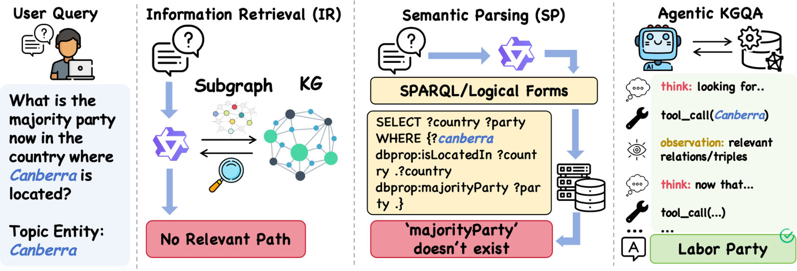
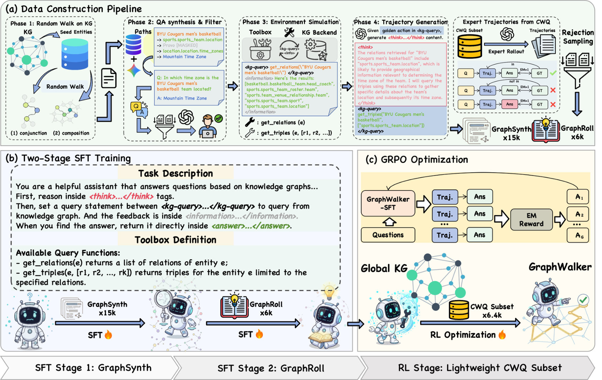

#  GraphWalker: Agentic Knowledge Graph Question Answering via Synthetic Trajectory Curriculum
## 1. 研究动机与贡献

知识图谱问答（KGQA）要求系统在大规模三元组图上进行多跳、结构化推理。传统两类方法——检索式（IR）和语义解析（SP）——通常在一个静态、预定义的子图或逻辑形式上工作，因而对“未见推理结构”泛化能力差。近期将大模型作为“智能体”以交互式探索图谱的方向（Agentic KGQA）打开了可能性，但遇到了两个关键瓶颈：

- 训练数据稀缺且结构单一，导致智能体缺乏广泛的探索先验；
- 在缺乏多样化监督的情况下直接做策略优化（RL）会陷入探索瓶颈，效果有限。

本文提出了 **`GraphWalker`**，通过自动合成交互轨迹与“分阶段微调（SFT）+轻量RL”训练流程，构建一个“先探索、再精修、最后策略优化”的学习曲线，从而显著提升在全局 KG 上的自动化推理能力。主要贡献：

- 自动合成两类数据集：**`GraphSynth`**（15k 条结构多样的受约束随机游走轨迹）和**`GraphRoll`**（6k 条经过结果驱动筛选的专家级轨迹），分别负责建立探索先验与训练反思/纠错能力。
- 提出 **`Stage-Wise SFT`** 课程化训练：先在 `GraphSynth` 上学会广泛探索，再在 `GraphRoll` 上学习反思与恢复，从而为后续的 RL 奠定更高的性能上限。
- 结合轻量级 RL 算法 `GRPO`（稀疏精确匹配奖励），在 `CWQ` 与 `WebQSP` 上实现 SOTA，且在 `GrailQA` 与作者构建的 **`GraphWalkerBench`** 上展现强零样本泛化能力。

## 2. 方法介绍

总体思路：先用自动化方法生成大量、多样的交互轨迹以建立“探索先验”，再用少量高质量专家轨迹训练反思能力，最后做策略微调以获得更稳健的检索/推理策略。整体模块可分为三部分：环境与轨迹表示、数据构建管线、训练流程。

图片：对比三类范式（传统 IR / SP vs Agentic）  

关键概念与符号
- 智能体在 KG 上生成的一个轨迹记为 $\tau=(s_0,a_0,s_1,a_1,\dots,s_T)$，其中状态 $s_t$ 通常包含当前实体/邻居信息，动作 $a_t$ 表示选择的关系或实体检索操作。
- 稀疏精确匹配（EM）奖励可形式化为：
$$
R(\tau) = \mathbf{1}[\hat{y} = y] \in \{0,1\},
$$
即预测答案与金标完全匹配则奖励 1，否则 0。

1) 数据构建：自动合成 + 筛选
- **`Constrained Random Walk (CRW)`**：受约束的随机游走策略在全局 KG 上生成多跳轨迹，目标是覆盖尽可能丰富的拓扑结构（链式、树状、环状混合等）。生成后合成自然语言问题与对应交互步骤，形成 **`GraphSynth`**（15k 条）。
- 结果驱动筛样（outcome-based rejection sampling）：从智能体或模型生成的候选轨迹中筛选出能够成功到达正确答案且包含反思/纠错步骤的高质量样本，构成 **`GraphRoll`**（6k 条）。这一数据强调“在错误路径上恢复”的行为。

2) 两阶段 SFT（Stage-Wise SFT）
- Stage 1（探索先验）：在 **`GraphSynth`** 上进行监督微调，使模型学习在多种结构上自由探索、展开搜索策略。这一步像中期训练的“探索脚手架（mid-training exploration scaffold）”，使模型在后续 RL 时拥有更广的搜索空间。
- Stage 2（反思与纠错）：在 **`GraphRoll``** 上继续微调，重点让模型学习如何检测错误、回溯或采取修正策略（例如重新选择边或实体）。这一步提升鲁棒性与样本效率。

3) 轻量 RL 优化
- 在有了强 SFT 基础后，使用轻量级的强化学习算法 `GRPO` 进行策略微调，利用上面的稀疏 EM 奖励。论文发现：只有当 SFT 提供了结构多样的探索先验时，RL 才能显著提升性能；否则 RL 很难跳出局部最优。

方法流程图（数据构建 + 两阶段 SFT + RL）  

训练与实现细节（要点）
- `GraphSynth` 的目标不是生成完美专家轨迹，而是覆盖多样的拓扑，从而增强探索性。
- `GraphRoll` 使用基于结果的筛选来保留“能反映真实决策与纠错过程”的样本（类似蒸馏后的专家演示）。
- 所有训练阶段都在“全局 KG”上进行（而非先截取子图），强调模型能面对真实、噪声且规模巨大的图谱。

## 3. 实验结果

论文围绕若干研究问题展开评估（RQ1–RQ4），主要结论如下（定性/定量结论并列）：

- RQ1 — 性能对比：在 `CWQ` 与 `WebQSP` 上，**`GraphWalker`** 达到或超过当时 SOTA 的性能。作者强调“分阶段 SFT + RL”是领先的关键，而非单纯更大的模型或更多参数。
- RQ2 — 探索性增益：去掉 `GraphSynth` 或将其替换为规模相当但结构单一的数据，模型在未见拓扑上的泛化显著下降，说明多样化轨迹能有效扩展搜索空间。
- RQ3 — 各阶段贡献：消融实验表明（1）只有 Stage 1 的模型能保证较好探索，但在错误恢复上薄弱；（2）只有 Stage 2 的模型在恢复上较强但探索范围受限；（3）两阶段联合再加上 `GRPO` 能取得最优效果，证明“先探索→再纠错→策略微调”这一课程化顺序是有效的。
- RQ4 — 数据构建管线有效性：`CRW` 能产生覆盖面广的结构样本，而 `GraphRoll` 的结果驱动筛样能显著提升模型在复杂推理任务的稳定性。

额外说明：作者还在 `GrailQA` 与自建 **`GraphWalkerBench`** 上进行了零样本评估，结果显示较强的 OOD（out-of-distribution）拓扑泛化能力。

（注：原文未给出完整数值表格的具体数值在摘要中，因此此处以结论性描述为主；阅读论文原文可获得完整实验表格与数值。）

## 4. 简要总结

GraphWalker 的核心洞见是：在面向全局 KG 的 agentic 推理中，缺乏“结构多样的探索先验”比算法本身更限制性能。作者提出了一个工程与算法结合的解决方案：

- 用自动化的受约束随机游走生成大量多样轨迹（**`GraphSynth`**）来建立探索能力；
- 用结果驱动筛样得到高质量专家轨迹（**`GraphRoll`**）来训练反思与纠错；
- 以“先广泛探索，后精修再做 RL” 的 `Stage-Wise SFT` 课程化训练，为轻量级的 RL 解锁更高的性能上限。

优点
- 兼顾可扩展性与实用性：数据自动合成降低了人工成本；
- 显著提升对未见推理结构的泛化能力，在多个 KGQA 基准上取得强劲表现。

局限与未来方向
- 自动合成轨迹的语义质量依赖于设计的约束与模板，能否进一步减少人工设计仍是挑战；
- 稀疏的 EM 奖励虽然简单有效，但对某些需要部分正确路径的任务可能不够细腻，未来可探索更丰富的奖励设计与混合监督。

如果你想继续深入：
- 查看作者开源代码与数据以复现实验： https://github.com/XuShuwenn/GraphWalker
- 关注如何将轨迹合成方法与更大规模的 LLM 或更细粒度的奖励机制结合，以进一步提升复杂问答场景下的稳健性。

总结一句话：GraphWalker 用“合成轨迹 + 分阶段微调 + 轻量 RL”这套实用且可扩展的训练策略，有效解决了 Agentic KGQA 中的探索与泛化瓶颈，为在真实、噪声且规模巨大的知识图谱上部署自主推理代理提供了一条清晰可行的路径。

## 语义分析补充

### 科学发现范式

- 主要范式：P01 Gap-Driven Reframing
- 次要范式：P05 Data & Evaluation Engineering, P04 Modular Pipeline Composition
- 置信度：high
- 分类理由：论文从‘缺乏探索先验’这一具体缺口出发，重新表述问题并以合成轨迹与分阶段SFT作为约束和解决方案（典型的 Gap-Driven Reframing）。同时大量工程化构造了GraphSynth/GraphRoll数据集并验证其对泛化的作用，属于数据与评测工程（P05）；训练流程采用分阶段SFT→轻量RL的模块化管线设计，也体现了模块化流水线思想（P04）。

### 前作谱系综合

近年的研究为代理化 KGQA 奠定了三类关键基础：一类是将“思考+行动”融入单步交互的 ReAct 范式，它具体说明了在生成内部推理同时调用工具以获得外部证据的可行性；另一类是若干提示式图遍历系统（如 ToG、GoG），它们展示了基于提示的迭代检索在生成性推理上的优势但也暴露出对封闭模型与固定工作流的依赖；第三类则是基于强化学习的 KGQA（如 KG‑R1）和相应的策略优化技术（如 GRPO），它们证明了策略优化能进一步提升长期决策，但在依赖预提取子图时容易陷入探索瓶颈。与此同时，CWQ 与 WebQSP 等数据集确立了复杂多跳、可执行 SPARQL 的评价范式并为构造轨迹提供了谓词与种子实体的资源。綜合这些工作，可以看出一個明显的机会：将“可训练的代理式交互范式”与“结构多样化的轨迹监督”以及“稳健的策略优化器”结合，能同时解决提示方法的不可训练性、RL 方法的探索局限与数据稀缺问题。GraphWalker 正是在此脉络下的自然延续：它借鉴 ReAct 的交互格式、以 ToG/GoG 与 KG‑R1 揭示的局限为改进目标，利用受限随机游走合成大规模结构多样轨迹作为 SFT 阶段的探索先验，并以 GRPO 为 RL 基础在两阶段 SFT 提供的先验上进一步提升性能。
