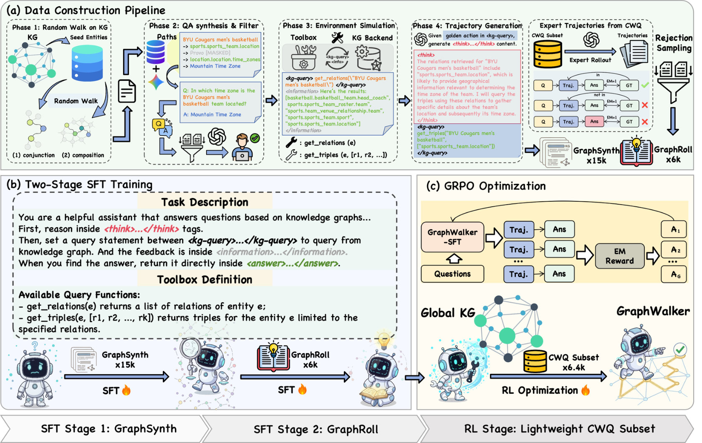
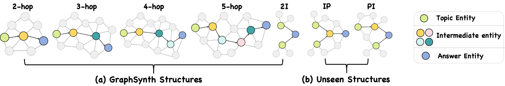
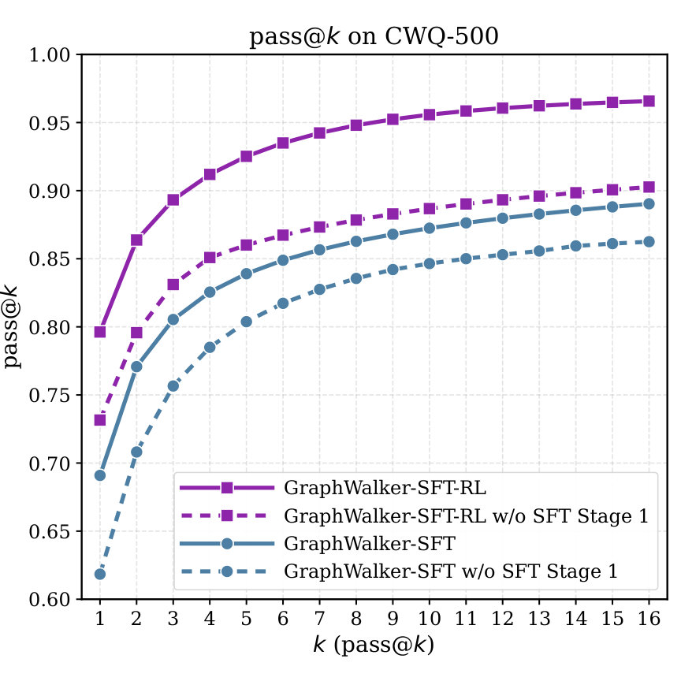

# GraphWalker: Agentic Knowledge Graph Question Answering via Synthetic Trajectory Curriculum

## 1. 研究动机

KGQA（Knowledge Graph Question Answering）需要在大规模三元组图上进行多跳、结构化的推理。传统的 IR 和语义解析方法受限于静态检索范围或固定逻辑形式，难以泛化到真实 KG 中长尾关系与未见推理结构。近来的“agentic”范式让 LLM 作为交互式代理通过工具调用逐步检索 KG，但两个关键瓶颈仍存在：训练数据稀缺（难以覆盖多样的推理轨迹）与探索先验不足（使得后续的强化学习难以有效发挥）。GraphWalker 的核心动机在于：通过合成大量结构多样的交互轨迹形成探索先验，再以分阶段微调（Stage-wise SFT）+轻量 RL 精炼策略，提升代理在全球 KG（非预先抽取子图）下的导航与纠错能力。

## 2. 核心洞见

- 探索先验是 agentic KGQA 能否泛化的关键：没有结构多样性的 SFT 基础，RL 在全图上几乎无法有效探索。
- 分阶段 SFT（先大规模合成探索轨迹，再少量专家轨迹教会反思与回退）比将两类数据混合训练更有效，训练顺序决定能力上限。
- 当有了稳健的 SFT 基础后，使用稀疏的轨迹级 exact-match 奖励并配合 `GRPO` 可以显著提升最终 EM 性能。

## 3. 提出的方法

### 3.1 方法概述

GraphWalker 包含三大模块：环境与工具箱、数据构建流水线、分阶段训练流程（两阶段 SFT + RL）。环境以可执行的 `SPARQL` 端点直接暴露全量 KG；工具包括 `get_relations(e)` 与 `get_triples(e, R')` 两个原子操作。代理在每一轮基于当前状态 $s_t$（包含问题 $q$ 与历史交互）生成（1）内部思考串，包裹在 `` `<think>` `` 中；（2）动作：一个检索查询（`` `<kg-query>` ``）或最终答案（`` `<answer>` ``）。执行器返回信息块 `` `<information>` `` 作为环境观测。

### 3.2 GraphSynth：受约束随机游走合成多样轨迹

GraphSynth-15k 的核心是对训练集中出现的谓词集合 $P$ 与种子实体集合 $E$ 启动受约束随机游走（CRW），合成两类结构：2–5 跳的组合链（composition chains）与从两主题实体汇聚到同一目标的联结图（conjunction graphs）。每一步的转移遵循谓词约束：

$$
r_t \in P,\quad e_{t+1} \in N(e_t, r_t),\quad d \le |N(e_t, r_t)| \le D
$$

其中 $N(e_t,r_t)$ 为通过关系 $r_t$ 可达的邻居集合，卡方约束避免过窄或过分发散的关系，保证结构多样性同时避免无信息路径。对每条路径，用 `Gemini-2.5-Pro` 合成自然语言问题（中间实体被掩码以避免泄露），再用 `GPT-4o-mini` 进行语义过滤（按完整性、相关性、语义连贯度评分，低于 9/10 的问题被丢弃）。为模拟真实检索噪声，执行序列化的 `SPARQL` 查询并按检索管线（`BM25` 候选 + LLM 关系重排序）生成每步观测；最后用 `GPT-4o-mini` 生成 chain-of-thought 风格的 `` `<think>` `` 理由，拼装成训练轨迹。

### 3.3 GraphRoll：面向反思与错误恢复的专家轨迹

GraphRoll-6k 从复杂问题集中（如 CWQ）分层抽样得到代表性问题；用 `GPT-4o-mini` 作为“专家”生成包含回溯、纠错示例的高质量轨迹，并通过基于结果的拒绝采样筛选：必须满足答案正确（EM=1）且所有答案必须能在观测历史中找到证据（Evidence Grounding）。这些轨迹专注于教授代理如何检测无效观测并回退修正。

### 3.4 分阶段训练与 RL 精炼

SFT 两阶段均以自回归 LM $\pi_\theta$ 的下一个 token 预测损失训练，但只把代理生成的思考、查询、答案作为目标（把 `` `<information>` `` 作为环境上下文而非学习目标）：

$$
\mathcal{L}(\theta) = -\sum_{t\in I_{\text{agent}}} \log p_\theta(x_t\mid x_{<t})
$$

阶段一用 GraphSynth 建立探索先验；阶段二用 GraphRoll 强化反思与恢复能力。之后在均匀采样的 CWQ 子集上用 `GRPO` 进行 RL，轨迹级稀疏奖励为：

$$
R(\theta)=s_{\text{EM}}(\theta)\in\{0,1\}
$$

`GRPO` 目标包含对参考策略（两阶段 SFT） 的 KL 约束，保证 RL 在可靠策略周围优化并避免灾难性漂移。

## 4. 实验结果

### 实验设置 / 关键发现

- 数据与模型：GraphSynth-15k、GraphRoll-6k；骨干模型包括 Qwen2.5-3B、Qwen2.5-7B、Llama-3.1-8B；检索管线使用 `BM25` + LLM 重排序；最大交互轮数 $T=10$。
- 主结果（节选）：GraphWalker 在 CWQ 与 WebQSP 上达到 SOTA。相较强基线，GraphWalker：
  - 比 GPT‑4 驱动的 GoG 在 CWQ 上高出 +4.4% EM；
  - 比训练型 KG-Agent 在 CWQ 上高出 +7.4% EM；
  - 在 WebQSP 上，比 KBQA-o1 高 +15.7% EM；
  - GraphWalker-3B-SFT-RL 比同骨干的 KG-R1 高 +4.1% EM（全局 KG 设置）。
- 专有 LLM 在 GraphWalker 框架下也显著受益：GPT-4o-mini 与 DeepSeek-V3.2 在 CWQ 上分别获得约 +17.9% 与 +19.7% EM 的提升（与它们的 IO Prompt 对照）。
- 零样本迁移：仅在 CWQ 上训练，GraphWalker 在 WebQSP 的零样本 EM 达到 91.5%，表明结构多样的训练路径易于迁移。
- Ablation（影响量化）：
  - 去掉 GraphSynth（无 SFT Stage 1）平均 EM 下降约 5.10%；
  - 去掉 GraphRoll（无 SFT Stage 2）平均 EM 下降约 9.00%；
  - 去掉 RL 直接训练（仅 SFT）平均 EM 下降约 10.40%；
  - 在零样本上，去掉 GraphSynth 平均 EM 下滑 6.80%，去掉 GraphRoll 下滑 11.10%。
- 数据质量与规模：
  - 去掉质量过滤器（semantic filter）会导致 CWQ EM 从 68.3% 降至 46.2%，WebQSP 从 82.0% 降至 55.6%，表明高质量合成问题至关重要。
  - 扩大 GraphSynth（5k→10k→15k）和 GraphRoll（0.5k→6k）均能持续提升 EM、检索率与恢复率。

Pass@k 实验进一步验证 GraphSynth 扩展了搜索空间：有无 GraphSynth 的模型在 Pass@k 曲线上差距明显，且 GraphWalker-SFT-RL 在所有 k 上表现最佳。

## 5. 分析与洞察

- 为什么分阶段有效？阶段一通过合成多结构路径使模型形成“广谱”的检索与工具调用习惯（探索策略），而阶段二在此基础上注入罕见但关键的行为——错误检测与回溯。这种顺序类似先学会“走得远”再学会“走得稳”，混合训练会让模型在学习早期就被高质量反思信号覆盖，从而抑制其形成广泛的探索策略，导致样本效率与泛化能力受损。
- SFT 为 RL 提供了必要的搜索起点：在全量 KG 上，随机或弱初始化的策略很难遇到正例轨迹，稀疏奖励几乎不可学习；GraphSynth 提供了结构覆盖，使得后续 `GRPO` 能在合理的行动分布上做出微调。
- 数据合成的质量门槛高：语义过滤和证据约束是保持合成轨迹可用性的关键。低质问题不仅浪费训练步骤，还会引导模型学到不可靠的检索模式（实验证明质量过滤的吞吐影响巨大）。
- 通用性与限制：GraphWalker 在零样本迁移上表现优异，说明合成轨迹的组合性对构建可迁移的推理策略非常有效；但该方法仍依赖强能力的 LLM（用于合成和重排序），以及 gold topic entities（实验中使用），因此现实部署需要考虑实体链接与成本问题。

## 6. 主要贡献

- 提出 GraphWalker：一个结合自动化轨迹合成（GraphSynth-15k）、专家轨迹（GraphRoll-6k）与分阶段 SFT + RL 的 agentic KGQA 框架。
- 证明了“结构多样性的 SFT 探索先验”是克服 RL 探索瓶颈、提升泛化能力的关键。
- 在 CWQ、WebQSP 上实现 SOTA，并在 GrailQA / GraphWalkerBench 上展示出强零样本泛化能力；同时提供详尽的消融与尺度分析来验证每个设计的作用。

## 7. 局限性与未来工作

- 生成质量与计算成本：依赖 `GPT-4o-mini` / `Gemini-2.5-Pro` 等强大模型来合成与过滤轨迹，成本较高。未来可探索更轻量级的数据合成或半自动人机校正机制。
- 实验假设了 gold topic entities，真实部署需解决实体链接噪声带来的挑战（需将实体识别/链接纳入训练流程）。
- 稀疏奖励的 RL 虽在本方案中有效，但仍存在样本效率问题；可研究更细粒度奖励或基于学习的辅助探索策略以降低 RL 成本。
- 当前以 Freebase 为后端，未来可扩展到跨 KG、异构 schema 或实时更新的知识源，并研究如何让合成轨迹适应动态知识变化。

## 8. 总结

GraphWalker 用“合成轨迹为先”的思想解决 agentic KGQA 中的探索与泛化瓶颈：通过受约束随机游走构建大规模结构多样的轨迹（GraphSynth），再用少量高质量专家轨迹（GraphRoll）教会反思与纠错，最后以轻量 RL 在该先验上精炼策略。实验显示这一分阶段流程能够显著提升在全球 KG 下的导航能力与零样本泛化，强调了数据设计与训练课程（curriculum）在 agentic 推理系统中的决定性作用。未来工作可在降低合成成本、合并实体链接以及改进 RL 样本效率方面继续推进。
