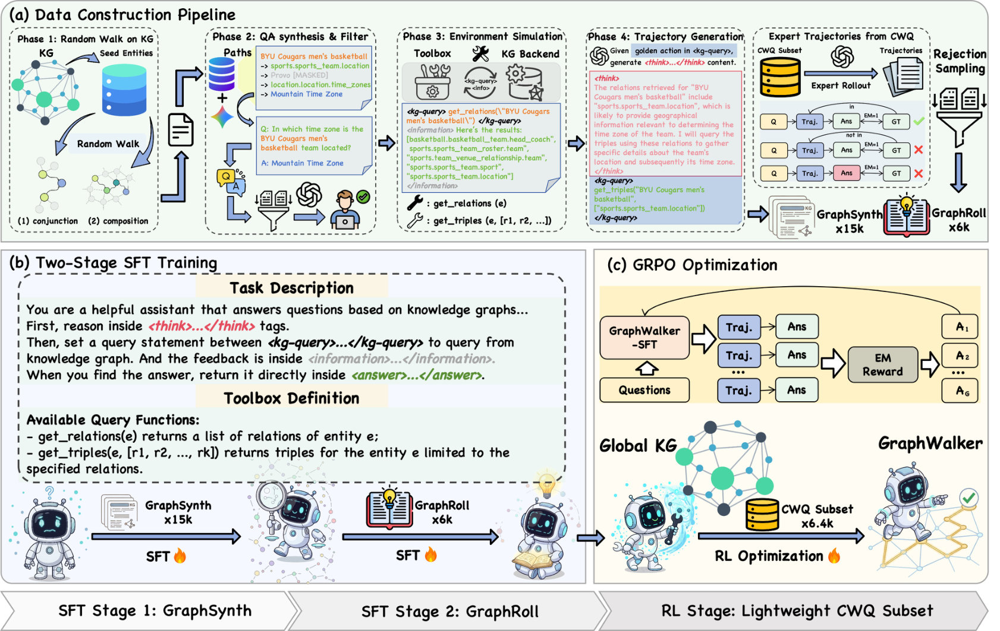

#  GraphWalker: Agentic Knowledge Graph Question Answering via Synthetic Trajectory Curriculum

## 1. 研究动机与贡献

复杂的知识图谱问答（KGQA）要求模型在大规模图上进行多跳搜索与决策。传统的两类方法——检索式（IR）和语义解析（SP）——把推理局限在预先提取的子图或静态逻辑形式中，难以泛化到未见的推理结构。新兴的“agentic”范式让模型通过反复调用工具与图交互，但现有工作往往在训练时限制探索：提示式缺少自主导航训练，RL 模型又常在预抽取子图上优化，导致探索瓶颈。

GraphWalker 提出的核心思想是：建立一个“结构性多样”的交互轨迹先验，再用小规模专家轨迹教会反思与纠错，最后用轻量 RL 在此先验之上微调，从而打开更高的性能上限。主要贡献：

- 提出 **GraphWalker** 框架：结合自动合成轨迹（GraphSynth-15k）、专家轨迹（GraphRoll-6k）和分阶段微调（Stage-Wise SFT）+ 轻量 RL（`GRPO`）的训练流程。
- 设计 **Constrained Random Walk (CRW)** 用以合成结构多样的轨迹，覆盖组成链（composition chains）与会聚型的 conjunction 图结构，从而显著扩展探索空间。
- 实证表明：两阶段 SFT 为后续的 RL 解锁更高的性能上限，在 CWQ、WebQSP 上取得 SOTA，并在 GrailQA 与自建的 GraphWalkerBench 上展现强的 OOD 泛化能力。

## 2. 方法

整体设计包含三部分：agentic 环境与工具、轨迹数据构建管线、阶段化训练流程（两阶段 SFT + RL）。

简要代理循环（Agent Loop）设定：
- 状态：$s_t=(q, h_{t-1})$，其中 $q$ 是自然语言问题，$h_{t-1}=\{(c_i,a_i,o_i)\}_{i=1}^{t-1}$ 是历史交互（$c_i$ 为内部思考，$a_i$ 为动作，$o_i$ 为观察）。
- 每步代理输出两部分：内部思路用 ``<think>`` 包裹，动作为 ``<kg-query>``（或最终答案用 ``<answer>``）。执行器将动作在 KG 上执行并以 ``<information>`` 返回观察。
- 两个基础工具：`get_relations(e)` 和 `get_triples(e, R')`（可视为查询模板，工具式接口）。

数据构建：GraphSynth-15k 与 GraphRoll-6k
- GraphSynth（15k）：目标是建立广泛的“探索先验”。
  - Phase 1 — CRW：从种子实体 $e_0$ 在谓词集合 $\mathcal{P}$ 上做受限随机游走，生成两类结构（2–5 跳的组合链与会聚的 conjunction 图）。在每一步采样满足 $r_t\in\mathcal{P},\ e_{t+1}\in N(e_t,r_t)$，并对 $|N(e_t,r_t)|$ 加入上下界约束以避免过窄或过度分支的路径，保证结构多样性。
  - Phase 2 — 问题合成与语义过滤：用强 LLM（如 Gemini-2.5-Pro）生成自然语言问题，同时遮蔽中间实体，随后用 GPT-4o-mini 做三维评分（路径完整性、问题-路径相关、语义连贯），低分样本剔除。
  - Phase 3 — 环境反馈模拟：将路径作为一系列 SPARQL 查询执行，模拟检索时的噪声（包括 `BM25` 候选检索与 LLM 重排序），得到每步的观测。
  - Phase 4 — 代理思路生成：用 LLM 生成每步的 Chain-of-Thought（作为训练时的 ``<think>`` 示例），最终组装成完整轨迹。
- GraphRoll（6k）：小规模高质量专家轨迹，强调反思与错误恢复。通过分层抽样覆盖问题类型，使用 outcome-based rejection sampling 保证（1）答案正确（EM=1），（2）答案在观测历史中有证据（grounded）。

训练流程（Stage-wise SFT + RL）
- SFT Stage 1（GraphSynth）：用自动合成的多样轨迹训练模型进行导航与工具调用的语言建模（下一 token 预测），并把 ``<information>`` 视为环境上下文（不作为模型输出目标）。
- SFT Stage 2（GraphRoll）：在专家轨迹上微调，学习如何检测无信息观测、回溯与自我纠错。
- RL Stage（`GRPO` + 稀疏 EM 奖励）：在两阶段 SFT 的基础上，用轨迹级稀疏奖励 $R(\pi)=\text{EM}(\tau)\in\{0,1\}$ 做进一步策略优化，`GRPO` 的目标包含 group-normalized advantage 与对 SFT 参考策略的 KL 正则化，从而在已有先验上安全探索并提升长期决策能力。

插图（方法总览）：

关键实现细节与设计意图要点
- 直接在全局 KG（而非预抽取子图）上训练与评估，暴露出真实世界 KG 的高分支因子与长尾关系，迫使模型学会稳健检索与归纳。
- 将轨迹合成与 LLM 生成结合，既保证规模（GraphSynth）又保证关键能力（GraphRoll），并通过有序的阶段式训练（先广泛探索，再精炼反思）避免“混合训练”带来的性能退化。
- 通过质量过滤、语义检验、以及环境噪声模拟，使训练数据更贴近推理时的真实分布。

## 3. 主要实验

设置要点
- 后端 KG：完整 Freebase（Global KG setting），更加困难但更真实。
- 验证集：CWQ、WebQSP 为主要基准；额外用 GrailQA（zero-shot）和作者自建的 GraphWalkerBench 检验 OOD 泛化。
- Backbone：Qwen2.5-3B/7B、Llama-3.1-8B；trajectory 生成与过滤依赖 GPT-4o-mini / Gemini-2.5-Pro。

核心结果（摘要）
- GraphWalker 在 CWQ 与 WebQSP 上取得 SOTA，特别是在 Global KG 设置下相较同骨干的 KG-R1 有显著提升（示例：CWQ EM 提升 ~4%）。
- 在 zero-shot 转移上，从 CWQ 训练的模型能很好迁移到 WebQSP（例：91.5% EM 报告），说明 GraphSynth 的结构覆盖对通用探索策略构建很有效。
- 用商业 LLM（GPT-4o-mini、DeepSeek）在 GraphWalker 交互框架下也取得较大增益，表明交互与训练流程本身带来的价值。

重要消融与分析（总结性要点）
- 三个阶段的相对贡献：去掉 GraphSynth（无 SFT Stage 1）会显著降低 EM（约 5.1% 平均降幅）；去掉 GraphRoll（无 SFT Stage 2）降幅更大（约 9.0%）；去掉 RL 则导致约 10.4% 的降幅。结论：三者互补，且次序关键。
- Pass@k 实验（探索能力）：存在 GraphSynth 时，随着 k 增大模型的 Pass@k 明显更高；没有 GraphSynth，探索质量整体下降，验证了合成轨迹扩展搜索空间的作用。
- 质量过滤与数据规模：去掉语义质量过滤会使 EM 大幅下降（例如 CWQ 从 68.3% 跌到 46.2%），而增加 GraphSynth / GraphRoll 的样本数能稳定提升检索率与纠错率（Retrieval/Recovery Rate）。

其他有价值的实验观察
- 混合训练（把两类数据合并在一个 SFT 轮次）不如分阶段训练，表明先建立广泛探索能力再教纠错是重要的课程策略。
- 在稀疏 EM 奖励下，若没有足够的 SFT 先验，RL 很难有效改进策略；GraphWalker 表明合成轨迹可以作为“中期训练脚手架”，为后续 RL 解锁更高的性能。

## 4. 为什么这个设计有说服力（实用角度解读）

- “构建先验再微调”的思想符合强化学习与模仿学习的常见实践：先通过大量 diverse 的轨迹学会“如何走”，再通过高质量专家轨迹学会“何时回头/反思”，最后用 RL 在真实奖励下精调策略边界。
- GraphSynth 的 CRW 并不需要创造新谓词，只是把现有谓词以未见的拓扑组合重排，因而在保证语义合理性的同时逼近“组合泛化”场景。
- 强化学习阶段使用的稀疏精确匹配奖励很节省标注，但它依赖 SFT 的稳固起点；GraphWalker 用两阶段 SFT 恰好弥补了这一点，使稀疏奖励足以推动改进。

## 5. 局限与待改进之处

- 依赖闭环 LLM 生成与过滤：GraphSynth / GraphRoll 的质量受生成模型与评分器的偏差影响，尽管作者采用了高质量 LLM，但仍可能引入系统性偏差或不可见的数据泄露风险（作者在附录中提到已做检测）。
- 计算与工程成本：在全局 KG 上训练与模拟交互（含 BM25 候选与多次 SPARQL 执行）带来较大计算负担，对资源有限的团队门槛较高。
- 可解释性与可证伪性：尽管轨迹是可执行的，但模型内部决策仍依赖生成式思路（``<think>``），需要更多机制来验证“为何选择某条路径”以便在关键任务中更可靠地部署。

## 6. 与相关工作的差别（简要对比）

- 和纯提示式 agentic 方法相比：GraphWalker 有系统的 SFT 数据构建与阶段化训练，能在训练中获得稳定、可优化的策略参数。
- 和以 RL 为中心但训练在子图上的方法相比：GraphWalker 在全局 KG 上训练并用合成轨迹扩展探索空间，解决了“RL 在简化环境中学到的策略无法迁移到真实大 KG”的问题。
- 与传统 IR / SP 方法相比：Agentic 交互允许动态决策与证据收集，避免了对单一预抽子图或固定逻辑形式的依赖，从而在结构变化多端的 KG 上更鲁棒。

## N. 总结

GraphWalker 提出了一套务实且有力的解决方案来解决 agentic KGQA 中的探索瓶颈：通过受限随机游走自动合成大量结构多样的轨迹（GraphSynth），再用小规模高质量专家轨迹（GraphRoll）教会反思与纠错，最后在该先验下用轻量 RL 精调策略。实验充分展示了各阶段的互补性与必要性：Stage 1 扩展探索空间，Stage 2 强化反思能力，RL 在此基础上解锁更高性能。该工作在方法设计上清晰、工程实现充分，并在真实的 Global KG 设置下取得了强有力的实证结果。

这篇论文值得参考：它提供了一套可复用的训练课程（合成多样轨迹 → 专家轨迹 → RL 微调）来提升 agentic 推理的泛化能力，对后续研究构建可训练的 KG 代理具有直接启发。若你的工作涉及在大型知识图上训练交互式代理或探索如何用合成轨迹做数据扩充，GraphWalker 的数据管线与分阶段训练策略非常值得借鉴。
