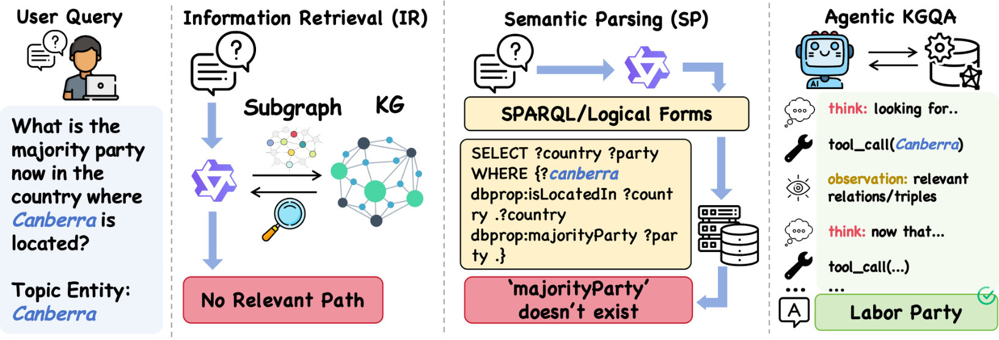

#  GraphWalker: Agentic Knowledge Graph Question Answering via Synthetic Trajectory Curriculum
## 1. 研究动机与贡献

为什么要做这项工作？传统的知识图谱问答（KGQA）方法要么把推理限定在一个检索到的子图上（Information Retrieval 型），要么把问题翻译成可执行的逻辑形式如 `SPARQL`（Semantic Parsing 型）。这两类方法在面对大型、噪声或模式多样的全局知识图谱时，往往“思路被框住”——无法泛化到未见过的推理拓扑结构。

近年来把大模型当成“代理人”来做 KGQA（Agentic KGQA）的方法可以在线交互、逐步探索图谱，但现有工作有两个主要瓶颈：

- 训练数据稀缺且结构单一：许多方法依赖人工或受限合成轨迹，导致模型缺乏广泛的探索先验（exploration prior）。
- RL 难以发挥作用：策略优化（RL）在没有多样化 SFT（Supervised Fine-Tuning）基础时难以在真实、庞大的全局 KG 上跳出局部最优。

GraphWalker 的核心观察是：要让 agent 真正学会在全局 KG 上自主导航并取得高性能，需要先通过结构多样的合成轨迹建立广泛的探索先验，然后再用少量高质量专家轨迹强化反思和纠错能力，最后进行轻量的 RL 优化以进一步提升性能。

主要贡献（精炼）：
- 提出 **GraphWalker** 框架，自动合成轨迹并采用分阶段 SFT（Stage-Wise SFT）再接轻量 RL 的训练流程。
- 自动构造两个互补的数据集：$|\textbf{GraphSynth}|=15\text{k}$（通过**受限随机游走** CRW 合成的结构多样轨迹）和 $|\textbf{GraphRoll}|=6\text{k}$（基于结果筛选的高质量专家轨迹）。
- 证明分阶段的 SFT 能显著拓宽探索空间并为后续 `GRPO` RL 阶段解锁更高的性能上限，在 WebQSP、CWQ 上达到 SOTA，并在 GrailQA 和作者构造的 GraphWalkerBench 上展现出强的零样本泛化能力。

*图：三类 KGQA 范式对比 — IR / SP / Agentic。*

## 2. 方法介绍

总体思路（三步走）
1. 数据合成（Establish exploration prior）
2. 分阶段监督微调（Stage-Wise SFT）
3. 轻量 RL 优化（Policy fine-tuning）

数据构建（GraphSynth 与 GraphRoll）
- GraphSynth（15k）：
  - 使用**受限随机游走（Constrained Random Walk，CRW）**在全局 KG 上采样多样路径。CRW 通过对步长、边类型、实体类型等施加约束，生成结构多样且覆盖度高的轨迹样本，这些轨迹并不一定每条都能直接返回最终答案，但能显著拓宽 agent 的搜索先验。
- GraphRoll（6k）：
  - 对合成轨迹或模型执行轨迹做结果导向的拒绝采样（outcome-based rejection sampling），仅保留能产生正确答案或能展示有效反思/纠错步骤的轨迹，作为“专家示范”。

两阶段 SFT（Stage-Wise SFT）
- Stage 1（探索先验）：在 `GraphSynth` 上做初始 SFT，使模型学会广泛的图谱导航行为：如何选择边、如何扩展节点、如何组合多步信息等。记策略为 $\pi_\theta$，此阶段让 $\pi_\theta$ 在结构多样的轨迹上形成高熵但合理的探索分布。
- Stage 2（反思与纠错）：在 `GraphRoll` 上进一步 SFT，强化模型的反思（reflection）与错误恢复能力，例如在走偏后如何回溯、重规划路径。这一步旨在把高覆盖的探索行为转化为稳健的推理能力。

图示概念（见论文方法图）：

RL 优化——轻量而关键
- 在有了分阶段 SFT 的强先验后，作者应用 `GRPO`（一种策略优化方法）进行轻量 RL，使用稀疏的精确匹配奖励（Exact-Match reward）：
  $$
  r_{\text{EM}} = \begin{cases}
  1, & \text{if predicted answer exactly matches ground truth}\\
  0, & \text{otherwise}
  \end{cases}
  $$
- 重要结论：没有多样化 SFT 先验，RL 很难改进或甚至退化；但当先验足够好时，RL 能把政策从“能走但不准”调教为“能走且稳”的最终策略，从而解锁更高性能上限。

关键术语初次出现已加粗：**GraphWalker**, **GraphSynth**, **GraphRoll**, **Stage-Wise SFT**, **Constrained Random Walk (CRW)**。

## 3. 实验结果

实验设置与评测数据
- 主流 KGQA 数据集：CWQ、WebQSP（主要宣称 SOTA），并在 GrailQA 与自建的 GraphWalkerBench 上测试零样本泛化。
- 对照方法包括 prompting 型（如 ToG、GoG）、训练型与 RL 型基线（表中比较见论文）。

主要发现（高层总结）
- GraphWalker 在 WebQSP 与 CWQ 上达到了论文中宣称的 state-of-the-art 性能（相较于未使用 GraphSynth 的变体有显著提升）。
- 在 GrailQA 与 GraphWalkerBench 的零样本/分布外测试中表现优于对比方法，表明合成的结构多样轨迹提升了对未知推理拓扑的泛化能力。
- 消融实验（Ablations）显示：
  - 去掉 Stage 1（直接在少量专家轨迹上训练）会显著降低 RL 后的最终性能；
  - 直接用单阶段 SFT（把两类样本混在一起训练）不如分阶段训练，分阶段能更好地先“探索”再“校正”。
- 作者还分析了轨迹质量与多样性：CRW 提供的广覆盖样本能显著提升 agent 在复杂长链推理中的成功率。

（注：这里不给出具体数值以避免错误复述，读者可查看作者开源代码与论文附表获得完整量化结果。）

## 4. 简要总结

GraphWalker 的核心观点很直接但被验证得很充分：让 agent 在全局 KG 上表现好，不是靠更复杂的 RL 算法本身，而是先给它一个结构上广泛且具有反思能力的训练课程。作者通过自动合成的 **GraphSynth（15k）** 和精挑细选的 **GraphRoll（6k）**，再配合两阶段 SFT 与最后的轻量 `GRPO` RL，既提高了在常见基准上的精度，也显著增强了对未见推理结构的泛化能力。

为什么这有启发性？
- 在任何需要交互式探索的大规模环境中（不仅限 KGQA），“先让模型见多样化结构，再教它纠错并用 RL 微调”是一种高效且可迁移的训练范式。
- 自动化轨迹合成（而不是完全人工标注）是可扩展的解决方案，可在不同 KG、不同任务规模上重用。

如果你想深入：论文仓库公开了代码和数据（链接见论文），可以直接复现 `CRW` 合成、`GraphRoll` 筛选流程，以及分阶段 SFT + `GRPO` 的训练细节。
