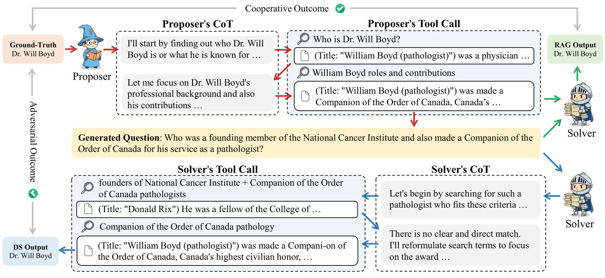
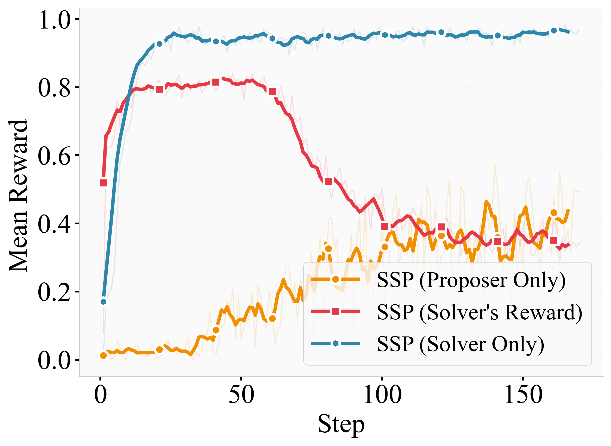

# Search Self-play: Pushing the Frontier of Agent Capability without Supervision

## 1. 研究动机

近年来基于大模型的**Agent**（尤其是以搜索为核心工具的深度搜索代理）在复杂信息检索与多步决策场景中表现突出，但其训练仍高度依赖人工构造的、可验证的问答对以提供精确奖励（即 RLVR）。构建大量高质量、可验证的任务对需要大量人工验证，限制了 agentic 强化学习的规模化。现有的自动合成查询方法要么离线、要么难以动态控制难度，因而难以形成自我持续训练的闭环。本文提出将自我对弈（self-play）引入深度搜索场景，令同一 LLM 同时扮演“问题提出者（proposer）”与“问题求解者（solver）”，并用检索增强生成（RAG）验证提出问题的可验证性，从而实现无需人工监督的可扩展训练流程。

## 2. 核心洞见

- 通过让模型同时生成任务与解决任务，并以提出者的检索轨迹作为外部证据来构造“可验证的”问题，既保证了奖励的准确性，又避免人工标注。
- 提出者与求解者在竞争与合作中**共进化**，形成自适应的难度调度：当求解者变强，提出者会生成更难的问题，防止过拟合并推动持续学习。
- 加入 RAG 验证与适量的“噪声文档”能显著提升问题质量并防止提出者“作弊”（生成在提供限定证据下可验证但实际难以求解的问题）。

## 3. 提出的方法

### 3.1 方法概述

SSP（Search Self-play）的核心流程包含两条并行角色轨迹：提出者使用多轮搜索调用来发掘证据并形成带有明确答案的深度搜索问题；随后收集提出者检索到的所有文档作为 RAG 上下文，供求解者在不再调用搜索的情况下验证并回答问题；验证通过的问题被用于 RL 训练回路，从而对提出者和求解者分别提供奖励与更新。这个闭环保证了问题的可验证性和训练数据的自洽性。

### 3.2 关键组成

- 提出者（proposer）：基于策略网络，用 `REINFORCE` 优化，其目标是生成难度递增且证据充分的问题。提出过程中会进行最多 $10$ 轮工具（搜索）调用。
- 求解者（solver）：使用多轮推理与工具调用的能力来回答问题，并用 `GRPO` 更新策略；在 RAG 验证阶段，求解者仅基于提出者轨迹提供的检索文档做生成，检验答案是否在这些文档中可复现。
- RAG 验证机制：将提出者轨迹中检索到的 top-$3$ 文档（用本地 E5 检索器在 Wiki-2018 上）作为上下文，验证问题的“ground-truth”是否可从这些材料中可靠地生成；为防止作弊，向上下文注入数量为 $k$ 的噪声文档（来自同批次其他轨迹），实验证明 $k=4$ 时效果最佳。
- 奖励与对弈规则：以“是否与 ground-truth 等价”的二元奖励为核心（RLVR 思路），并通过两者交替对弈来调节难度与训练信号。

## 4. 实验结果

### 实验设置 / 关键发现

- 基准：在 NQ、TriviaQA、PopQA、HotpotQA、2WikiMultiHopQA、Musique、Bamboogle 七个常用 QA 基准上评估；每个基准随机抽样 500 个 QA（Bamboogle 用 125 个）。
- 模型与对比：Qwen2.5（7B/32B）、LLaMA3.1、Qwen3，以及现有搜索专门模型 Search-R1、ZeroSearch、R-Search。
- 工具与限制：本地 E5 检索器检索 top-$3$，搜索调用上限 $10$ 轮；评估使用 Qwen2.5-32B-Instruct 作为 judge（LLM-as-a-judge），度量为 pass@1（100 分制）。
- 训练超参（摘要）：学习率 $1\mathrm{e}{-6}$，batch size 全局 $256$，mini-batch $128$，最大 prompt 长度 $4096$，response 长度 $8192$，回合步长 $150\text{–}200$。

关键实验结论：

- SSP 在从头训练（from-scratch）时带来显著提升：对 Qwen2.5-7B-Base 平均提升 $+26.4$ 分，TriviaQA 单项高达 $+40.4$。
- 对指令微调模型（instruction-tuned）也有收益：Qwen2.5-7B-Instruct 平均提升 $+8.0$。
- 模型无关性：对 LLaMA3.1、Qwen3 等不同架构均能带来一致改进；在继续训练（continual training）强基线（如 Search-R1）上也能进一步获利。
- 大模型扩展：Qwen2.5-32B-Instruct +SSP 在 7 个数据集中的 5 个上达到 SOTA 水平。

消融研究（重要）：

- 固定对手 vs 共演化：与仅训练求解者（Solver-Only）或仅训练提出者（Proposer-Only）相比，完整 SSP 共进化框架表现最好。仅训练求解者会出现内在训练奖励快速饱和（≈0.9），导致在 held-out 集上过拟合并退化；仅训练提出者则难以生成对复杂多跳任务有推动作用的问题。
- RAG 验证的必要性：去掉 RAG 验证会显著降低性能，尤其是在 GeneralQA 基准上。注入噪声文档的实验显示，适度的噪声（$4$ 个）最佳，过多（$7$）会使验证混淆、性能下降。

## 5. 分析与洞察

- 动态难度调度的价值：SSP 内在形成的“对抗式课程”（adversarial curriculum）是一种低成本、在线自适应的难度调节机制，优于静态合成数据或单向训练。训练曲线中求解者成功率的短暂下降正是提出者提升难度的直接证据，促使求解者不断扩展能力。
- RAG 验证不仅保证了奖励精度，还通过噪声注入约束提出者避免生成“在给定小集合中显而易见但实际不可检索”的作弊题目，提升了训练数据的泛化性。
- 体系可扩展性：因为提出者利用外部检索，SSP 打破了仅依赖 LLM 内部知识的局限，理论上可接入任意检索语料与工具，扩展到法律、科研等需可溯源证据的域。
- 风险与稳定性：提出者若过度追求“难度”可能生成不合逻辑或不稳定的问题，RAG 验证与噪声注入是重要的防护，但仍需对提出者策略和奖励设计进行精细调整以避免“毒样本”进入训练集。

## 6. 主要贡献

- 提出并实现了 **Search Self-play (SSP)**：首个将 self-play 与检索增强相结合、用于 agentic 搜索训练的端到端方案，能够在无监督下生成可验证任务并共同提升提出与求解能力。
- 设计了基于提出者检索轨迹的 RAG 验证机制与噪声注入策略，用以保证问题质量并防止提出者“作弊”。
- 在多模型、多基准与多训练范式上展示了显著且稳定的性能提升（包括从零训练与持续训练场景），并给出系统性的消融分析证明共演化的必要性。

## 7. 局限性与未来工作

- 语料与检索依赖：当前实验以 Wiki-2018 与本地 E5 为主，SSP 在更专业或领域稀缺语料（如专利、医学）上的表现尚需验证，检索器质量会直接影响提出者生成问题的质量。
- 验证器与判分偏差：使用 LLM-as-a-judge 存在评判噪声；需要更多人类对齐或更稳健的自动判分策略来减少误判对训练的影响。
- 提出者“作弊”更高级策略：尽管噪声文档能限制某类作弊，提出者仍可能学会更隐蔽的“坑位式”提问，未来可引入更严格的逻辑一致性检查或外部证据链验证。
- 可解释性与可追溯性：SSP 生成的问题与解答依赖检索轨迹，如何把这些轨迹包装成可审计的证据链以满足高敏感性领域应用，是后续重要方向。

## 8. 总结

Search Self-play (SSP) 提供了一条可扩展的无监督 agentic 训练路线：通过提出者与求解者的共演化、自带检索证据的 RAG 验证，以及噪声注入的对抗式约束，SSP 在多模型、多数据集和不同训练范式下均带来了稳定且显著的性能提升。此方法既缓解了 agentic RL 中对人工可验证数据的依赖，也为未来将自监督自适应课程与工具驱动的 LLM Agent 训练结合提供了实证基础。进一步工作应聚焦于跨域迁移、更加鲁棒的验证机制与防止高级作弊策略的长期稳定性。

## 科学发现范式

- 主要范式：P01 Gap-Driven Reframing
- 次要范式：P15 Data-Centric Optimization & Active Sampling, P04 Modular Pipeline Composition
- 分类理由：论文以‘标注/可验证奖励稀缺’为出发点，把问题重构为模型自我生成并验证训练任务的自博弈（proposer ↔ solver），将原先需要人工构造的监督数据转化为内部生成的可验证约束——典型的Gap‑Driven Reframing。同时方法把数据合成与筛选（RAG 验证、噪声注入、防止‘hacking’、自适应难度）作为主要杠杆，属Data‑Centric Optimization；并以 proposer 与 solver 的分工与接口实现可替换的模块化训练流水线，体现Modular Pipeline Composition。

## 先前工作分析

多项既有工作在技术细节上为本文奠定了直接基础：AlphaGo Zero 首次把自对弈证明为无需人工标签即可产生连续自适应训练分布的通用范式；Lewis 等人的 RAG 明确了用检索文档作为可验证证据来保证生成答案正确性的实用机制；Guo 提出的 RLVR 体系把代理训练的问题形式化为“以可核验答案为奖励”的范式，构成了本文所要改进的训练范畴；Search‑R1 则提供了与本文共享的深度搜索代理实现与评测协议，是本文主要对比与改进的基线；WebSailor 等查询合成方法揭示了离线合成在验证成本与难度控制上的局限；而 SPAG 与 R‑Zero 系列工作展示了把自对弈用于 LLM 能力提升以及同时训练 proposer/solver 的可行性但各自受限于模型内知识或缺乏工具交互。 这些前作共同暴露的机会是清晰的：需要一个既能在线自生训练题目又能保证题目答案可核验、并能随 solver 能力自适应升级的代理训练流程。Search Self‑play 正是在此基础上自然衔接：把自对弈的自适应课程思想与 RAG 的检索验证机制结合，且将 proposer 装备真实搜索工具实现外部证据挖掘，从而在 RLVR 框架下实现无监督、可验证且动态提升难度的深度搜索代理训练。
